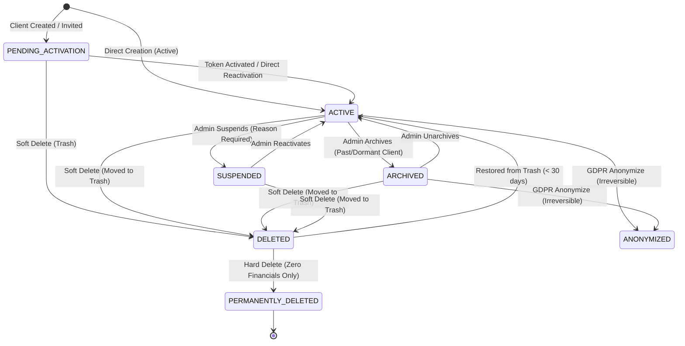

# Client Lifecycle & State Transition Specification

**Date:** 2026-10-26  
**Auditor & Architect:** Senior Full-Stack Engineer & QA Lead  
**Scope:** Axivon Technologies Client Management Platform  

---

## 1. Lifecycle State Machine Diagram



---

## 2. State Definitions

| State | Portal Access | Project Delivery | Default Query Visibility | Description |
| :--- | :--- | :--- | :--- | :--- |
| **`PENDING_ACTIVATION`** | Blocked (Needs setup) | On hold or prep | Visible (Tab: Pending) | Account provisioned, activation invite email dispatched, awaiting password setup. |
| **`ACTIVE`** | Allowed | Active | Visible (Tab: Active / All) | Client in normal standing with active or prospective business operations. |
| **`SUSPENDED`** | **Blocked immediately** | Paused | Visible (Tab: Suspended) | Administratively frozen due to payment dispute, security breach, or contract violation. Active sessions revoked. |
| **`ARCHIVED`** | Blocked or read-only | Completed | **Hidden by default** (Tab: Archived) | Past client with no ongoing engagements; retained for compliance, audit, and tax accounting. |
| **`DELETED`** | **Blocked** | Inactive | **Hidden everywhere** (Tab: Trash) | Soft-deleted in Trash for 30-day retention period. Fully restorable by administrator. |
| **`ANONYMIZED`** | **Blocked** | Completed/Archived | Visible as pseudonymized | Personally identifiable information (PII) stripped per GDPR/DPDP request; financial logs preserved. |

---

## 3. State Transition Matrix & Enforcement Rules

### 3.1 `PENDING_ACTIVATION` $\rightarrow$ `ACTIVE`
- **Trigger:**
  - Client visits `/client/activate?token=...` and submits new password.
  - Or Admin clicks "Reactivate / Set Active" directly from Admin CRM.
- **Enforcement & Side Effects:**
  - `User.status` set to `"ACTIVE"`.
  - `User.activationToken` set to `null`.
  - `User.mustChangePassword` set to `false`.
  - `CrmClient.status` set to `"ACTIVE"`.
  - Creates `AuditLog` entry: `CLIENT_ACCOUNT_ACTIVATED`.

### 3.2 `ACTIVE` $\rightarrow$ `SUSPENDED`
- **Trigger:** Admin clicks "Suspend Client" in CRM table or detail page.
- **Requirements:**
  - Mandatory `reason` (minimum 5 characters).
  - Permission: `clients:manage` or role `ADMIN`, `FOUNDER`, `CO_FOUNDER`.
- **Enforcement & Side Effects:**
  - `CrmClient.status = "SUSPENDED"`.
  - `CrmClient.suspendedAt = new Date()`, `suspendedById = admin.id`, `suspendReason = reason`.
  - If linked `User` exists: `User.status = "SUSPENDED"`.
  - **Instant Session Invalidation:** All active records in `Session` table where `userId = client.userId` are purged.
  - Subsequent portal requests receive HTTP 403 `ACCOUNT_SUSPENDED` with the admin's recorded reason.
  - Creates `AuditLog` entry: `CLIENT_SUSPENDED`.

### 3.3 `SUSPENDED` $\rightarrow$ `ACTIVE`
- **Trigger:** Admin clicks "Reactivate Client".
- **Requirements:**
  - Permission: `clients:manage` or role `ADMIN`, `FOUNDER`, `CO_FOUNDER`.
- **Enforcement & Side Effects:**
  - `CrmClient.status = "ACTIVE"`.
  - Clears suspension fields (`suspendedAt = null`, `suspendedById = null`, `suspendReason = null`).
  - If linked `User` exists: `User.status = "ACTIVE"`.
  - Client can log in again.
  - Creates `AuditLog` entry: `CLIENT_REACTIVATED`.

### 3.4 `ACTIVE` $\rightarrow$ `ARCHIVED`
- **Trigger:** Admin clicks "Archive Client".
- **Requirements:**
  - Optional `reason`.
  - If client has active, in-progress projects, UI displays a prominent confirmation prompt: *"Client has N active projects. Archiving will remove them from standard operational dropdowns. Are you sure?"*
- **Enforcement & Side Effects:**
  - `CrmClient.status = "ARCHIVED"`.
  - `CrmClient.archivedAt = new Date()`, `archivedById = admin.id`, `archiveReason = reason`.
  - Client is excluded from default CRM queries, dropdowns, and search unless `includeArchived=true` or tab `Archived` is selected.
  - Creates `AuditLog` entry: `CLIENT_ARCHIVED`.

### 3.5 `ARCHIVED` $\rightarrow$ `ACTIVE`
- **Trigger:** Admin clicks "Unarchive Client".
- **Enforcement & Side Effects:**
  - `CrmClient.status = "ACTIVE"`.
  - Clears `archivedAt`, `archivedById`, `archiveReason`.
  - Restores default query visibility.
  - Creates `AuditLog` entry: `CLIENT_UNARCHIVED`.

### 3.6 ANY STATE $\rightarrow$ `DELETED` (Soft Delete to Trash)
- **Trigger:** Admin clicks "Delete Client" (Soft Delete).
- **Requirements:**
  - Mandatory `reason` (minimum 3 characters).
  - Permission: `clients:delete` or role `ADMIN`, `FOUNDER`, `CO_FOUNDER`.
  - Warning modal warns that client will move to Trash for 30 days before potential permanent purge.
- **Enforcement & Side Effects:**
  - `CrmClient.status = "DELETED"`.
  - `CrmClient.deletedAt = new Date()`, `deletedById = admin.id`, `deleteReason = reason`.
  - If linked `User` exists: `User.status = "INACTIVE"`, all portal sessions deleted immediately.
  - Client is completely hidden from all regular CRM list views, search results, dropdown selectors, and proposal generators.
  - Only visible under the **Trash** tab in `/admin/crm/clients`.
  - Creates `AuditLog` entry: `CLIENT_SOFT_DELETED`.

### 3.7 `DELETED` $\rightarrow$ `ACTIVE` (Restore from Trash)
- **Trigger:** Admin clicks "Restore" on a record in the Trash tab.
- **Requirements:**
  - Permission: `clients:delete` or role `ADMIN`, `FOUNDER`, `CO_FOUNDER`.
- **Enforcement & Side Effects:**
  - `CrmClient.status = "ACTIVE"`.
  - `CrmClient.restoredAt = new Date()`, `restoredById = admin.id`.
  - Clears `deletedAt`, `deletedById`, `deleteReason`.
  - If linked `User` exists: `User.status = "ACTIVE"`.
  - Client immediately reappears in normal CRM queries and lists.
  - Creates `AuditLog` entry: `CLIENT_RESTORED`.

### 3.8 `DELETED` $\rightarrow$ `PERMANENTLY_DELETED` (Hard Delete)
- **Trigger:** Admin clicks "Permanently Delete" in Trash tab.
- **STRICT BLOCKER POLICY (Zero Tolerance for Data Corruption):**
  - Permanent delete is **REJECTED with HTTP 409 Conflict** if:
    1. Any linked `PartnerProject` exists (matched by `clientEmail` or `clientUserId`).
    2. Any linked `PartnerPayment` exists (financial records).
    3. Any linked `PartnerContract` exists (legal documents).
    4. Any open or won `Opportunity` exists.
  - The API returns structured blockers:
    ```json
    {
      "success": false,
      "error": {
        "code": "CANNOT_PERMANENTLY_DELETE",
        "message": "Cannot permanently delete: client has 2 projects, 3 payment transactions, and 1 legal contract. Archive or keep in Trash instead.",
        "blockers": {
          "projects": 2,
          "payments": 3,
          "contracts": 1,
          "opportunities": 0
        }
      }
    }
    ```
- **Allowed Permanent Deletion Flow:**
  - **Prerequisites:**
    - Zero financial, contract, or project records.
    - Admin confirms by typing the exact `companyName`.
    - Admin re-enters their current login password for cryptographic verification.
  - **Cascades Safely Only to:**
    - `ClientContact` (non-financial contact list).
    - `LeadActivity` (client-specific notes/activities).
    - `FollowUp` (reminders).
    - Linked `User` portal account if created solely for this deleted client.
  - Creates immutable `AuditLog` entry: `CLIENT_PERMANENTLY_DELETED`.

### 3.9 ANY STATE $\rightarrow$ `ANONYMIZED` (GDPR / Privacy Erasure)
- **Trigger:** Admin executes "Anonymize Client" action.
- **Purpose:** Meet statutory privacy "Right to be Forgotten" requirements while preserving accounting ledgers and tax audit trails.
- **Requirements:**
  - Irreversible action warning.
  - Admin types `"ANONYMIZE"` and re-enters admin password.
  - Permission: role `ADMIN`, `FOUNDER`, `CO_FOUNDER`.
- **Enforcement & Side Effects:**
  - `companyName` replaced with `"Anonymized Client [clientCode]"`.
  - `contactName` replaced with `"Anonymized Contact"`.
  - `email` replaced with `"anonymized_[clientCode]@redacted.local"`.
  - `phone`, `website`, `address`, `gstNumber` replaced with `null`.
  - Child `ClientContact` records purged or anonymized.
  - Linked `User` record email, name, phone anonymized, password randomized, status set to `"INACTIVE"`, all sessions destroyed.
  - `CrmClient.anonymizedAt = new Date()`, `anonymizedById = admin.id`.
  - Transaction amounts, project timelines, and invoices remain intact for tax audit.
  - Creates `AuditLog` entry: `CLIENT_ANONYMIZED`.

---

## 4. Query Isolation & Default Filters

All client queries throughout the application are updated to strictly respect the lifecycle:
1. **Default Queries (`status` omitted):**
   `where: { status: { notIn: ["DELETED", "ARCHIVED"] }, deletedAt: null }`
2. **Archived Tab (`tab=archived`):**
   `where: { status: "ARCHIVED", deletedAt: null }`
3. **Trash Tab (`tab=trash`):**
   `where: { status: "DELETED", deletedAt: { not: null } }`
4. **Suspended Tab (`tab=suspended`):**
   `where: { status: "SUSPENDED", deletedAt: null }`
5. **Pending Activation Tab (`tab=pending`):**
   `where: { status: "PENDING_ACTIVATION", deletedAt: null }`
