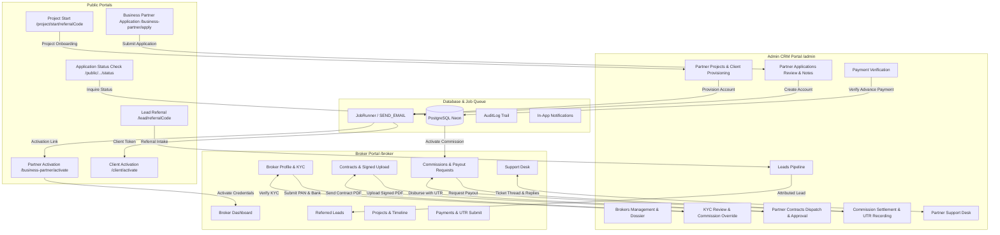
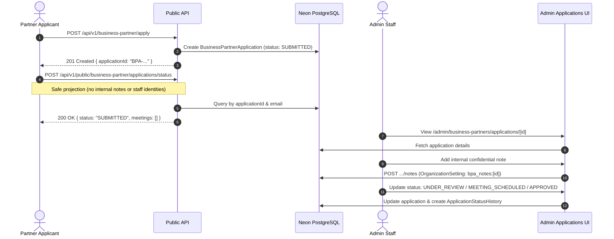
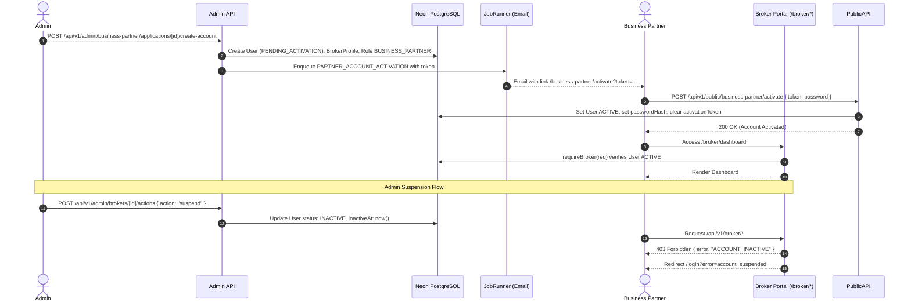
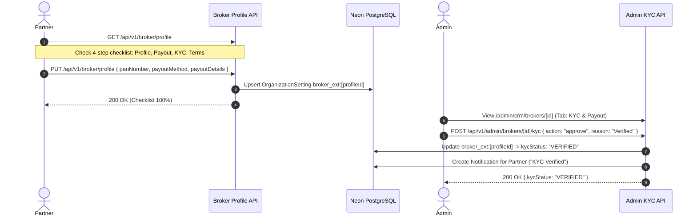
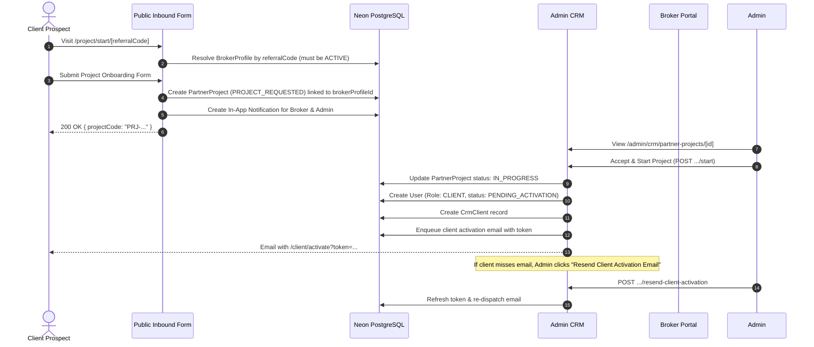
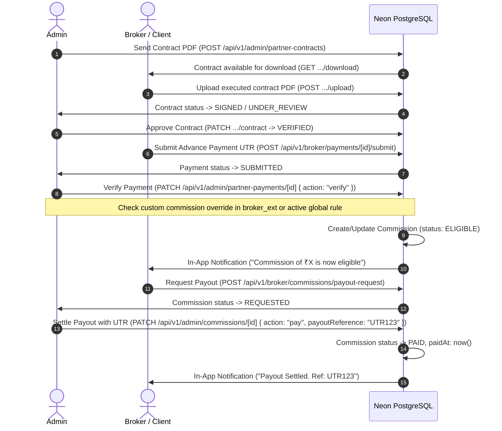

# Broker & Admin Integration Flow

This document maps the end-to-end integration flows across the **Broker / Business Partner Portal**, the **Admin CRM Portal**, and the **Client Portal** in Axivon Technologies.

---

## 1. High-Level System Architecture

---

## 2. Step-by-Step Sequence Flows

### Flow 1: Partner Application, Internal Notes & Status Inquiry

---

### Flow 2: Account Creation, Activation & Suspension Gate

---

### Flow 3: Broker Onboarding Gate & Admin KYC Review

---

### Flow 4: Lead Referral, Project Onboarding & Client Provisioning

---

### Flow 5: Contract & Payment Settlement with Commission Activation

---

## 3. Entity State Machines

### 3.1 BusinessPartnerApplication Status
- `SUBMITTED` -> `UNDER_REVIEW` -> `MEETING_SCHEDULED` -> `MORE_INFO_REQUESTED` -> `ON_HOLD` -> `APPROVED` | `REJECTED`
- `APPROVED` enables `Create Partner Account`.

### 3.2 User Status (Partner & Client)
- `PENDING_ACTIVATION` -> (via activation token) -> `ACTIVE`
- `ACTIVE` -> (via admin suspend) -> `INACTIVE`
- `INACTIVE` -> (via admin reactivate) -> `ACTIVE`

### 3.3 PartnerProject Status
- `PROJECT_REQUESTED` -> `PRICING_PROPOSED` -> `CONTRACT_PENDING` -> `CONTRACT_UPLOADED` -> `PAYMENT_PENDING` -> `PROJECT_CONFIRMED` -> `IN_PROGRESS` -> `INTERNAL_QA` -> `UAT_READY` -> `UAT_APPROVED` -> `DELIVERED` -> `COMPLETED`

### 3.4 Commission Status
- `PENDING` -> `ELIGIBLE` -> `REQUESTED` -> `PROCESSING` / `APPROVED` -> `PAID`
