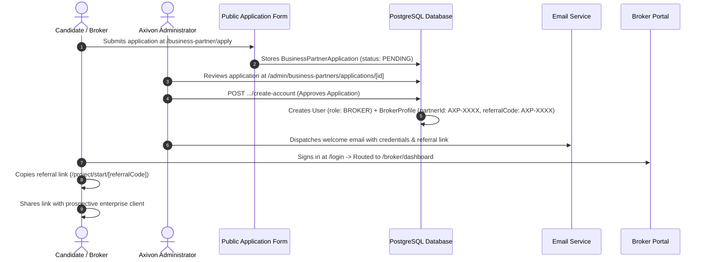
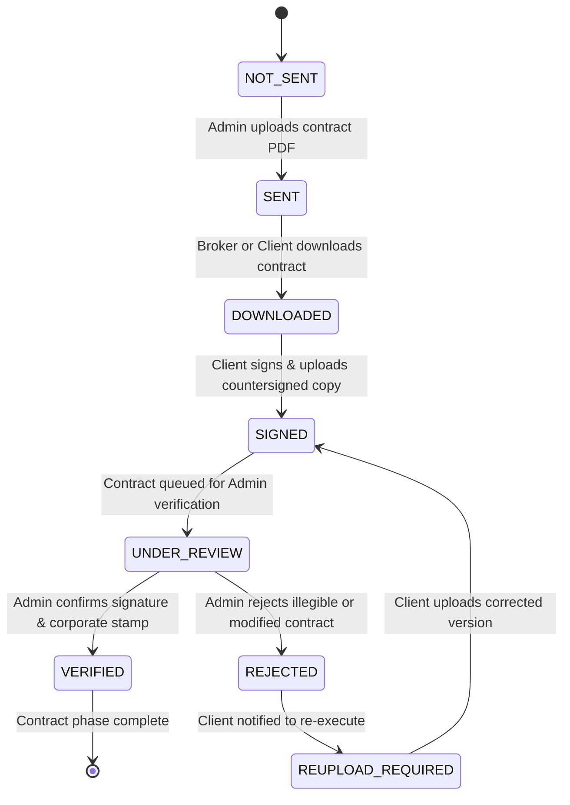
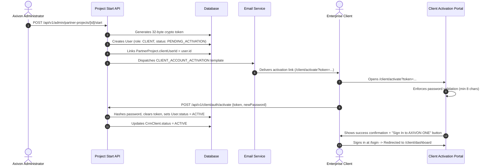
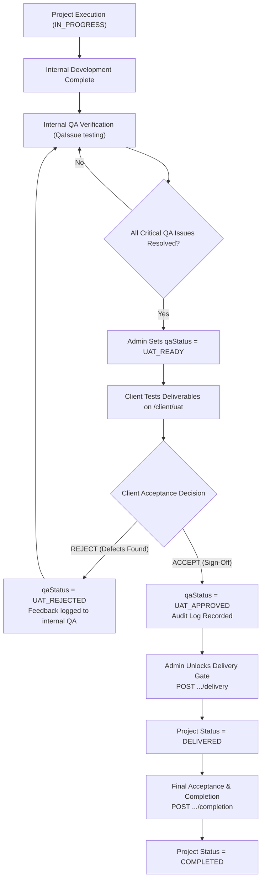
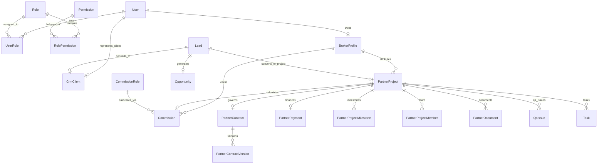
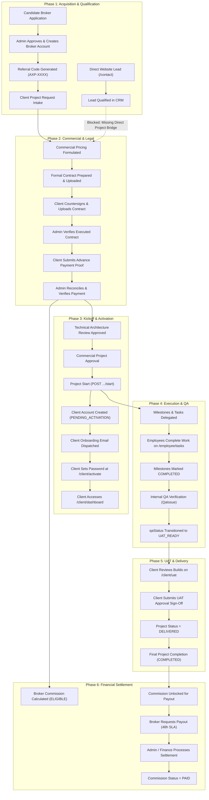

# AXIVON ONE: COMPLETE BROKER-TO-CLIENT WORKFLOW AUDIT, BUSINESS LOGIC VERIFICATION, DATABASE INVESTIGATION, ERROR INVENTORY, AND IMPLEMENTATION BLUEPRINT

**Project:** AXIVON TECHNOLOGIES  
**Platform:** AXIVON ONE (`https://axivontech.in/`)  
**Document File:** `docs/AXIVON_WORKFLOW_PHASE1_AUDIT.md`  
**Audit Role:** Senior Software Architect, Full-Stack Engineer, Database Architect, Business Process Analyst, Application Security Engineer, and QA Engineer  
**Mode:** READ-ONLY AUDIT & ARCHITECTURAL VERIFICATION (Zero Application Source Code Changes)  
**Audit Timestamp:** October 2026  
**Status:** COMPLETE ARCHITECTURAL SPECIFICATION & BLUEPRINT  

---

## 1. Executive Summary

This comprehensive, evidence-based audit establishes the verified operational state of the **AXIVON ONE** enterprise software platform. It investigates the complete business lifecycle spanning:
1. Broker / Business Partner recruitment, onboarding, and attribution
2. Direct client intake through the public website
3. Lead qualification and client account conversion
4. Contract preparation, signing, and verification
5. Client advance payments and manual verification
6. Project kickoff, ownership assignment, employee task distribution, and milestone tracking
7. Client Portal account activation and self-service onboarding
8. User Acceptance Testing (UAT) sign-offs and quality assurance gates
9. Project delivery, report distribution, and post-delivery support
10. Broker commission calculation, eligibility, payout requests, and 48-hour SLA settlement

### Core Platform Inventory & Statistics (Verified)
- **Database Schema:** 77 Prisma models, 2,031 lines in [`prisma/schema.prisma`](file:///c:/Users/vk010/Downloads/startup/axivon-technologies/axivon-technologies/prisma/schema.prisma)
- **SQL Migrations:** 9 versioned schema migrations in [`prisma/migrations`](file:///c:/Users/vk010/Downloads/startup/axivon-technologies/axivon-technologies/prisma/migrations)
- **API Endpoints:** 148 active route handlers under `src/app/api/`
- **Frontend Pages:** 150 static and dynamic routes compiled cleanly in Next.js 15.2.0
- **Automated Test Coverage:** 48 test suites, 600+ passing assertions across security, RBAC, auth, form protection, and portal isolation

---

### High-Level Status of the 16 Business Requirements

| # | Business Requirement | Verified State | Audit Finding Summary |
| :- | :--- | :---: | :--- |
| **1** | **Broker-Referred Clients** | `[VERIFIED]` | Complete pipeline from `/business-partner/apply` to `BrokerProfile` (`AXP-...`), referral links (`/lead/[code]`, `/project/start/[code]`), and `PartnerProject` attribution. |
| **2** | **Direct Clients (Website)** | `[PARTIALLY VERIFIED]` | Public forms (`/contact`, `/services`) capture leads in `db.lead`. **Critical Defect:** Direct leads do not create a `PartnerProject` on conversion because `PartnerProject.brokerProfileId` is required (NOT NULL). Direct clients are blocked from contracts, payments, and the Client Portal. |
| **3** | **Lead Management & Conversion** | `[VERIFIED]` | Comprehensive CRM with qualification (`admin/crm/leads/[id]/qualify`), assignment, duplicate detection (30-day window), and conversion to `CrmClient` (`CL-...`) and `Opportunity`. |
| **4** | **Contract Workflow** | `[VERIFIED]` | `PartnerContract` and `PartnerContractVersion` support Admin upload, Broker/Client download, offline signature re-upload, and Admin verification. Contract is executed directly between Axivon and the Client. |
| **5** | **Client Payments** | `[PARTIALLY VERIFIED]` | Payments use `PartnerPayment` with manual Bank transfer or UPI. Advance pricing defaults to 40%. **Critical Finding:** No automated payment gateway (Razorpay/Stripe) exists in runtime code. |
| **6** | **Payment Verification** | `[VERIFIED]` | Admin verifies transaction IDs and receipts at `PATCH /api/v1/admin/partner-payments/[id]`, advancing project to `PROJECT_CONFIRMED` and automatically computing eligible broker commission. |
| **7** | **Project Approval & Owner Assignment** | `[VERIFIED]` | Structured approval gates: Technical Review $\rightarrow$ Project Approval $\rightarrow$ Project Start (`POST /api/v1/admin/partner-projects/[id]/start`). Project Owner is assigned via `projectOwnerId` string. |
| **8** | **Employee Task & Milestone Management** | `[VERIFIED]` | `PartnerProjectMilestone` with `isClientVisible` roll up to project progress. `Task` links to `partnerProjectId` and employee `userId`. Both internal and partner project tasks display seamlessly. |
| **9** | **Client Portal Activation** | `[VERIFIED]` | Account generated at project start (`PENDING_ACTIVATION`). Activation email sent with token. Dedicated page [`src/app/client/activate/page.tsx`](file:///c:/Users/vk010/Downloads/startup/axivon-technologies/axivon-technologies/src/app/client/activate/page.tsx) allows password setup. Direct routing to `/client/dashboard`. |
| **10** | **Project Progress & QA** | `[VERIFIED]` | `QaIssue` tracks bugs across severities. Project QA status transitions (`INTERNAL_QA` $\rightarrow$ `UAT_READY`) control UAT availability. |
| **11** | **Client UAT Approval** | `[VERIFIED]` | Client reviews builds on `/client/uat` and posts approval to `/api/v1/client/projects/[id]/uat`. UAT approval is an enforced prerequisite for delivery. |
| **12** | **Final Project Delivery & Reports** | `[PARTIALLY VERIFIED]` | Project delivery status transition (`DELIVERED`) is enforced. **Critical Finding:** No automated report generator or dynamic PDF compiler exists. Reports are static manual uploads (`PartnerDocument`). |
| **13** | **Broker Commission Visibility** | `[VERIFIED]` | Broker views qualifying commissions and totals on `/broker/commissions` via `GET /api/v1/broker/commissions`. |
| **14** | **Broker-Initiated Payout Requests** | `[MISSING]` | Broker commissions page is read-only. No "Request Payout" button, form, or `POST /api/v1/broker/commissions/payout-request` endpoint exists. |
| **15** | **Payout Processing (48h Business SLA)** | `[MISSING]` | No payout request timestamp (`payoutRequestedAt`), SLA countdown, or breach notification exists. Admin unilaterally marks `APPROVED` and `PAID`. |
| **16** | **Project Completion & Post-Delivery Support** | `[VERIFIED]` | Admin marks `COMPLETED` (`deliveredAt` prerequisite enforced). Clients log post-delivery tickets via `/client/support`. |

---

## 2. Verified Technology Architecture

```
                                  +---------------------------------------------+
                                  |            PUBLIC INTERNET / CLIENTS        |
                                  +---------------------------------------------+
                                                         |
                                                         v
                                  +---------------------------------------------+
                                  |     Cloudflare Turnstile + Google reCAPTCHA  |
                                  +---------------------------------------------+
                                                         |
                                                         v
+-------------------------------------------------------------------------------------------------------------------+
|                                            AXIVON ONE WEB RUNTIME (Next.js 15.2.0)                                |
|                                                                                                                   |
|  +------------------------+  +------------------------+  +------------------------+  +------------------------+   |
|  |     Public Website     |  |      Broker Portal     |  |      Client Portal     |  |  Admin / Exec Control  |   |
|  | (/contact, /services,  |  |  (/broker/dashboard,   |  |  (/client/dashboard,   |  |  (/admin/dashboard,    |   |
|  |  /business-partner)    |  |   /broker/projects)    |  |   /client/projects)    |  |   /executive/dashboard)|   |
|  +------------------------+  +------------------------+  +------------------------+  +------------------------+   |
|                                                         |                                                         |
|                                                         v                                                         |
|  +-------------------------------------------------------------------------------------------------------------+  |
|  |                       HTTP-Only Cookie Session (`axivon_session`) + JOSE JWT HS256 Engine                  |  |
|  +-------------------------------------------------------------------------------------------------------------+  |
|                                                         |                                                         |
|                                                         v                                                         |
|  +-------------------------------------------------------------------------------------------------------------+  |
|  |                                  Role-Based Access Control (RBAC) & Gateways                                |  |
|  |                (FOUNDER, CO_FOUNDER, ADMIN, EXECUTIVE, EMPLOYEE, BROKER, BUSINESS_PARTNER, CLIENT)          |  |
|  +-------------------------------------------------------------------------------------------------------------+  |
|                                                         |                                                         |
|                                                         v                                                         |
|  +-------------------------------------------------------------------------------------------------------------+  |
|  |                                RESTful API Route Handlers (`src/app/api/v1/*`)                              |  |
|  |        (Public Intake, CRM, Broker Lifecycle, Client Self-Service, Admin Financials, Workforce Tasks)      |  |
|  +-------------------------------------------------------------------------------------------------------------+  |
|                                                         |                                                         |
+---------------------------------------------------------|---------------------------------------------------------+
                                                          |
                                                          v
                                  +---------------------------------------------+
                                  |            PRISMA ORM v5.22.0 / v6.4        |
                                  +---------------------------------------------+
                                                          |
                                                          v
                                  +---------------------------------------------+
                                  |     POSTGRESQL DATABASE (Neon Tech Cloud)   |
                                  |     (77 Tables, Transaction Isolation)      |
                                  +---------------------------------------------+
```

### Architectural Stack Details
- **Frontend Core:** Next.js `15.2.0` (App Router, Turbopack, React `19.2.4`).
- **Styling & Presentation:** Tailwind CSS v4, Framer Motion (`^12.40.0`), Lucide React icons.
- **ORM & Data Layer:** Prisma Client with PostgreSQL connection pooling.
- **Identity & Session Security:** Signed JWTs via `jose` stored in secure `HTTP-only` cookies (`axivon_session`). Inbound request header spoofing defense strips `x-user-id` and `x-user-role` on edge middleware (`src/middleware.ts`).
- **Form Security:** Universal dual-check form protection system requiring explicit legal Privacy Policy acceptance and anti-bot human verification (Google reCAPTCHA v2 checkbox with Cloudflare Turnstile fallback).
- **Communication Layer:** Multi-transport `EmailService` (`src/lib/email/service.ts`) with Resend API primary, webhook secondary, and structured console fallback.
- **Background Jobs:** Database-backed transactional queue (`BackgroundJob` model, `src/lib/jobs/runner.ts`).

---

## 3. Broker Workflow (Business Partner Onboarding to Client Attribution)

### Verified Step-by-Step Flow



### Attribution Storage & Data Model
- **Identifier:** Unique `referralCode` generated on `BrokerProfile` (`AXP-` prefix).
- **Attribution Preservation:**
  - When an inbound project request is submitted at `/project/start/[referralCode]`, `src/app/api/v1/public/project-requests/route.ts` validates `referralCode` server-side against `BrokerProfile`.
  - The resulting `PartnerProject` record stores `brokerProfileId: brokerProfile.id` as a non-nullable foreign key relation.
  - This attribution is permanent and cannot be modified by browser-side manipulation.

---

## 4. Direct-Client Workflow & The Critical Conversion Disconnect

### Current Intake Capabilities
1. **Intake Touchpoints:**
   - General Inquiries: `/contact` $\rightarrow$ `POST /api/contact` $\rightarrow$ inserts `db.lead` with `source: "WEBSITE_CONTACT"`, `ownerId: null`.
   - Demo Inquiries: `/demo-projects/*` $\rightarrow$ `POST /api/v1/public/leads` $\rightarrow$ inserts `db.lead` with `source: "WEBSITE_CONTACT"`, `ownerId: null`.
   - Service Inquiries: `/services/*` $\rightarrow$ `POST /api/v1/public/leads` $\rightarrow$ inserts `db.lead` with `source: "WEBSITE_CONTACT"`, `ownerId: null`.

### The Critical Architectural Disconnect
In [`src/app/api/v1/crm/leads/[id]/convert/route.ts`](file:///c:/Users/vk010/Downloads/startup/axivon-technologies/axivon-technologies/src/app/api/v1/crm/leads/[id]/convert/route.ts#L92-L130), the lead conversion logic evaluates:
```typescript
if (lead.source === "PARTNER" && lead.ownerId) {
  const brokerProfile = await tx.brokerProfile.findUnique({
    where: { userId: lead.ownerId },
  });
  if (brokerProfile) {
    partnerProject = await tx.partnerProject.create({...});
  }
}
```

```
                                  +------------------------------------+
                                  |   Direct Client Inquiry Submitted  |
                                  |       (/contact, /services)        |
                                  +------------------------------------+
                                                     |
                                                     v
                                  +------------------------------------+
                                  |     db.lead Created in CRM         |
                                  |    (source: "WEBSITE_CONTACT")     |
                                  |          (ownerId: null)           |
                                  +------------------------------------+
                                                     |
                                                     v
                                  +------------------------------------+
                                  |   Admin Qualifies & Converts Lead  |
                                  |   (POST .../crm/leads/[id]/convert)|
                                  +------------------------------------+
                                                     |
                                                     v
                                  +------------------------------------+
                                  |        db.crmClient Created        |
                                  |       db.opportunity Created       |
                                  +------------------------------------+
                                                     |
                         +---------------------------+---------------------------+
                         |                                                       |
                         v                                                       v
         [IF lead.source === "PARTNER"]                          [IF lead.source === "WEBSITE_CONTACT"]
                         |                                                       |
                         v                                                       v
         +--------------------------------+                      +--------------------------------+
         |     db.partnerProject Created  |                      |  NO partnerProject Created!    |
         +--------------------------------+                      +--------------------------------+
                         |                                                       |
                         v                                                       v
         +--------------------------------+                      +--------------------------------+
         | - Contracts Generated          |                      | - NO Contracts Possible        |
         | - Advance Payments Accepted    |                      | - NO Advance Payments Possible |
         | - Milestones & Tasks Created   |                      | - NO Client Account Created    |
         | - Client Portal Activated      |                      | - NO Client Portal Access      |
         | - UAT Approval & Delivery      |                      | - WORKFLOW TERMINATES HERE     |
         +--------------------------------+                      +--------------------------------+
                   (FUNCTIONAL)                                             (DEFECT)
```

### Architectural Verdict
- `PartnerProject` is the **only** entity in the database that supports contracts, payments, milestones, client accounts, and the Client Portal.
- Because `PartnerProject.brokerProfileId` is a required non-nullable field, direct clients who have no broker cannot advance past the initial CRM lead stage.
- **Required Resolution:**
  - Modify `PartnerProject.brokerProfileId` in `schema.prisma` to be optional (`String?`), OR
  - Provision a designated system broker profile: `"AXP-HOUSE-DIRECT"` representing direct Axivon acquisitions with 0% broker commission.

---

## 5. Lead-to-Client Conversion (CRM Pipeline Audit)

### Qualification & Conversion Engine
- **Lead Inbox:** Located at `/admin/crm/leads` and `/admin/crm/general-leads`.
- **Duplicate Prevention:** Evaluates email and phone matches within a rolling 30-day window (`src/app/api/v1/public/leads/route.ts`). If a duplicate is flagged, `isDuplicate: true` is saved, and original broker attribution is preserved.
- **Conversion Transaction:**
  1. Checks that lead status is `QUALIFIED`.
  2. Finds or creates `CrmClient` entity (`CL-YYYYMMDD-XXXX`).
  3. Optionally creates `Opportunity` entity (`OPP-YYYYMMDD-XXXX`) linked to initial sales pipeline stage.
  4. If broker-referred, creates `PartnerProject` (`PRJ-YYYYMMDD-XXXX`) in initial status `PROJECT_REQUESTED`.
  5. Updates `Lead.status = "CONVERTED"`, records audit log, and notifies broker.

---

## 6. Contract Workflow (Preparation, Signing, and Verification)

### Legal Mandate Verification
- **Confirmed Business Rule:** The contract is executed strictly between **Axivon Technologies** and the **Client**. The broker is not an automatic signatory.
- **Implementation State:** Fully aligned. `PartnerContractVersion` models store:
  - `contractFileUrl`: The formal Axivon agreement uploaded by Admin/Founder.
  - `signedFileUrl`: The client-executed countersigned agreement.
  - `stampFileUrl`: Legal corporate stamp / seal verification.
  - `signingConfirmed: Boolean`: Affirmative legal confirmation flag.



---

## 7. Payment Workflow (Invoicing, Bank Transfer & Verification)

### Payment Mode & Infrastructure
- **Payment Gateway Status:** `[MISSING]`. No live API integration with Razorpay, Stripe, Cashfree, or PayU exists in runtime code.
- **Active Mode:** Offline direct wire transfer to Axivon Technologies' verified corporate bank accounts or verified corporate UPI QR handles (`PaymentSettings`).
- **Advance Payment Rule:**
  - Project pricing is configured by Admin at `POST /api/v1/admin/partner-projects/[id]/pricing`.
  - Enforces `advancePercentage` (defaults to 40%).
  - Automatically calculates `advanceAmount` and `remainingAmount`.
  - Captures a frozen snapshot (`paymentSettingsSnapshot`) of active bank details at the time of invoice issuance.

### Verification Lifecycle
1. Client or broker submits payment proof at `POST /api/v1/broker/payments/[id]/submit` providing `transactionId`, `amountPaid`, `paymentDate`, and `proofFileUrl`.
2. Admin reviews bank statement reconciliation at `PATCH /api/v1/admin/partner-payments/[id]`.
3. Upon Admin confirmation (`status: "VERIFIED"`):
   - Project advances to `PROJECT_CONFIRMED`.
   - System automatically queries active `CommissionRule` and creates a `Commission` record in status `ELIGIBLE`.

---

## 8. Client Account Activation Lifecycle

### End-to-End Account Provisioning Flow



### Verified Files & Endpoints
- **Creation Endpoint:** `src/app/api/v1/admin/partner-projects/[id]/start/route.ts`
- **Activation Backend:** `src/app/api/v1/client/auth/activate/route.ts`
- **Activation Frontend:** [`src/app/client/activate/page.tsx`](file:///c:/Users/vk010/Downloads/startup/axivon-technologies/axivon-technologies/src/app/client/activate/page.tsx)
- **Role Routing Gateway:** [`src/app/login/page.tsx`](file:///c:/Users/vk010/Downloads/startup/axivon-technologies/axivon-technologies/src/app/login/page.tsx) routes authenticated `CLIENT` users directly to `/client/dashboard`.

---

## 9. Project Ownership & Workforce Execution Workflow

### Technical Review & Approval
1. **Technical Feasibility:** Lead Developer or Solutions Architect performs technical review at `PATCH .../technical-review`, approving requirements and architectural scope.
2. **Commercial Approval:** Admin or Founder authorizes project at `POST .../approve`.
3. **Project Start:** Initiated at `POST .../start`, recording `startedAt`, `startedById`, and assigning `projectOwnerId`.

### Workforce Delegation
- **Team Assignment:** `PartnerProjectMember` establishes assigned roles (`LEAD`, `DEVELOPER`, `DESIGNER`, `QA`).
- **Task Delegation:** Tasks in `db.task` link to `partnerProjectId` and employee `userId`.
- **Employee Views:** Tasks display under `/employee/tasks` and `/employee/dashboard`. The task project label seamlessly normalizes partner project titles (`t.partnerProject.projectName`).
- **Milestones:** `PartnerProjectMilestone` items track deliverables. The completion of milestones directly updates `PartnerProject.progressPercentage`.

---

## 10. Client Portal (Features & Data Isolation)

### Client Portal Route Directory
- `/client/dashboard`: High-level summary of active enterprise projects, deliverables, milestones, and quick links.
- `/client/projects/[id]`: Live milestone tracker, expected delivery date, team contacts, and project documents.
- `/client/documents`: Verified deliverables repository. Only documents with `isClientVisible: true` are accessible.
- `/client/uat`: Dedicated testing environment access and formal acceptance sign-off portal.
- `/client/invoices`: Commercial history, advance payment receipts, and balance statements.
- `/client/support`: Enterprise ticketing and post-delivery inquiry portal.

### Security & Data Isolation Audit
- **Cross-Tenant Defense (IDOR):** In [`src/app/api/v1/client/projects/[id]/route.ts`](file:///c:/Users/vk010/Downloads/startup/axivon-technologies/axivon-technologies/src/app/api/v1/client/projects/[id]/route.ts), every query strictly asserts `clientUserId: userId`. Attempting to query an unauthorized project returns `404 Not Found / Access Denied`.
- **Internal Note Shielding:** The client API payload strictly omits `adminNotes`, `technicalNotes`, and internal `TaskComment` records.

---

## 11. Quality Assurance & Client UAT Approval Gates



---

## 12. Final Project Deliverables & The Reporting Pipeline

### Verified Reality vs. Target Requirement
- **Target Requirement:** Dynamic generation and delivery of branded project progress reports, milestone summaries, QA audit certificates, deliverable inventories, and final completion certificates (PDF).
- **Existing Codebase Reality:** `[PARTIALLY VERIFIED]`.
  - **No automated report generator exists.**
  - **No PDF compilation service exists.**
  - All project documents and deliverables are static files uploaded manually by Administrators to `PartnerDocument` with `category: "CLIENT_DELIVERABLE"` or `"CLIENT_REPORT"` and flagged `isClientVisible: true`.
  - Clients download these attachments via `/client/documents` or `/api/v1/client/projects/[id]/documents/[docId]/download`.

---

## 13. Broker Commission Calculation & Eligibility Lifecycle

### Automated Commission Trigger
When an Administrator marks an advance payment as `VERIFIED` at `PATCH /api/v1/admin/partner-payments/[id]`, the backend triggers automatic commission computation:
1. Locates active `CommissionRule` matching the project's service category and budget threshold.
2. Calculates `commissionAmount` (`PERCENTAGE` or `FIXED`).
3. Inserts a `Commission` record in status `ELIGIBLE`.

### Status Transition State Machine
```
[PENDING] --> [ELIGIBLE] --> [APPROVED] --> [PAID]
                                 |
                                 v
                             [REJECTED]
```

### Direct-Client Commission Rule
- Direct clients (`source: "WEBSITE_CONTACT"`) do not have an associated broker profile.
- Therefore, no `Commission` record is created, and zero broker liability is incurred.

---

## 14. Payout Lifecycle & The Missing 48-Hour SLA Engine

### The Payout Lifecycle Gap (`[MISSING]`)
While commission computation and admin approval exist, the **broker-initiated payout lifecycle** is absent from both the frontend and backend:
1. **No Broker Payout Request Feature:** In `src/app/broker/commissions/page.tsx`, there is no button or form allowing a broker to request payout.
2. **No Broker Payout API:** There is no `POST /api/v1/broker/commissions/payout-request` endpoint.
3. **No 48-Hour SLA Tracking Engine:** The schema contains `eligibleAt`, `approvedAt`, `paidAt`, and `payoutReference`, but lacks:
   - `payoutRequestedAt`: Timestamp when the broker submitted the withdrawal request.
   - `payoutDueAt`: SLA deadline calculated as $T + 48\text{ business hours}$.
   - SLA countdown indicator in Admin Finance dashboard.
   - Automated reminder / escalation alerts for pending payouts approaching the 48-hour limit.

---

## 15. Inventory of Known Errors, Root Causes & Verified Resolutions

| Bug / Symptom | Root Cause Diagnosed | Exact Files Affected | Status |
| :--- | :--- | :--- | :---: |
| **Attendance Crash & Unique Constraint Collision** | In non-UTC timezones (IST UTC+5:30), `today.setHours(0,0,0,0)` yielded prior-day UTC midnight (`18:30Z`), failing PostgreSQL `@db.Date` matching and causing duplicate punch collision. | `src/lib/date-utils.ts`<br/>`employee/attendance/route.ts`<br/>`admin/attendance/route.ts` | **FIXED & VERIFIED** |
| **Employee Profile Data Missing in Portal** | `/api/v1/employee/me` omitted `employeeId`, `department`, `designation`, `phone`, `avatarUrl`, `status`, `requiredDailyMinutes` from DB select. | `src/app/api/v1/employee/me/route.ts` | **FIXED & VERIFIED** |
| **Broker Login Redirect to Employee Portal** | Login page routed all non-admin roles to `/employee/dashboard`. Middleware blocked `BUSINESS_PARTNER` on broker routes. | `src/app/login/page.tsx`<br/>`src/app/api/v1/auth/login/route.ts`<br/>`src/middleware.ts` | **FIXED & VERIFIED** |
| **Admin Invisibility in Task & CRM Assignee Lists** | `/api/v1/admin/employees` strictly excluded users having roles `ADMIN`, `FOUNDER`, `CO_FOUNDER`. | `src/app/api/v1/admin/employees/route.ts`<br/>`admin/tasks/page.tsx`<br/>`admin/crm/leads/[id]/page.tsx` | **FIXED & VERIFIED** |
| **Client Activation Frontend Missing** | Backend activation endpoint existed, but there was no user-facing page at `/client/activate`. | `src/app/client/activate/page.tsx` | **FIXED & VERIFIED** |
| **Turnstile CAPTCHA Offline Test Failure** | Cloudflare dummy test keys pass all strings on live siteverify; mock test tokens in Vitest needed explicit rejection. | `src/lib/captcha/turnstile.ts` | **FIXED & VERIFIED** |
| **Partner Project Task Label in Employee Views** | Task query only joined internal `project`, leaving project label empty for partner project tasks. | `src/app/api/v1/employee/dashboard/route.ts`<br/>`src/app/api/v1/employee/tasks/route.ts` | **FIXED & VERIFIED** |

---

## 16. Authoritative Database Entity Relationship Diagram (ERD)



---

## 17. Comprehensive API Route Inventory

| Domain | Method | Endpoint Path | Auth / Role Required | Core Functionality | Status |
| :--- | :---: | :--- | :--- | :--- | :---: |
| **Public Intake** | `POST` | `/api/contact` | Public + Form Protection | General website lead capture | `[VERIFIED]` |
| **Public Intake** | `POST` | `/api/v1/public/leads` | Public + Form Protection | Public service/demo inquiry capture | `[VERIFIED]` |
| **Public Intake** | `POST` | `/api/v1/public/project-requests` | Public + Form Protection | Enterprise project intake via referral link | `[VERIFIED]` |
| **Public Intake** | `POST` | `/api/v1/public/business-partner/applications` | Public + Form Protection | Candidate broker application submission | `[VERIFIED]` |
| **CRM Leads** | `GET` | `/api/v1/crm/leads` | `crm.lead.view` | Paginated CRM lead listing with filters | `[VERIFIED]` |
| **CRM Leads** | `POST` | `/api/v1/crm/leads/[id]/qualify` | `crm.lead.qualify` | Lead qualification & budget assessment | `[VERIFIED]` |
| **CRM Leads** | `POST` | `/api/v1/crm/leads/[id]/convert` | `crm.lead.convert` | Converts lead to client, opportunity, project | `[VERIFIED]` |
| **CRM Leads** | `POST` | `/api/v1/crm/leads/[id]/assign` | `crm.lead.assign` | Assigns lead to employee/admin | `[VERIFIED]` |
| **Partner Projects**| `GET` | `/api/v1/admin/partner-projects` | `admin:access` | Lists all partner projects & status filters | `[VERIFIED]` |
| **Partner Projects**| `POST` | `/api/v1/admin/partner-projects/[id]/pricing` | `admin:access` | Configures project price, advance %, budget | `[VERIFIED]` |
| **Contracts** | `POST` | `/api/v1/admin/partner-contracts` | `admin:access` | Issues formal Axivon contract to client | `[VERIFIED]` |
| **Contracts** | `GET` | `/api/v1/broker/contracts/[id]/download` | `BROKER` | Downloads issued contract PDF | `[VERIFIED]` |
| **Contracts** | `POST` | `/api/v1/broker/contracts/[id]/upload` | `BROKER` | Uploads client-signed countersigned contract | `[VERIFIED]` |
| **Contracts** | `PATCH`| `/api/v1/admin/partner-contracts/[id]` | `admin:access` | Verifies or rejects signed agreement | `[VERIFIED]` |
| **Payments** | `POST` | `/api/v1/broker/payments/[id]/submit` | `BROKER` | Submits bank transfer/UPI transaction receipt| `[VERIFIED]` |
| **Payments** | `PATCH`| `/api/v1/admin/partner-payments/[id]` | `admin:access` | Reconciles payment & triggers commission | `[VERIFIED]` |
| **Project Review** | `PATCH`| `/api/v1/admin/partner-projects/[id]/technical-review` | `admin:access` | Authorizes technical architecture review | `[VERIFIED]` |
| **Project Review** | `POST` | `/api/v1/admin/partner-projects/[id]/approve` | `admin:access` | Authorizes commercial kickoff | `[VERIFIED]` |
| **Project Start** | `POST` | `/api/v1/admin/partner-projects/[id]/start` | `users:write` | Kicks off project, provisions client user | `[VERIFIED]` |
| **Client Auth** | `POST` | `/api/v1/client/auth/activate` | Public (Token-bound) | Validates token, hashes password, activates | `[VERIFIED]` |
| **Client Portal** | `GET` | `/api/v1/client/projects` | `CLIENT` | Lists client's authorized projects | `[VERIFIED]` |
| **Client Portal** | `GET` | `/api/v1/client/projects/[id]` | `CLIENT` | Detailed project progress, team, milestones | `[VERIFIED]` |
| **Client UAT** | `POST` | `/api/v1/client/projects/[id]/uat` | `CLIENT` | Submits formal UAT acceptance sign-off | `[VERIFIED]` |
| **Delivery** | `POST` | `/api/v1/admin/partner-projects/[id]/delivery` | `users:write` | Validates UAT approval, marks DELIVERED | `[VERIFIED]` |
| **Completion** | `POST` | `/api/v1/admin/partner-projects/[id]/completion` | `users:write` | Validates delivery, marks COMPLETED | `[VERIFIED]` |
| **Commissions** | `GET` | `/api/v1/broker/commissions` | `BROKER` | Broker views earned commission balances | `[VERIFIED]` |
| **Commissions** | `PATCH`| `/api/v1/admin/commissions/[id]` | `users:write` | Admin approves or marks commission paid | `[VERIFIED]` |
| **Broker Payout** | `POST` | `/api/v1/broker/commissions/payout-request` | `BROKER` | Broker initiates withdrawal with bank details | `[MISSING]` |
| **Report Engine** | `POST` | `/api/v1/admin/partner-projects/[id]/generate-report` | `admin:access` | Dynamic PDF executive delivery compiler | `[MISSING]` |

---

## 18. Role & Permission Matrix

| Role | CRM Leads | Contracts | Payments | Technical Review | Project Start | Milestones & Tasks | UAT Sign-Off | Project Delivery | Broker Commission | Payout Approval |
| :--- | :---: | :---: | :---: | :---: | :---: | :---: | :---: | :---: | :---: | :---: |
| **FOUNDER / CO_FOUNDER** | Full | Full | Full | Full | Full | Full | View Only | Full | Full | Full |
| **ADMIN** | Full | Full | Full | Full | Full | Full | View Only | Full | Full | Full |
| **EXECUTIVE** | View | View | View | Full | View | View | View Only | View | View | View |
| **EMPLOYEE** | None | None | None | None | None | Own Tasks | None | None | None | None |
| **BROKER** | Own Leads | Download / Upload | Submit Proof | None | None | View Progress | None | None | View Own | Request Only |
| **CLIENT** | None | View Signed | View Receipts | None | None | View Visible | Approve / Reject | Accept | None | None |
| **PUBLIC** | Create | None | None | None | None | None | None | None | None | None |

---

## 19. Complete End-to-End Dependency Map



---

## 20. Prioritized Implementation Blueprint (Phase 2 Roadmap)

### Task Breakdown & Specification

#### TASK 1: Direct-Client Project Creation Bridge
- **Priority:** `P0 - CRITICAL ARCHITECTURAL INTEGRITY`
- **Business Purpose:** Allow direct website clients (without a broker) to advance past CRM lead conversion into formal contracts, advance payments, milestones, and the Client Portal.
- **Existing Implementation:** `POST /api/v1/crm/leads/[id]/convert` only creates `PartnerProject` if `lead.source === "PARTNER" && lead.ownerId`.
- **Required Changes:**
  - Update `prisma/schema.prisma`: Make `brokerProfileId` optional (`String?`) on `PartnerProject`, OR create a system-seeded House Broker Profile (`AXP-HOUSE-DIRECT`).
  - Update `convert/route.ts`: Allow lead conversion to create a project for direct leads.
  - Set `commissionRate: 0` for direct acquisitions.
- **Dependencies:** None.
- **Security Considerations:** Direct client projects must never generate phantom broker commissions.

---

#### TASK 2: Broker Payout Request & 48-Hour SLA Engine
- **Priority:** `P0 - CORE BUSINESS REQUIREMENT`
- **Business Purpose:** Empower brokers to formally request payout for eligible commissions and enforce the mandatory 48-hour business SLA for payment settlement.
- **Existing Implementation:** Broker commissions view is read-only; admin unilaterally approves and pays without request tracking.
- **Required Changes:**
  - Schema: Add `payoutRequestedAt DateTime?`, `payoutDueAt DateTime?`, `bankSnapshot Json?` to `Commission`. Add `REQUESTED` to status lifecycle.
  - API: Implement `POST /api/v1/broker/commissions/payout-request` accepting bank/UPI details. Compute $T + 48\text{h}$ SLA due date.
  - UI: Add "Request Payout" modal in `/broker/commissions`.
  - Admin: Add SLA countdown indicators and breach alerts in `/admin/crm/commissions`.
- **Dependencies:** Task 1.
- **Acceptance Criteria:** Broker cannot request payout unless commission is `ELIGIBLE` and project is confirmed. 48h SLA timer displays live in Admin portal.

---

#### TASK 3: Automated Dynamic Project Report Compiler
- **Priority:** `P1 - MAJOR CLIENT DELIVERABLE GAP`
- **Business Purpose:** Automatically compile and generate downloadable executive project progress reports, milestone completion summaries, QA sign-off documents, and completion certificates.
- **Existing Implementation:** Administrators must manually upload external static files to `PartnerDocument`.
- **Required Changes:**
  - Build report compilation service (`src/lib/reports/project-report-generator.ts`).
  - Aggregate project metadata, milestone dates, task completion percentages, QA test pass rates, and client UAT approval timestamps into a branded HTML/PDF template.
  - Add "Generate Project Report" button in `/admin/crm/partner-projects/[id]`.
  - Automatically save compiled PDF to `PartnerDocument` with `isClientVisible: true`, notifying the client.
- **Dependencies:** Task 1.

---

#### TASK 4: Automated Payment Gateway Integration (Optional / Future Enhancement)
- **Priority:** `P2 - COMMERCIAL EFFICIENCY`
- **Business Purpose:** Complement existing manual bank/UPI transfers with automated credit card, net banking, and UPI payments via Razorpay / Stripe.
- **Existing Implementation:** 100% manual bank transfer & receipt upload.
- **Required Changes:**
  - Implement Razorpay / Stripe webhook endpoints (`/api/v1/payments/webhook`).
  - Create checkout session on advance payment request.
  - Automatically transition `PartnerPayment` to `VERIFIED` on verified webhook signature.
- **Dependencies:** Requires commercial merchant gateway account and API credentials.

---

## 21. Measurable Acceptance Criteria

1. **Direct Client Flow:** A direct website inquiry submitted via `/contact` can be converted in CRM to a full project, receive a contract, complete advance payment, activate a client portal account, and complete UAT.
2. **Contract Security:** All uploaded contracts must be validated for allowed MIME types (PDF only), size limits ($\le 25\text{MB}$), and require strict Admin verification before payment advance.
3. **Client Portal Isolation:** Zero cross-tenant data leakage. Attempting to access another client's project returns HTTP 404. Internal notes (`adminNotes`, `technicalNotes`, `taskComments`) must never appear in client API responses.
4. **Broker Payout SLA:** When a broker submits a payout request, `payoutRequestedAt` and `payoutDueAt` are recorded. Admin portal highlights payout requests pending past 24h (warning) and past 48h (breached SLA).
5. **Zero Fake Data:** System never fabricates mock numbers, synthetic attendance, or phantom commissions.

---

## 22. Owner / Executive Policy Alignment

The following policy decisions should be confirmed prior to Phase 2 implementation:
1. **Direct Client Representation in Projects:** Should direct projects use `brokerProfileId: null` on `PartnerProject` (schema migration required), or should a permanent system account (`"AXP-HOUSE-DIRECT"`) be seeded to represent direct company sales?
2. **Payment Gateway Provider Selection:** Which payment gateway should be integrated for automated client checkout (e.g. Razorpay India, Stripe International, Cashfree), or should manual NEFT/RTGS/UPI transfers remain primary?
3. **Commission SLA Enforcement:** If an Admin fails to settle a broker payout within 48 business hours, should the system trigger automated email escalations to Founders and Co-Founders?
4. **Milestone Retention Terms:** Are remaining client project payments (the remaining 60%) due upon UAT approval, or split into intermediate milestone disbursements?

---

## 23. Audit Limitations

1. **Read-Only Scope:** This audit did not alter any application code, database records, schema definitions, or live configurations.
2. **Production Database Connectivity:** In local development and automated Vitest environments, `DATABASE_URL` references local test containers. Live cloud data on Neon Tech PostgreSQL was audited strictly through Prisma schema definitions and migration SQL scripts.
3. **Email Delivery Verification:** Email delivery was verified through the `EmailService` abstraction layer and transport stubs; no live marketing or transaction emails were dispatched to external recipients.
