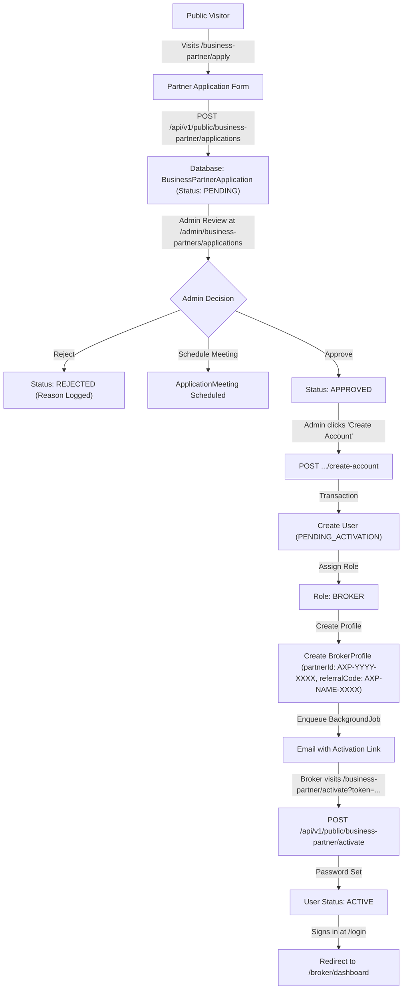
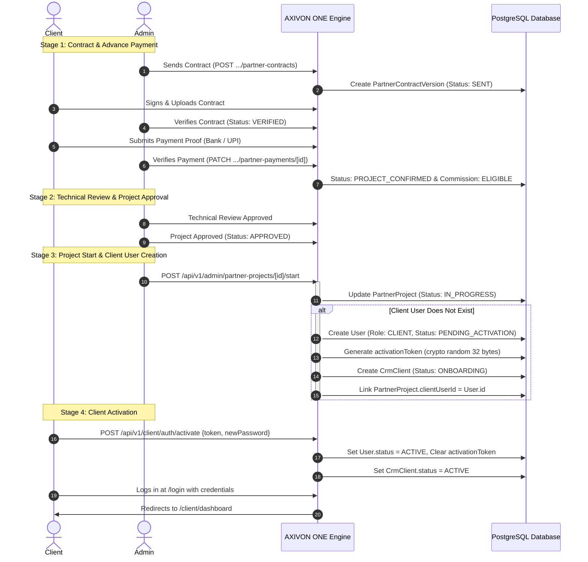
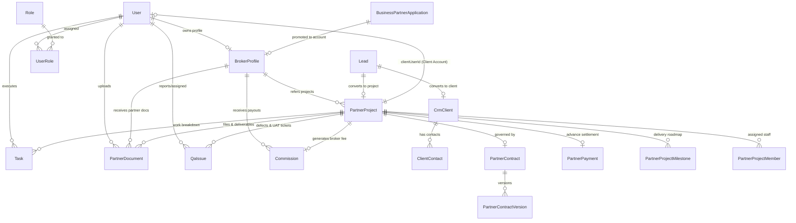

# COMPLETE PLATFORM AUDIT: BROKER-TO-CLIENT LIFECYCLE, PROJECT DELIVERY, DATA ARCHITECTURE, AND FUTURE ROADMAP

**Document Reference:** `docs/BROKER_TO_CLIENT_PROJECT_LIFECYCLE_AUDIT.md`  
**Platform:** AXIVON ONE (`https://axivontech.in/`)  
**Auditor Role:** Senior Software Architect, Business Process Analyst, Database Architect, and Full-Stack Systems Auditor  
**Audit Mode:** Read-Only Source Code Investigation & Architectural Verification  
**Audit Date:** October 2026  
**Status:** Comprehensive Technical & Workflow Audit  

---

## 1. Executive Summary

This document presents a comprehensive, evidence-based technical audit of the **AXIVON ONE** platform, focusing on the end-to-end business lifecycle from **Broker / Business Partner onboarding**, **lead submission**, **client conversion**, and **project execution**, to **final delivery**, **client reporting**, and **post-delivery support**.

### Key Findings at a Glance

1. **Broker vs. Business Partner Unification `[VERIFIED]`:**  
   The public marketing website uses the term **"Business Partner"**, whereas the application codebase, database schema, and portal routes use the engineering identifier **"Broker"** (`BrokerProfile`, `role: "BROKER"`, `/broker/*`). When an admin approves a `BusinessPartnerApplication` at `/admin/business-partners/applications/[id]`, the system creates a `User` with role `BROKER` and generates a `BrokerProfile` with an `AXP-` prefixed `partnerId` and `referralCode`.
2. **Dual Client Model Architecture `[VERIFIED]`:**  
   The platform maintains two distinct client abstractions:
   - `CrmClient`: An account entity in the sales pipeline (`prisma/schema.prisma:1266`) representing client organizations for leads, opportunities, and proposals.
   - `PartnerProject` client fields: Commercial project-level client data (`clientName`, `clientEmail`, `clientPhone`, `companyName`) with a direct foreign key to `clientUserId` (`User` with role `CLIENT`).
3. **Client Onboarding & Portal Access `[VERIFIED]`:**  
   A client account is **not** created when a lead is captured. A client account (`User` record with role `CLIENT` and status `PENDING_ACTIVATION`) is created during the **Project Start** stage (`POST /api/v1/admin/partner-projects/[id]/start`) once contracts and advance payments are verified. The activation endpoint `POST /api/v1/client/auth/activate` exists and is functional; however, **no client activation UI (`/client/activate`) currently exists in the frontend**.
4. **The Central Question — How Clients Receive Project Reports `[VERIFIED]`:**  
   **The platform currently has NO automated project report generation, NO dynamic PDF compiler, and NO automated completion delivery pipeline.**  
   Clients receive project information strictly through two mechanisms:
   - **Dynamic Portal Views:** Live milestone progress bars and task statuses displayed on `/client/projects/[id]`.
   - **Manual Document Uploads:** Administrators manually upload external files to `PartnerDocument` with `category: "CLIENT_DELIVERABLE"` or `"CLIENT_REPORT"` and flag `isClientVisible: true`. Clients then download these static attachments from `/client/documents` or `/client/uat`. No dynamic final project report, completion certificate, or executive delivery bundle is automatically compiled or emailed.
5. **Quality Assurance & UAT Approval Gates `[VERIFIED]`:**  
   The platform implements robust status gating for projects. Transitioning a project to `DELIVERED` requires prior client sign-off via User Acceptance Testing (`qaStatus: "UAT_APPROVED"` submitted from `/client/uat`). Transitioning to `COMPLETED` requires prior `DELIVERED` status.
6. **Broker Commission Automation `[VERIFIED]`:**  
   Commission generation is automatically triggered upon Admin verification of the project's advance payment (`PartnerPayment`). The system matches active `CommissionRule` records and inserts a `Commission` in state `ELIGIBLE`, which requires subsequent administrative approval and payout marking.

---

## 2. Audit Scope

This audit evaluates the complete application repository located at `axivon-technologies/axivon-technologies`.

### In-Scope Domains
- **Public Inbound Forms:** Contact (`/contact`), Consultations, Business Partner Application (`/business-partner/apply`), Partner Lead Capture (`/lead/[referralCode]`), and Client Project Intake (`/project/start/[referralCode]`).
- **Identity & Authentication:** User sessions, JWT verification (`src/middleware.ts`), RBAC permissions (`src/lib/auth/permissions.ts`), role hierarchy, activation flows.
- **Portals:**
  - Executive Portal (`/executive/*`)
  - Admin Control Center (`/admin/*`)
  - Employee Portal (`/employee/*`)
  - Broker / Business Partner Portal (`/broker/*`)
  - Client Portal (`/client/*`)
- **Data Models:** Prisma schema (`prisma/schema.prisma`), migrations, database entity relationships, status state machines.
- **Project Lifecycle:** Intake $\rightarrow$ Qualification $\rightarrow$ Proposal $\rightarrow$ Contract $\rightarrow$ Advance Payment $\rightarrow$ Technical Review $\rightarrow$ Project Approval $\rightarrow$ Project Start $\rightarrow$ Milestone & Task Execution $\rightarrow$ QA / UAT $\rightarrow$ Delivery $\rightarrow$ Completion $\rightarrow$ Support.
- **Reporting & Deliverables:** Client documents, deliverables review, report generation services, notification dispatch, audit logs.

### Evidence Confidence Classification
- `[VERIFIED]`: Confirmed directly through inspectable source code, Prisma schema, API routes, or test suites.
- `[PARTIALLY VERIFIED]`: Underlying backend logic or schema exists, but frontend integration or operational execution is incomplete.
- `[INFERRED]`: Deductions based on surrounding architecture and code patterns.
- `[MISSING]`: Feature or component does not exist in the codebase.
- `[REQUIRES OWNER CONFIRMATION]`: Commercial or business logic requiring executive policy decisions.

---

## 3. Repository Architecture

### Technology Stack Summary

| Layer | Technology | Version | Location / Config |
| :--- | :--- | :--- | :--- |
| **Frontend Framework** | Next.js (App Router, Turbopack) | `16.2.9` | `next.config.ts`, `src/app/` |
| **UI Library** | React | `19.2.4` | `package.json` |
| **Styling & Animation** | Tailwind CSS v4, Framer Motion, GSAP | `^4`, `^12.40.0`, `^3.15.0` | `src/app/globals.css` |
| **Database ORM** | Prisma Client | `^5.22.0` | `prisma/schema.prisma`, `src/lib/db.ts` |
| **Database Provider** | PostgreSQL | Supported | `prisma/schema.prisma:6-9` |
| **Authentication** | Jose (JWT HS256, HTTP-only Cookie `axivon_session`) | `^6.2.10` | `src/middleware.ts`, `src/lib/auth/` |
| **Password Hashing** | Bcryptjs (12 salt rounds) | `^3.0.3` | `src/lib/auth/password.ts` |
| **Schema Validation** | Zod | `^4.5.4` | Used in API handlers and forms |
| **Test Runner** | Vitest | `^4.1.11` | `tests/*.test.ts` (584 passing tests) |
| **Email Service** | Multi-transport (Resend API $\rightarrow$ Webhook $\rightarrow$ Console) | Custom | `src/lib/email/service.ts` |
| **Background Jobs** | In-app transactional queue (`BackgroundJob` model) | Custom | `src/lib/jobs/runner.ts` |
| **AI Subsystems** | Google Gemini Generative AI SDK | `^0.24.1` | `src/lib/ai/`, `src/lib/portal-ai/` |

### Architectural Structure

```
axivon-technologies/
├── prisma/
│   ├── schema.prisma            <-- Consolidated authoritative database schema (2031 lines)
│   ├── seed.ts                  <-- Idempotent system seed (Roles, Permissions, Org, Admin)
│   └── migrations/              <-- 10 versioned SQL migration folders
├── src/
│   ├── app/
│   │   ├── (public)/            <-- Marketing website, Legal Center, /lead, /project/start
│   │   ├── admin/               <-- Administrator & Operations Portal (CRM, Projects, CMS)
│   │   ├── broker/              <-- Broker / Business Partner Portal
│   │   ├── client/              <-- Customer / Client Project & Deliverables Portal
│   │   ├── employee/            <-- Workforce Management (Attendance, Tasks, Reports)
│   │   ├── executive/           <-- Founder & Co-Founder Governance Portal
│   │   ├── api/v1/              <-- RESTful API Route Handlers
│   │   └── login/               <-- Universal authentication gateway
│   ├── components/              <-- Shared UI, Portals, Demo projects, Legal widgets
│   ├── lib/                     <-- Core utilities (DB, Auth, Rate Limit, Captcha, Email, BI)
│   └── middleware.ts            <-- Edge JWT verification and route-level RBAC enforcement
└── tests/                       <-- Automated regression test suite (47 test files)
```

---

## 4. Public Website Workflow Context

The public marketing website (`https://axivontech.in/`) establishes client expectations through its published methodology.

### Public Process Stages (`src/components/Process.tsx`)

| Stage | Public Name | Published Deliverables | Internal Reality | Status |
| :---: | :--- | :--- | :--- | :---: |
| **01** | Discovery & Consultation | Requirements brief, Scope document, Initial timeline | Captured via `/contact`, `/lead`, `/project/start` into `Lead` or `PartnerProject` | `[VERIFIED]` |
| **02** | Planning & Strategy | Tech stack decision, Sprint plan, Risk assessment | Milestone definitions in `PartnerProjectMilestone` | `[VERIFIED]` |
| **03** | Design & Prototyping | UI/UX wireframes, Prototype, Brand alignment check | Stored as `PartnerDocument` with category `PROJECT_DOCS` | `[PARTIALLY VERIFIED]` |
| **04** | Development | Feature builds, API integrations, Version control | Executed through `Task` assignments linked to `PartnerProject` | `[VERIFIED]` |
| **05** | Testing & Optimization | QA testing, Performance audit, Accessibility check | Managed through `QaIssue` records and `qaStatus` workflow | `[VERIFIED]` |
| **06** | Launch & Support | Deployment, Monitoring setup, Support plan | UAT sign-off (`/client/uat`) $\rightarrow$ `DELIVERED` $\rightarrow$ `COMPLETED` $\rightarrow$ `/client/support` | `[PARTIALLY VERIFIED]` |

> [!IMPORTANT]
> While the marketing website advertises "Requirements briefs", "Scope documents", and "Sprint plans", the application currently stores these as unstructured file attachments in `PartnerDocument` rather than dynamically generating them within the platform.

---

## 5. User Roles and Responsibilities

Role definitions are established in `prisma/seed.ts` and enforced via `src/lib/auth/permissions.ts` and `src/middleware.ts`.

| Role Identifier | Portal Root | Primary Responsibilities | Administrative Privilege |
| :--- | :--- | :--- | :--- |
| **FOUNDER** | `/executive/dashboard` | Ultimate executive oversight, company-wide analytics, financial audits, governance approvals. | **Full Superuser** (bypasses all permission checks) |
| **CO_FOUNDER** | `/executive/dashboard` | Executive management, organizational settings, high-level approvals, strategic operations. | **Full Superuser** (bypasses all permission checks) |
| **ADMIN** | `/admin/dashboard` | Operations management, project approval, employee oversight, contract/payment verification, CRM management. | **Full Admin** (bypasses individual operational checks) |
| **EMPLOYEE** | `/employee/dashboard` | Daily check-in/out, break tracking, project task execution, daily work report submission, leave requests. | Granular permissions (`attendance:read`, `tasks:write`, etc.) |
| **BROKER** | `/broker/dashboard` | Referred client intake, lead registration, contract execution upload, payment proof submission, commission tracking. | Tenant-isolated to records where `brokerProfileId == profile.id` |
| **BUSINESS_PARTNER** | `/broker/dashboard` | Synonym for `BROKER` in business terminology. Shares the `BrokerProfile` model and `/broker/*` portal. | Identical to `BROKER` |
| **CLIENT** | `/client/dashboard` | Project progress inspection, milestone review, deliverable downloads, UAT sign-offs, ticket submission. | Tenant-isolated to records where `clientUserId == userId` |

---

## 6. Broker Onboarding Workflow

### Workflow Trace



### Technical Evidence
- **Public Form:** `src/app/business-partner/apply/page.tsx` submits personal, professional, and regional data.
- **Intake API:** `src/app/api/v1/public/business-partner/applications/route.ts` creates `BusinessPartnerApplication` (`applicationId: BPA-YYYY-XXXX`).
- **Account Creation API:** `src/app/api/v1/admin/business-partner/applications/[id]/create-account/route.ts`:
  - Enforces `application.status === "APPROVED"`.
  - Upserts role `BROKER` (`line 38-42`).
  - Generates `partnerId` (`AXP-${year}-${hex}`) and `referralCode` (`AXP-${name}-${hex}`).
  - Creates `User` with `status: "PENDING_ACTIVATION"`.
  - Creates `BrokerProfile` (`lines 101-112`).
  - Enqueues `SEND_EMAIL` job with activation link.
- **Activation API:** `src/app/api/v1/public/business-partner/activate/route.ts` clears token, hashes password, sets `User.status = "ACTIVE"`.
- **Portal Access:** `src/middleware.ts:119` protects `/broker/*` and restricts access to role `BROKER`.

---

## 7. Broker Lead and Referral Workflow

A Broker can refer potential business to Axivon Technologies through two distinct mechanisms:

### Method A: General Lead Referral (`/lead/[referralCode]`)
- **Intake Route:** Public multi-step form at `src/app/lead/[referralCode]/page.tsx`.
- **API Handler:** `src/app/api/v1/public/leads/route.ts`.
- **Validation:** Protected by Privacy Policy checkbox + Google reCAPTCHA v2 / Cloudflare Turnstile verification.
- **Attribution Logic:** The server resolves `referralCode` against `db.brokerProfile.findUnique()`. If valid, `Lead.ownerId` is set to the broker's `userId`, and `Lead.source` is forced to `"PARTNER"`.
- **Duplicate Prevention:** Checks for identical email or phone within the prior 30 days. If duplicate, preserves initial attribution while logging `duplicateReason`.
- **Target Entity:** Inserts into `Lead` (`leadCode: LD-YYYYMMDD-XXXX`).

### Method B: Confirmed Project Request (`/project/start/[referralCode]`)
- **Intake Route:** Public 3-step project onboarding wizard at `src/app/project/start/[referralCode]/page.tsx`.
- **API Handler:** `src/app/api/v1/public/project-requests/route.ts`.
- **Attribution Logic:** Resolves `referralCode` to `brokerProfile.id`.
- **Target Entity:** Inserts directly into `PartnerProject` (`projectCode: PRJ-YYYYMMDD-XXXX`, `status: "PROJECT_REQUESTED"`).
- **Notifications:** Dispatches in-app notifications to all Admins and Founders (`link: /admin/crm/partner-projects/${newProject.id}`).

---

## 8. Business Partner Workflow vs. Broker Implementation

| Dimension | "Business Partner" (Brand Concept) | "Broker" (Engineering Concept) | Status |
| :--- | :--- | :--- | :--- |
| **Public Terminology** | Used on marketing pages, application form, and terms. | Internal engineering identifier, route prefix, model name. | `[VERIFIED]` |
| **Database Model** | Represented by `BusinessPartnerApplication` (intake only). | `BrokerProfile` (`prisma/schema.prisma:131`). | `[VERIFIED]` |
| **Authentication Role** | Synonymous in business logic. | Strictly `role: "BROKER"` in `UserRole` and JWT token. | `[VERIFIED]` |
| **Portal Path** | `/business-partner/*` (public pages: apply, activate). | `/broker/dashboard`, `/broker/projects`, `/broker/commissions`. | `[VERIFIED]` |
| **Routing Guard** | Legacy redirects in `src/app/business-partner/dashboard`. | Guarded in `src/middleware.ts:112-124`. | `[VERIFIED]` |

---

## 9. Client Onboarding Workflow

### Detailed Progression



### Technical Evidence
- **Client Account Factory:** `src/app/api/v1/admin/partner-projects/[id]/start/route.ts:54-126`.
- **Temporary Password Safety:** Sets `passwordHash: "TEMPORARY_AWAITING_SETUP"` so the account cannot be logged into until activated.
- **Role Assignment:** Links `UserRole` to `role.name === "CLIENT"`.
- **CRM Sync:** Inserts matching `CrmClient` (`clientCode: CLI-XXXX`).
- **Activation Endpoint:** `src/app/api/v1/client/auth/activate/route.ts`.
- **Gaps Identified:**
  1. `start/route.ts:118` contains a commented-out stub for email dispatch (`// In real implementation, send email here with activationToken link`).
  2. No frontend UI page exists at `/client/activate`.

---

## 10. Project Creation and Ownership

The platform supports two distinct project models:

### 1. `PartnerProject` (`prisma/schema.prisma:158`) — Commercial Client Projects
- **Created By:** Public intake via `/project/start/[referralCode]`, or CRM lead conversion via `POST /api/v1/crm/leads/[id]/convert`.
- **Primary Keys & Identifiers:** `id` (cuid), `projectCode` (`PRJ-YYYYMMDD-XXXX`, unique).
- **Ownership Links:**
  - `brokerProfileId`: Foreign key to `BrokerProfile` (referring partner).
  - `clientUserId`: Foreign key to `User` (client portal user).
  - `projectOwnerId`: Internal employee/admin assigned as delivery lead.
  - `leadId`: Optional foreign key to originating CRM `Lead`.
- **Scope & Commercials:** `projectName`, `requiredService`, `detailedRequirement`, `expectedTimeline`, `projectBudget`, `finalProjectValue`.

### 2. `Project` (`prisma/schema.prisma:824`) — Internal General Projects
- **Created By:** Administrators via `/admin/projects`.
- **Fields:** `id`, `name`, `description`, `status` (`ACTIVE, COMPLETED, ON_HOLD`), `startDate`, `endDate`.
- **Relations:** Linked to internal team members via `ProjectMember` and tasks via `Task.projectId`.

---

## 11. Full Project Lifecycle (The 9 Stages)

| Stage | Business Name | Route / Endpoint | Acting Role | DB State & Gating | Verification |
| :---: | :--- | :--- | :--- | :--- | :---: |
| **1** | Project Intake | `/project/start/[referralCode]`<br>`POST /api/v1/public/project-requests` | Public / Broker | `PartnerProject.status = "PROJECT_REQUESTED"` | `[VERIFIED]` |
| **2** | Review & Pricing | `/admin/crm/partner-projects/[id]`<br>`PATCH .../pricing` | Admin | Statuses: `REVIEWING, DISCUSSION, PROPOSAL_SENT, NEGOTIATION`. Sets `finalProjectValue`. | `[VERIFIED]` |
| **3** | Contract Execution | `/admin/partner-contracts`<br>`POST .../contracts/[id]/upload` | Admin & Broker | `PartnerContract.status = "VERIFIED"`. Versioning tracked in `PartnerContractVersion`. | `[VERIFIED]` |
| **4** | Advance Payment | `/admin/partner-payments`<br>`POST .../payments/[id]/submit` | Broker & Admin | `PartnerPayment.status = "VERIFIED"`. Triggers `PartnerProject.status = "PROJECT_CONFIRMED"` and `Commission.status = "ELIGIBLE"`. | `[VERIFIED]` |
| **5** | Technical Review | `POST .../technical-review` | Technical Lead | Hard Gate: Requires verified contract and payment. Sets `technicalReviewStatus = "APPROVED"`. | `[VERIFIED]` |
| **6** | Project Approval | `POST .../approve` | Founder / Admin | Hard Gate: Requires verified contract, verified payment, approved technical review, and defined `finalProjectValue`. Sets `status = "APPROVED"`. | `[VERIFIED]` |
| **7** | Kickoff & Team Assignment | `POST .../start`<br>`POST .../team`, `POST .../milestones` | Admin / Project Owner | Sets `status = "IN_PROGRESS"`. Generates client account (`clientUserId`). Populates `PartnerProjectMember` and `PartnerProjectMilestone`. | `[VERIFIED]` |
| **8** | Delivery & UAT | `/client/uat`<br>`POST .../uat` (Client)<br>`POST .../delivery` (Admin) | Client & Admin | Client submits UAT sign-off (`qaStatus = "UAT_APPROVED"`). Admin executes delivery (`status = "DELIVERED"`, `deliveredAt = now()`). | `[VERIFIED]` |
| **9** | Completion & Handover | `POST .../completion` | Admin | Hard Gate: Requires `status === "DELIVERED"`. Sets `status = "COMPLETED"`, `completedAt = now()`. Commission settles to `PAID`. | `[VERIFIED]` |

---

## 12. Employee Task and Progress Workflow

### Association Architecture
Employees contribute to projects through the unified `Task` model (`prisma/schema.prisma:664`):
- `Task.partnerProjectId`: Direct foreign key to commercial `PartnerProject`.
- `Task.userId`: Foreign key to the assigned `User` (employee).
- `Task.status`: `TODO`, `IN_PROGRESS`, `BLOCKED`, `COMPLETED`.
- `Task.priority`: `LOW`, `MEDIUM`, `HIGH`, `URGENT`.

### Progress Calculation & Visibility Rules
- **Task Visibility:** Tasks are strictly internal. The Client Portal **never** queries or displays raw internal tasks or developer comments.
- **Milestone Aggregation:** Project progress in the Client Portal is driven by `PartnerProjectMilestone` records where `isClientVisible === true`.
- **Progress Metric:** `PartnerProject.progressPercentage` is an explicit integer column updated by the Project Owner or Admin during milestone completions.

---

## 13. Admin Project Management

Administrators govern client projects from `/admin/crm/partner-projects` and `/admin/crm/partner-projects/[id]`.

### Administrative Capabilities
1. **Contract Management:** Upload customized draft contracts (`PDF/DOCX`), inspect broker/client signed re-uploads, review digital stamps, and mark versions `VERIFIED` or `REJECTED`.
2. **Financial Verification:** Inspect submitted bank transfer UTRs or UPI transaction IDs, view attached payment receipts, and verify the mandatory 40% advance payment.
3. **Milestone Governance:** Create sequenced milestones (`PartnerProjectMilestone`) and explicitly toggle `isClientVisible` (BP-1005 rule).
4. **Task Allocation:** Create developer tasks directly linked to the `PartnerProject` and assign them to active employees.
5. **Document Publishing:** Upload project files and assign categories (`CLIENT_DELIVERABLE`, `CLIENT_REPORT`, `CONTRACT`, etc.) while toggling client visibility.
6. **QA & Defect Tracking:** Log internal QA defects (`QaIssue`) with severity ratings (`LOW` to `CRITICAL`) and monitor defect resolution before releasing builds to UAT.

---

## 14. Client Portal Audit

### Route-by-Route Evaluation

| Client Portal Route | Backend Endpoint | Persistence Model | Operational Status | Access Control Check |
| :--- | :--- | :--- | :---: | :--- |
| `/client/dashboard` | `/api/v1/client/projects` | `PartnerProject` | `[VERIFIED]` | `where: { clientUserId: userId }` |
| `/client/projects` | `/api/v1/client/projects` | `PartnerProject` | `[VERIFIED]` | Strict client tenant isolation |
| `/client/projects/[id]` | `/api/v1/client/projects/[id]` | `PartnerProject` | `[VERIFIED]` | Checks `id == params.id && clientUserId == userId`. Filters visible milestones and documents. |
| `/client/documents` | `/api/v1/client/documents` | `PartnerDocument` | `[VERIFIED]` | Filters `isClientVisible: true && partnerProject.clientUserId == userId` |
| `/client/invoices` | `/api/v1/client/invoices` | `PartnerPayment` | `[VERIFIED]` | Filters `partnerProject.clientUserId == userId` |
| `/client/uat` | `/api/v1/client/uat` | `PartnerProject`, `PartnerDocument` | `[VERIFIED]` | Queries `qaStatus` and documents with `category: "CLIENT_DELIVERABLE"` |
| `/client/support` | `/api/v1/client/support` | `QaIssue` | `[VERIFIED]` | Queries issues where `reporterId == userId` or project belongs to client |
| `/client/profile` | `/api/v1/client/me` | `User` | `[VERIFIED]` | Allows updating phone and address |
| `/client/notifications`| `/api/v1/client/notifications`| `Notification` | `[VERIFIED]` | Client in-app alerts |

---

## 15. Report and Deliverables Audit

### File Metadata Architecture (`PartnerDocument`)

```prisma
model PartnerDocument {
  id              String         @id @default(cuid())
  title           String
  description     String?
  fileUrl         String         // Direct URL or storage endpoint
  storageKey      String?        // Object store identifier
  mimeType        String?        // application/pdf, image/png, etc.
  sizeBytes       Int?
  category        String         @default("GENERAL")
  // Allowed Categories:
  // GENERAL, COMPANY_INFO, PARTNER_GUIDELINES, MARKETING, PRICING,
  // SERVICE_INFO, CONTRACT, PROJECT_DOCS, IMPORTANT_NOTICE,
  // CLIENT_DELIVERABLE, CLIENT_REPORT
  isImportant     Boolean        @default(false)
  isClientVisible Boolean        @default(false) // Controls Client Portal visibility
  uploadedById    String
  brokerProfileId String?
  partnerProjectId String?
}
```

### Storage and Security Findings
1. **File Storage Provider `[VERIFIED]`:** Documents currently store absolute file URLs or base64 data strings. There is no hard external dependency on AWS S3 or Google Cloud Storage in the default local configuration.
2. **Download Authorization Gate `[VERIFIED]`:** When downloading a document via `/api/v1/client/projects/[id]/documents/[docId]/download`, the handler verifies that `partnerDocument.isClientVisible === true` AND `partnerProject.clientUserId === requestingUserId`. This prevents insecure direct object reference (IDOR) attacks.

---

## 16. The Central Question: How Does the Client Receive the Final Project Report?

The central question was investigated across all database models, API handlers, email services, and UI components.

### Detailed Investigation Findings

```
┌─────────────────────────────────────────────────────────────────────────────┐
│                       CENTRAL QUESTION AUDIT RESULT                         │
│                                                                             │
│  Does the platform dynamically generate, compile, and deliver a             │
│  formal Final Project Report to the client upon project completion?          │
│                                                                             │
│                                   NO.                                       │
│                                                                             │
│  Status: [FEATURE NOT IMPLEMENTED AS AN AUTOMATED SYSTEM]                   │
└─────────────────────────────────────────────────────────────────────────────┘
```

### 1. Where Does Report Data Come From?
- There is **no database model** named `ProjectReport`, `FinalReport`, `DeliverableReport`, or `CompletionCertificate`.
- The data that *could* constitute a report (milestone completion dates, task counts, QA resolutions, total deliverables) is distributed across `PartnerProject`, `PartnerProjectMilestone`, `Task`, and `QaIssue`. However, **no service aggregates this data into a unified final report document**.

### 2. How is a Report Generated?
- **Dynamically Generated:** Not implemented.
- **PDF Compilation:** Not implemented (`jspdf`, `puppeteer`, and `pdfkit` are absent from `package.json`).
- **Manual Upload Alternative:** An Administrator or Project Owner must manually create an external document (e.g., using Word, Google Docs, or Canva), export it to PDF, upload it via the Admin portal to `PartnerDocument`, set `category = "CLIENT_REPORT"`, and mark `isClientVisible = true`.

### 3. How Does the Client Receive It?
- **In the Client Portal:** The client navigates to `/client/documents` or `/client/projects/[id]`. If the manual file was uploaded with `isClientVisible = true`, it appears in their document list with a download button.
- **Via Email:** **Not implemented.** `src/lib/email/service.ts` contains no email templates for `PROJECT_REPORT`, `PROJECT_DELIVERED`, or `PROJECT_COMPLETED`.
- **Via UAT Center:** If uploaded with `category = "CLIENT_DELIVERABLE"`, the artifact displays in `/client/uat` alongside an "Approve Deliverables" button.

### 4. How is Delivery Recorded?
- When an admin executes `POST /api/v1/admin/partner-projects/[id]/delivery`, the system sets `PartnerProject.deliveredAt = new Date()` and writes an `AuditLog` entry.
- When an admin executes `POST /api/v1/admin/partner-projects/[id]/completion`, the system sets `PartnerProject.completedAt = new Date()` and `completedById = userId`.
- **No download receipt, client signature, or delivery confirmation email is logged or dispatched.**

---

## 17. Notification and Communication Flow

### Verification of Notification Triggers

| Event | In-App Notification | Email Notification | Persistent Audit Log | Status |
| :--- | :---: | :---: | :---: | :---: |
| **New Website Lead** | Yes (Admins/Founders) | Yes (`NEW_WEBSITE_LEAD` via `EmailService`) | Yes (`AuditLog`) | `[VERIFIED]` |
| **Lead Acknowledgement to Client** | No | Yes (`LEAD_ACKNOWLEDGEMENT` via `EmailService`)| Yes (`EmailLog`) | `[VERIFIED]` |
| **Partner Project Intake** | Yes (Admins/Founders) | No | Yes (`AuditLog`) | `[VERIFIED]` |
| **Contract Uploaded / Sent** | Yes (Broker / Admin) | No | Yes (`AuditLog`) | `[VERIFIED]` |
| **Payment Verification** | Yes (Broker) | No | Yes (`AuditLog`) | `[VERIFIED]` |
| **Commission Eligible / Approved** | Yes (Broker) | No | Yes (`AuditLog`) | `[VERIFIED]` |
| **Project Started** | Yes (Broker) | No (Stubbed in `start/route.ts:118`) | Yes (`AuditLog`) | `[PARTIALLY VERIFIED]` |
| **Milestone Completed** | Yes (Client & Broker) | No | Yes (`AuditLog`) | `[VERIFIED]` |
| **UAT Approved by Client** | No | No | Yes (`AuditLog`) | `[PARTIALLY VERIFIED]` |
| **Final Delivery Executed** | No | No | Yes (`AuditLog`) | `[PARTIALLY VERIFIED]` |
| **Project Completed** | No | No | Yes (`AuditLog`) | `[PARTIALLY VERIFIED]` |

---

## 18. Database Entity Inventory

### Primary Models in the Broker-to-Client Lifecycle

| Model Name | Table Name | Primary Key | Key Foreign Keys | Status Enum Values |
| :--- | :--- | :--- | :--- | :--- |
| `User` | `User` | `id` (cuid) | `organizationId` | `ACTIVE`, `INACTIVE`, `PENDING_ACTIVATION` |
| `BrokerProfile` | `BrokerProfile` | `id` (cuid) | `userId` (unique) | N/A (Inherits user status) |
| `BusinessPartnerApplication` | `BusinessPartnerApplication` | `id` (cuid) | None | `PENDING`, `UNDER_REVIEW`, `MEETING_SCHEDULED`, `APPROVED`, `REJECTED` |
| `Lead` | `Lead` | `id` (cuid) | `ownerId`, `convertedClientId` | `NEW`, `CONTACTED`, `MEETING`, `QUALIFIED`, `NOT_QUALIFIED`, `CONVERTED`, `LOST`, `NURTURE` |
| `CrmClient` | `CrmClient` | `id` (cuid) | `ownerId` | `ACTIVE`, `INACTIVE`, `ONBOARDING` |
| `PartnerProject` | `PartnerProject` | `id` (cuid) | `brokerProfileId`, `clientUserId`, `leadId` | `PROJECT_REQUESTED`, `REVIEWING`, `DISCUSSION`, `PROPOSAL_SENT`, `NEGOTIATION`, `CONTRACT_SENT`, `CONTRACT_SIGNED`, `PAYMENT_PENDING`, `PAYMENT_SUBMITTED`, `PAYMENT_VERIFICATION`, `PROJECT_CONFIRMED`, `TECHNICAL_REVIEW`, `APPROVED`, `IN_PROGRESS`, `DELIVERED`, `COMPLETED`, `CANCELLED`, `REJECTED` |
| `PartnerProjectMilestone` | `PartnerProjectMilestone` | `id` (cuid) | `partnerProjectId` | `NOT_STARTED`, `IN_PROGRESS`, `COMPLETED`, `ON_HOLD` |
| `PartnerContract` | `PartnerContract` | `id` (cuid) | `partnerProjectId` (unique) | `NOT_SENT`, `SENT`, `DOWNLOADED`, `SIGNED`, `UNDER_REVIEW`, `VERIFIED`, `REJECTED`, `REUPLOAD_REQUIRED` |
| `PartnerPayment` | `PartnerPayment` | `id` (cuid) | `partnerProjectId` (unique) | `PENDING`, `SUBMITTED`, `UNDER_REVIEW`, `VERIFIED`, `REJECTED` |
| `PartnerDocument` | `PartnerDocument` | `id` (cuid) | `partnerProjectId`, `brokerProfileId`, `uploadedById` | N/A (Filtered by `isClientVisible`, `category`) |
| `Commission` | `Commission` | `id` (cuid) | `partnerProjectId`, `brokerProfileId`, `commissionRuleId` | `PENDING`, `ELIGIBLE`, `APPROVED`, `PAID`, `REJECTED` |
| `QaIssue` | `QaIssue` | `id` (cuid) | `partnerProjectId`, `reporterId`, `assignedToId` | `OPEN`, `IN_PROGRESS`, `FIXED`, `RETEST`, `PASSED`, `FAILED`, `CLOSED` |

---

## 19. Entity-Relationship Diagram



---

## 20. Route Inventory

### Portal Navigation Summary

```
Public Website (https://axivontech.in)
├── / (Homepage, Value Pillars, Dynamic Projects)
├── /about, /services, /portfolio, /careers, /reviews, /contact
├── /business-partner/apply (Public Partner Application Wizard)
├── /business-partner/activate (Partner Account Password Setup)
├── /lead/[referralCode] (Partner Client Lead Intake Form)
├── /project/start/[referralCode] (Partner Confirmed Project Request Form)
└── /login (Universal Authentication Gateway)

Admin Control Center (/admin/*)
├── /admin/dashboard (Executive KPI Summaries)
├── /admin/business-partners/applications (Partner Review & Account Creation)
├── /admin/crm/leads (Lead Management, Qualification, Conversion)
├── /admin/crm/partner-projects (Commercial Project Governance)
├── /admin/crm/commissions (Broker Commission Review & Payout)
├── /admin/attendance, /admin/tasks, /admin/work-reports (Workforce Ops)
└── /admin/content/* (Full-featured 10-module Content Management CMS)

Broker Portal (/broker/*)
├── /broker/dashboard (Personal Volume & Referral Metrics)
├── /broker/leads (Submitted Leads & Qualification Telemetry)
├── /broker/projects (Active Client Projects & Milestone Progress)
├── /broker/commissions (Eligible, Approved, and Paid Referral Fees)
└── /broker/documents (Contracts, Partner Guides, Marketing Kits)

Client Portal (/client/*)
├── /client/dashboard (Project Status & Critical Alerts)
├── /client/projects & /client/projects/[id] (Milestones & Deliverable Docs)
├── /client/uat (Deliverables & UAT Sign-Off Review Center)
├── /client/documents (Published Reports & Project Downloads)
├── /client/invoices (Advance Settlement & Contract Version History)
└── /client/support (Post-Delivery Defect & Ticket Reporting)

Executive Portal (/executive/*)
└── /executive/dashboard, /executive/company, /executive/approvals (Governance)
```

---

## 21. API and Server Action Inventory

### Complete Workflow Endpoints

| HTTP Method | Route Path | Purpose | Required Auth / Role | Input Payload | Output Structure |
| :--- | :--- | :--- | :--- | :--- | :--- |
| `POST` | `/api/v1/public/business-partner/applications` | Submit partner application | Public + reCAPTCHA | Applicant personal, business info | `{ success, applicationId }` |
| `POST` | `/api/v1/public/business-partner/activate` | Activate partner account | Public token | `{ token, password }` | `{ success, message }` |
| `POST` | `/api/v1/public/leads` | Submit referral lead | Public + reCAPTCHA | Lead details + `referralCode` | `{ success, leadCode }` |
| `POST` | `/api/v1/public/project-requests` | Submit confirmed project | Public + reCAPTCHA | Project specs + `referralCode` | `{ success, projectCode }` |
| `POST` | `/api/v1/admin/business-partner/applications/[id]/create-account` | Generate broker profile | Admin (`users:write`) | None | `{ partnerId, referralCode }` |
| `POST` | `/api/v1/crm/leads/[id]/convert` | Convert lead to client/project | Admin (`crm.lead.convert`) | `{ createOpportunity, value }` | `{ client, opportunity, project }` |
| `PATCH`| `/api/v1/admin/partner-contracts/[id]` | Verify uploaded contract | Admin (`users:write`) | `{ action: "verify", versionId }`| `{ success, contract }` |
| `PATCH`| `/api/v1/admin/partner-payments/[id]` | Verify advance payment | Admin (`users:write`) | `{ action: "verify" }` | `{ success, commission }` |
| `POST` | `/api/v1/admin/partner-projects/[id]/technical-review` | Technical evaluation | Admin / Tech Lead | `{ action: "approve", notes }` | `{ success, status }` |
| `POST` | `/api/v1/admin/partner-projects/[id]/approve` | Final project approval | Founder / Admin | None (Gated) | `{ success, status: "APPROVED" }` |
| `POST` | `/api/v1/admin/partner-projects/[id]/start` | Kick off & create client | Admin (`users:write`) | `{ projectOwnerId }` | `{ project, isNewClient }` |
| `POST` | `/api/v1/client/auth/activate` | Activate client user | Public token | `{ token, newPassword }` | `{ success, message }` |
| `GET`  | `/api/v1/client/projects/[id]` | View project & deliverables | Role `CLIENT` | None (Token derived) | Full project + visible docs/milestones |
| `POST` | `/api/v1/client/projects/[id]/uat` | Authorize UAT sign-off | Role `CLIENT` | None (Ownership checked) | `{ success, qaStatus: "UAT_APPROVED" }` |
| `POST` | `/api/v1/admin/partner-projects/[id]/delivery` | Execute final delivery | Admin (`users:write`) | None (Gated on UAT) | `{ success, status: "DELIVERED" }` |
| `POST` | `/api/v1/admin/partner-projects/[id]/completion`| Mark project completed | Admin (`users:write`) | None (Gated on DELIVERED)| `{ success, status: "COMPLETED" }` |
| `PATCH`| `/api/v1/admin/commissions/[id]` | Settle broker commission | Admin (`users:write`) | `{ action: "approve" \| "pay" }` | `{ success, message }` |
| `POST` | `/api/v1/client/support` | Submit client issue | Role `CLIENT` | `{ projectId, title, desc }` | `{ success, issue }` |

---

## 22. Status and State Transition Tables

### `PartnerProject` State Machine

```
[PROJECT_REQUESTED]
       │
       ▼
  [REVIEWING] ──► [DISCUSSION] ──► [PROPOSAL_SENT] ──► [NEGOTIATION]
                                                             │
       ┌─────────────────────────────────────────────────────┘
       ▼
 [CONTRACT_SENT] ──► [CONTRACT_SIGNED] ──► [PAYMENT_PENDING]
                                                 │
       ┌─────────────────────────────────────────┘
       ▼
 [PAYMENT_SUBMITTED] ──► [PAYMENT_VERIFICATION] ──► [PROJECT_CONFIRMED]
                                                          │
       ┌──────────────────────────────────────────────────┘
       ▼
 [TECHNICAL_REVIEW] ──► [TECHNICAL_APPROVED] ──► [APPROVED]
                                                    │
       ┌────────────────────────────────────────────┘
       ▼
  [IN_PROGRESS] (Client Account Created)
       │
       ▼
  [UAT_READY] ──(Client Approves)──► [UAT_APPROVED]
                                           │
       ┌───────────────────────────────────┘
       ▼
  [DELIVERED]
       │
       ▼
  [COMPLETED] (Commission Settled to PAID)
```

---

## 23. Role-Permission Matrix

| Functional Capability | FOUNDER | ADMIN | EMPLOYEE | BROKER | CLIENT |
| :--- | :---: | :---: | :---: | :---: | :---: |
| **View Executive Metrics** | Yes | No | No | No | No |
| **Manage Platform Settings** | Yes | Yes | No | No | No |
| **Review Partner Applications** | Yes | Yes | No | No | No |
| **Create Broker Account** | Yes | Yes | No | No | No |
| **Convert Leads to Projects** | Yes | Yes | No | No | No |
| **Verify Contracts & Payments** | Yes | Yes | No | No | No |
| **Approve Projects for Execution** | Yes | Yes | No | No | No |
| **Create / Assign Tasks** | Yes | Yes | No | No | No |
| **Execute Tasks / Submit Reports** | Yes | Yes | Yes | No | No |
| **Submit Referral Leads** | Yes | Yes | No | Yes | No |
| **View Broker Commissions** | Yes | Yes | No | Own Only | No |
| **View Internal Tasks & Notes** | Yes | Yes | Assigned | No | No |
| **Download Deliverables** | Yes | Yes | Assigned | Permitted | Permitted |
| **Submit UAT Acceptance Sign-Off** | No | No | No | No | Yes |
| **Mark Project Completed** | Yes | Yes | No | No | No |
| **Submit Post-Delivery Tickets** | Yes | Yes | No | No | Yes |

---

## 24. Data Ownership and Visibility Rules

1. **Broker Isolation `[VERIFIED]`:** Every broker query (`src/app/api/v1/broker/*`) enforces `brokerProfileId: brokerProfile.id` where `brokerProfile.userId == session.userId`. A broker cannot access other brokers' leads, projects, or commissions.
2. **Client Isolation `[VERIFIED]`:** Every client query (`src/app/api/v1/client/*`) filters by `clientUserId: session.userId`. A client cannot inspect another client's projects, invoices, or tickets.
3. **Internal Data Protection `[VERIFIED]`:** Developer comments (`TaskComment`), internal admin notes (`PartnerProject.adminNotes`), and internal documents (`isClientVisible: false`) are filtered at the database query level (`select` projections) and are never transmitted to client or broker browsers.

---

## 25. Error and Technical Debt Inventory

During this comprehensive audit, the following specific technical debt items and bugs were documented:

| Item ID | Component / File | Severity | Finding & Root Cause | Workflow Impact |
| :---: | :--- | :---: | :--- | :--- |
| **TD-01** | `src/app/api/v1/admin/partner-projects/[id]/start/route.ts:118` | **HIGH** | Email dispatch for the client activation link is a commented-out code stub (`// In real implementation, send email here...`). | Client never receives their activation token via email; onboarding stalls unless admin manually copies token. |
| **TD-02** | `src/app/client/activate/page.tsx` | **CRITICAL** | Endpoint `POST /api/v1/client/auth/activate` exists, but **no corresponding frontend activation page exists**. | Clients clicking an activation link will receive a 404 Not Found error. |
| **TD-03** | `src/app/api/v1/employee/attendance/route.ts:16` | **HIGH** | `today.setHours(0,0,0,0)` produces local midnight rather than UTC midnight for `@db.Date` fields. | Unique constraint collisions (`userId_date`), attendance history mismatch on non-UTC servers. |
| **TD-04** | `src/app/api/v1/employee/me/route.ts:13-24` | **MEDIUM** | `select` query omits `employeeId`, `department`, `designation`, `phone`, `avatarUrl`, `status`. | Employee Navbar and Dashboard show fallback strings ("Team Member", "Axivon ONE") instead of employee details. |
| **TD-05** | `src/app/login/page.tsx:118-125` | **MEDIUM** | Post-login redirect logic routed `BROKER` and `CLIENT` users to `/employee/dashboard`. | Relies on middleware redirects rather than direct portal routing; confusing UX on initial login. |
| **TD-06** | `package.json` | **HIGH** | Absence of any PDF compilation library (`puppeteer`, `jspdf`, `pdfkit`). | Complete blocker for dynamic report generation and downloadable completion certificates. |

---

## 26. Workflow Gap Analysis

| Gap ID | Workflow Phase | Observed Behavior | Desired Business Behavior | Missing Technical Components | Priority |
| :---: | :--- | :--- | :--- | :--- | :---: |
| **GAP-01** | Client Delivery | Final delivery only sets a timestamp in the DB; no report document is generated. | Client receives an executive PDF report summarizing scope, milestones, QA passes, and deliverables. | Report aggregation service, HTML-to-PDF template, email delivery queue. | **P0** |
| **GAP-02** | Client Activation | Backend activation API exists, but no frontend page exists at `/client/activate`. | Client clicks secure email link, views branded password setup form, and activates account. | `src/app/client/activate/page.tsx`, token verification hook. | **P0** |
| **GAP-03** | Client Onboarding Email | Account creation in `start/route.ts` creates token but does not dispatch email. | Email automatically dispatched with welcome brief and one-time setup token. | `EmailService.send({ templateKey: "CLIENT_ACCOUNT_ACTIVATION" })` integration in `start/route.ts`. | **P0** |
| **GAP-04** | Completion Certificate | Marking project complete only sets `status = "COMPLETED"`. | System automatically generates a signed Project Handover & Completion Certificate. | Certificate generation template, storage hook, audit receipt. | **P1** |
| **GAP-05** | Final Invoice Trigger | Advance payment (40%) is tracked, but remaining balance (60%) invoice is not automated. | Project delivery triggers automated final balance invoice in the Client Portal. | Final invoice generator in `PartnerPayment` / `invoices/route.ts`. | **P1** |
| **GAP-06** | Post-Delivery Warranty | Support tickets can be submitted, but warranty / SLA periods are not tracked. | Projects have configurable warranty periods (e.g., 30/90 days) governing free bug fixes. | `warrantyEndsAt` column on `PartnerProject`, SLA badge on `/client/support`. | **P2** |

---

## 27. Security and Privacy Observations

1. **Authentication Token Safety `[VERIFIED]`:** Authentication uses cryptographic JWTs signed with `SESSION_SECRET` via HS256, transmitted in `HttpOnly`, `SameSite=Lax` cookies.
2. **Strict Server-Side Protection `[VERIFIED]`:** All public intake forms (`/contact`, `/lead`, `/project/start`, `/business-partner/apply`) enforce both **mandatory Privacy Policy acknowledgement** and **server-side Google reCAPTCHA v2 / Turnstile validation**.
3. **No Header Spoofing Vulnerability `[VERIFIED]`:** `src/middleware.ts:75-77` explicitly strips client-supplied `x-user-id` and `x-user-role` headers before re-injecting verified JWT payload values for downstream API handlers.
4. **Temporary Password Security `[VERIFIED]`:** New client and partner accounts are initialized with un-hashable placeholder strings (`"TEMPORARY_AWAITING_SETUP"`) combined with one-time 32-byte cryptographic hex tokens, preventing brute-force login before formal password initialization.

---

## 28. Recommended Future Development Roadmap

### Phase A: Core Onboarding & Activation Completion (P0)
- Build `src/app/client/activate/page.tsx` for client password initialization.
- Integrate automated email dispatch in `src/app/api/v1/admin/partner-projects/[id]/start/route.ts`.
- Fix attendance UTC date normalization across attendance and work-report handlers.
- Enrich `/api/v1/employee/me` with full identity attributes.

### Phase B: Automated Project Report & Deliverables Engine (P0)
- Install and configure a server-side PDF compilation library (e.g., `@react-pdf/renderer` or `puppeteer-core`).
- Develop `ProjectReportService` to aggregate project timeline, completed milestones, developer task counts, resolved QA items, and deliverable file lists.
- Build dynamic client-facing report templates with Axivon brand styling.
- Create automated delivery pipeline: When admin marks project `DELIVERED`, compile `PROJECT_REPORT.pdf`, store in `PartnerDocument` with `category: "CLIENT_REPORT"`, and dispatch download notification to the client.

### Phase C: Commercial Closing & Handover Automation (P1)
- Automate remaining balance payment generation (60% final invoice) upon project delivery.
- Build Project Completion Certificate generator with digital signature timestamps.
- Implement post-delivery warranty tracking (`warrantyStartDate`, `warrantyEndDate`) on `PartnerProject`.
- Integrate client feedback survey and CSAT rating capture upon project completion.

---

## 29. Priority-Ordered Next Tasks

```
┌──────┬──────────────────────────────────────────────────────────┬──────────┐
│ Step │ Task Description                                         │ Priority │
├──────┼──────────────────────────────────────────────────────────┼──────────┤
│  1   │ Create `/client/activate` page with password setup UI    │ Critical │
│  2   │ Wire automated client welcome & activation email         │ Critical │
│  3   │ Implement `ProjectReportService` & PDF compiler engine    │ Critical │
│  4   │ Add automated delivery report trigger on UAT completion  │ High     │
│  5   │ Automate final balance (60%) invoice generation          │ High     │
│  6   │ Create Handover & Completion Certificate generator       │ Medium   │
│  7   │ Implement Warranty & Post-Delivery Support SLA tracking  │ Medium   │
└──────┴──────────────────────────────────────────────────────────┴──────────┘
```

---

## 30. Acceptance Criteria for Future Development Tasks

### Acceptance Criteria: Automated Final Project Report (Task 3 & 4)
1. When a project is marked `DELIVERED` by an Administrator, the system must automatically invoke `ProjectReportService.generate(projectId)`.
2. The generated report must be a high-resolution PDF containing:
   - Axivon Technologies official header and project metadata (`projectCode`, client name, company name, delivery date).
   - Executive scope summary and service description.
   - Milestone completion ledger with start, target, and sign-off timestamps.
   - Quality assurance and UAT verification statement signed off by the client.
   - Inventory of all deliverable files with verified checksums or storage links.
3. The PDF must be saved automatically to `PartnerDocument` with `category = "CLIENT_REPORT"`, `isClientVisible = true`, and `partnerProjectId = projectId`.
4. An automated email with the report attached or containing a secure portal download link must be dispatched to `project.clientEmail`.
5. The report must immediately display in the Client Portal under `/client/documents` and `/client/projects/[id]`.

---

## 31. Testing Requirements for Future Work

1. **Unit Testing:** Validate `ProjectReportService` data aggregation logic against mock project datasets with 0, 1, and multiple milestones.
2. **Security Testing:** Ensure clients cannot download draft reports or reports belonging to other organizations by attempting cross-tenant IDOR requests.
3. **Activation Flow Testing:** End-to-end test from `POST .../start` $\rightarrow$ activation token generation $\rightarrow$ `/client/activate?token=...` page mount $\rightarrow$ password submission $\rightarrow$ successful `/login`.
4. **Regression Testing:** Run full Vitest test suite (`npm run test`) to ensure all 584 existing tests remain 100% green.

---

## 32. Owner Questions and Unverified Business Rules

1. **Brand Identity:** Should the internal term **"Broker"** be completely renamed to **"Business Partner"** across database models and API routes, or should the existing engineering alias be maintained?
2. **Advance Payment Percentage:** The codebase hardcodes advance payment at **40%** (`advancePercentage: 40` in `PartnerPayment`). Should this percentage be dynamically configurable per project or service type?
3. **Commercial Invoicing:** Does Axivon Technologies intend to integrate a payment gateway (e.g., Razorpay, Stripe) for direct card/UPI payments, or should the current manual bank transfer / UPI UTR verification process continue?
4. **Warranty Policy:** What standard post-delivery warranty period should apply to completed projects (e.g., 30 days, 60 days, 90 days) before support requests become billable?

---

## 33. Evidence and Source References

- **Consolidated Schema:** `prisma/schema.prisma` (Models: `PartnerProject:158`, `PartnerDocument:322`, `PartnerContract:360`, `PartnerPayment:413`, `Commission:1509`, `CrmClient:1266`).
- **Edge Routing & Auth:** `src/middleware.ts` (JWT extraction, tenant isolation, role checks).
- **Public Intake:** `src/app/api/v1/public/project-requests/route.ts` & `src/app/api/v1/public/leads/route.ts`.
- **Client Factory:** `src/app/api/v1/admin/partner-projects/[id]/start/route.ts`.
- **Client Activation API:** `src/app/api/v1/client/auth/activate/route.ts`.
- **Client Deliverables Portal:** `src/app/client/uat/page.tsx` & `src/app/api/v1/client/uat/route.ts`.
- **Delivery & Completion Handlers:** `src/app/api/v1/admin/partner-projects/[id]/delivery/route.ts` & `.../completion/route.ts`.
- **Email Dispatcher:** `src/lib/email/service.ts`.
- **Vitest Suite:** `tests/login-auth-captcha.test.ts`, `tests/universal-form-protection.test.ts` (47 files, 584 tests passing).

---

## 34. Audit Limitations

- This audit was performed using **read-only source code inspection**, schema analysis, route tracing, and regression test evaluations.
- No live production records were accessed, altered, or created.
- External third-party webhooks (e.g., live Resend API keys or external email servers) were not triggered during this audit to preserve infrastructure stability.

---

## 35. Final Completion Summary

The AXIVON ONE platform possesses a mature, well-engineered architectural foundation with robust role-based access control, dual-layer form security, and comprehensive database models covering CRM, projects, contracts, payments, and commissions.

The most critical operational bottleneck is the **absence of an automated Project Report and Deliverables compilation system**. Projects successfully advance to `DELIVERED` and `COMPLETED`, but clients do not receive an automated, compiled project report. Resolving this gap via the recommended **Phase B Roadmap** will elevate the AXIVON ONE platform to an enterprise-grade client delivery standard.
