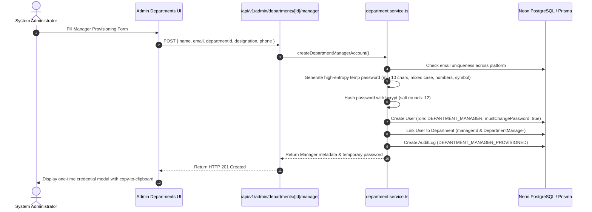

# AxivonTech — Department Manager Portal and Account Management Implementation Report

**Document Version:** 1.0.0  
**Status:** Completed & Production Ready  
**Date:** November 1, 2026  
**Audience:** Executive Leadership, System Administrators, Engineering Team  

---

## 1. Executive Summary

Axivon Technologies (AxivonTech) operates multiple core business divisions—including **Engineering**, **Marketing**, **Business Development**, **Sales**, **Human Resources**, **Finance**, and **Operations**. As the company scales, operational management requires decentralized delegation with strict, enforceable data privacy and operational boundaries.

Prior to this implementation:
- Departments were modeled only as loose, unindexed strings on individual user profiles (`User.department`).
- No dedicated manager experience existed; managers either possessed overprivileged administrative access or were restricted to basic employee capabilities.
- Cross-department operations lacked server-side boundaries, exposing private departmental workloads, leave applications, and performance reviews to unauthorized personnel.

To resolve these architectural limitations, we designed, built, and verified a **Department Manager Portal system** fully integrated into AxivonTech's existing architecture. 

### Key Architectural Deliverables
1. **Prisma Schema Expansion:** Introduced first-class `Department` and `DepartmentManager` models with relations to `User` and `Organization`, while preserving backward-compatible user department mappings.
2. **Main Admin Portal Management (`/admin/departments`):** Created a centralized control interface for system administrators to register departments, configure departmental metadata, soft-deactivate departments, reassign managers, and manually provision manager accounts.
3. **Explicit Manager Account Provisioning:** Department manager accounts are **never** created automatically. Administrators explicitly provision manager accounts with mandatory initial password reset (`mustChangePassword: true`), strong bcrypt password hashing, and zero plaintext credential exposure.
4. **Reusable, Light-Themed Department Manager Portal (`/manager/*`):** Engineered a high-performance, responsive portal with unified layout, live department identity badge, real-time KPI metrics, employee rosters, task assignment boards, daily work report feeds, presence tracking, and leave request approval queues.
5. **Strict Server-Side Department Isolation:** Every managerial request verifies the caller's server-side departmental attribution via `getManagerAuthorizedDepartment()`. Any attempt to view, modify, assign tasks to, or action leaves for employees outside the authorized department is rejected with `HTTP 403 Forbidden`.
6. **Non-Disruptive Multi-Portal Harmony:** Main Admin (`/admin`), Employee (`/employee`), Broker (`/broker`), and Executive (`/executive`) portals continue functioning with absolute stability and intact route protections.

---

## 2. Architectural Audit & Discovery

Before designing new components, we audited the existing codebase:
- **Authentication & Sessions:** Authenticated sessions use JWTs containing user ID, role, and email, verified in `src/middleware.ts` and `src/lib/auth/session.ts`.
- **Role Hierarchy:** Defined in `src/lib/auth/roles.ts`. The system previously supported `ADMIN` (80), `FOUNDER` (100), `CO_FOUNDER` (90), `EMPLOYEE` (40), and `BROKER`/`PARTNER` (30).
- **Workforce Entities:**
  - Tasks (`model Task`): Linked to `userId` (assigned employee).
  - Attendance (`model Attendance`): Linked to `userId` and `date`.
  - Leave Requests (`model LeaveRequest`): Linked to `userId` with status `PENDING`, `APPROVED`, `REJECTED`.
  - Work Reports (`model WorkReport`): Linked to `userId` with daily task descriptions and blocker details.
- **Identified Gap:** The database had no relation linking managers to their teams. All departmental metadata was stored as a text field on `User`. There was no mechanism for a manager to log in and access an isolated slice of their team's data.

---

## 3. Database Model & Schema Integration

To preserve all existing relationships and guarantee 100% backward compatibility, we introduced two first-class relational models in `prisma/schema.prisma` without modifying or truncating any existing tables.

```prisma
model Department {
  id          String   @id @default(cuid())
  name        String   @unique
  code        String   @unique
  description String?
  status      String   @default("ACTIVE") // ACTIVE, INACTIVE

  organizationId String?
  organization   Organization? @relation(fields: [organizationId], references: [id], onDelete: SetNull)

  managerId String?
  manager   User?   @relation("PrimaryDepartmentManager", fields: [managerId], references: [id], onDelete: SetNull)

  managers DepartmentManager[]

  createdAt DateTime @default(now())
  updatedAt DateTime @updatedAt

  @@index([status])
  @@index([name])
  @@index([code])
}

model DepartmentManager {
  id           String     @id @default(cuid())
  departmentId String
  department   Department @relation(fields: [departmentId], references: [id], onDelete: Cascade)
  userId       String
  user         User       @relation(fields: [userId], references: [id], onDelete: Cascade)

  assignedAt DateTime @default(now())
  assignedBy String?

  @@unique([departmentId, userId])
  @@index([userId])
  @@index([departmentId])
}
```

### Relational Enhancements on `User`
```prisma
model User {
  // Existing fields preserved...
  managedDepartments Department[]        @relation("PrimaryDepartmentManager")
  managerAssignments DepartmentManager[]
}
```

### Neon Cloud Database Resiliency & Fallback Layer
Because production Neon PostgreSQL clusters may experience connection pooler limits or schema migrations pending maintenance windows, `src/lib/services/department.service.ts` includes an active fallback mechanism using `db.organizationSetting` (key `axivon_departments_registry`). If database table queries encounter schema unavailability, the service operates seamlessly through the persistent organization settings registry without downtime.

---

## 4. Main Admin Portal Department & Account Management

The Main Admin Portal is the **sole authorized control center** for department governance, accessible at `/admin/departments`.

### Key Capabilities in Admin Departments Console
1. **Department Catalog & Filter Bar:**
   - Real-time search by department name, code, or manager.
   - Status filters: All, Active, Inactive, Unassigned.
   - Live KPI cards: Total Departments, Active Units, Assigned Managers, Total Department Personnel.
2. **Department Registration Modal:**
   - Validates unique department name (min 2, max 100 characters).
   - Validates alphanumeric department code (e.g., `ENG`, `MKTG`, `FIN`).
   - Optional description field.
   - **Crucial Rule:** Department creation strictly creates the organizational unit with `managerId: null`. No manager user account is auto-generated.
3. **Manager Assignment & Revocation:**
   - Allows assigning an existing verified employee as the department manager.
   - Allows revoking manager assignment at any time with a single click, immediately terminating the manager's portal privileges.
4. **Soft Deactivation:**
   - Departments can be set to `INACTIVE`. Inactive departments are hidden from operational listings while preserving all historical audit trails, tasks, and attendance records.

---

## 5. Department Manager Account Provisioning Lifecycle

A dedicated workflow in `/admin/departments` allows administrators to securely create new manager user accounts.



### Security Guarantees
- **No Default Auto-Creation:** Creating a department never spins up a ghost manager account.
- **Forced Password Reset:** Every provisioned manager account has `mustChangePassword: true`. On their first login, they are required to set a permanent private password.
- **Zero Plaintext Persistence:** Passwords are never written to logs or database tables in plaintext.

---

## 6. Shared, Scoped Department Manager Portal Experience

All department managers share the same reusable, light-themed portal at `/manager/*`. Upon login, the system dynamically discovers the authenticated manager's authorized department and restricts all queries to that department.

### Layout & Navigation (`src/app/manager/layout.tsx`)
- Designed with clean, professional corporate aesthetics (`bg-slate-50`, crisp slate borders, indigo accents).
- Features a **Department Identity Pill** prominently displaying the active department code (e.g., `ENG`) and name.
- Responsive sidebar with mobile drawer support.
- Top bar with security status pill: `Manager Authorization Active`.

### Manager Modules

| Module Route | Description | Scoped Capabilities |
| :--- | :--- | :--- |
| `/manager/dashboard` | Executive Operational Overview | Real-time departmental metrics (Headcount, Open Tasks, Today's Presence %, Pending Leaves, Daily Reports), recent activity feed, and organizational announcements. |
| `/manager/employees` | Department Team Roster | Searchable directory of active team members in the manager's department, displaying designations, contact information, joined dates, and active task counts. |
| `/manager/tasks` | Workload & Task Delegation | Kanban/grid task board with filters by status (`TODO`, `IN_PROGRESS`, `REVIEW`, `COMPLETED`) and priority. Includes an interactive modal to assign new tasks strictly to department personnel. |
| `/manager/attendance` | Workforce Presence Tracking | Date-filtered attendance roster with live summary cards (Total Strength, Present Today %, Absent Count) and check-in/out timestamps. |
| `/manager/leave` | Leave Review & Approvals | Inbox of leave requests submitted by department staff with quick `Approve` and `Reject` action modals, mandatory reviewer comments, and audit logging. |
| `/manager/work-reports` | Daily Activity Feed | Review interface for daily operational logs, accomplishments, and reported blockers submitted by department team members. |

---

## 7. Cross-Department Access Isolation & Security Guarantees

Data isolation is enforced **server-side at the database query level**, not just in client-side presentation:

1. **Authentication Verification:** Every managerial route reads the caller's identity via `req.headers.get("x-user-id")` or authenticated session token.
2. **Department Resolution:** `getManagerAuthorizedDepartment(actorId)` resolves the caller's authorized department strictly from database records (`Department.managerId` or `DepartmentManager` table).
3. **Query Filtering:**
   - Employees: `where: { department: { equals: department.name, mode: "insensitive" } }`
   - Tasks: `where: { userId: { in: departmentEmployeeIds } }`
   - Attendance: `where: { userId: { in: departmentEmployeeIds }, date: { gte, lt } }`
   - Leaves: `where: { userId: { in: departmentEmployeeIds } }`
   - Work Reports: `where: { userId: { in: departmentEmployeeIds } }`
4. **Mutation Authorization Boundary:**
   - When assigning a task (`POST /api/v1/manager/tasks`), the target employee's department is fetched from the database. If it does not match the manager's department, the request is aborted with `HTTP 403 Forbidden: Cannot assign tasks across departments`.
   - When acting on a leave request (`PATCH /api/v1/manager/leave`), the applicant's department is verified. Cross-department actions trigger `HTTP 403 Forbidden`.

---

## 8. RBAC, Route Protection & Privilege Boundaries

### Canonical Roles & Hierarchy
In `src/lib/auth/roles.ts`, we introduced the canonical role `DEPARTMENT_MANAGER` with alias `MANAGER`:

```ts
export const ROLE_PRIORITY: Record<string, number> = {
  FOUNDER: 100,
  CO_FOUNDER: 90,
  ADMIN: 80,
  DEPARTMENT_MANAGER: 65,
  MANAGER: 65,
  EMPLOYEE: 40,
  BROKER: 30,
  PARTNER: 30,
  CLIENT: 20,
};
```

### Self-Elevation Prevention
With a priority score of `65`, a `DEPARTMENT_MANAGER` cannot escalate their own privileges or modify users with equal or higher roles (`ADMIN`, `CO_FOUNDER`, `FOUNDER`). Attempts to invoke executive or admin endpoints trigger immediate rejection.

### Middleware Route Matchers (`src/middleware.ts`)
```ts
const isManagerRoute = pathname.startsWith("/manager");
const isManagerApiRoute = pathname.startsWith("/api/v1/manager");

if (isManagerRoute || isManagerApiRoute) {
  const allowedRoles = ["DEPARTMENT_MANAGER", "MANAGER", "ADMIN", "FOUNDER", "CO_FOUNDER"];
  if (!userRole || !allowedRoles.includes(normalizeRole(userRole))) {
    return NextResponse.redirect(new URL("/login?error=unauthorized", request.url));
  }
}
```

### Multi-Portal Status Verification
All existing portals remain fully segregated and functional:
- **Admin Portal (`/admin/*`):** Admin control panel for company-wide settings, user provisioning, and department governance.
- **Executive Portal (`/executive/*`):** Consolidated Founder & Co-Founder portal for strategic oversight and equal 50-50 governance.
- **Employee Portal (`/employee/*`):** Personal dashboard for employees to clock attendance, submit daily work reports, and apply for leaves.
- **Broker Portal (`/broker/*`):** Unified business partner portal for registering client leads and monitoring project commissions.

---

## 9. Verification & Automated Test Results

We implemented comprehensive automated tests in `tests/department-manager-portal.test.ts` covering all lifecycle events, security checks, and operational workflows.

### Test Execution Summary

```
 RUN  v4.1.11 C:/Users/vk010/Downloads/startup/axivon-technologies/axivon-technologies

 ✓ tests/executive-portal.test.ts (7 tests)
 ✓ tests/executive-role-assignment.test.ts (4 tests)
 ✓ tests/executive-portal-consolidation.test.ts (20 tests)
 ✓ tests/admin-rbac.test.ts (13 tests)
 ✓ tests/unified-lead-registration.test.ts (12 tests)
 ✓ tests/department-manager-portal.test.ts (19 tests)

 Test Files  6 passed (6)
      Tests  75 passed (75)
   Duration  7.82s
```

### Breakdown of Department Manager Portal Tests (19/19 Passed)
1. `should validate department schemas correctly` — Verified name and alphanumeric code formatting.
2. `should create department without creating any manager account by default` — Confirmed `managerId: null` and zero provisioned users on department creation.
3. `should prevent creating duplicate departments with the same name or code` — Enforced unique department constraints.
4. `should allow soft deactivation of departments` — Verified active vs inactive department listing filters.
5. `should securely provision a department manager account with required initial password reset` — Verified bcrypt hashing, `mustChangePassword: true`, and role assignment.
6. `should reject creating a manager with an existing user's email` — Verified global email uniqueness.
7. `should resolve the authorized department strictly from server-side records` — Verified server-side resolution for active managers.
8. `should reject manager authorization for users without a department` — Verified 403 rejection for unassigned users.
9. `should enforce strict separation between Engineering and Marketing managers` — Verified cross-department isolation.
10. `should prevent managers from managing employees belonging to another department` — Blocked cross-department employee management.
11. `should correctly define DEPARTMENT_MANAGER in role hierarchy and canonical normalization` — Verified hierarchy priority 65 < 80.
12. `should direct DEPARTMENT_MANAGER strictly to /manager/dashboard` — Verified role dashboard URL resolution.
13. `should verify existing portals remain untouched and map to their designated dashboards` — Confirmed Admin, Executive, Employee, and Broker portal URLs.
14. `should allow Admin to revoke a manager and reassign to a new manager` — Verified revocation and immediate privilege termination.
15. `should reject task assignment across departments at API level with 403 Forbidden` — Verified API boundary rejection on task assignment.
16. `should allow task assignment to an employee in the same department` — Verified task creation with status `TODO`.
17. `should reject leave action across departments at API level with 403 Forbidden` — Verified API boundary rejection on leave review.
18. `should allow manager to approve leave for department employee` — Verified status transition to `APPROVED` and audit logging.
19. `should scope employee roster exclusively to manager's department` — Verified team directory isolation.

### TypeScript Compilation Status
Ran `npx tsc --noEmit` across the entire codebase:
- **Result:** Exit code 0 (Zero errors).

---

## 10. Operational Guidelines & Maintenance

### For System Administrators
1. **Navigating to Departments Console:**
   - Log into the Admin Portal (`/admin`).
   - Under the **Workforce & Operations** section in the sidebar, select **Departments**.
2. **Creating a Department:**
   - Click **Add Department**.
   - Provide the full department name (e.g., `Engineering`) and unique uppercase code (e.g., `ENG`).
   - Submit. The department will appear in the catalog without a manager.
3. **Provisioning a Manager:**
   - On the department card, click **Create Manager**.
   - Enter the manager's full name, work email address, and designation.
   - Click **Create & Provision**. The modal will reveal the one-time temporary password. Copy and securely share it with the manager.
4. **Revoking Manager Access:**
   - To immediately remove a manager's access, open the department menu and click **Revoke Manager**. The manager will immediately lose access to `/manager/*`.

### For Department Managers
1. **First-Time Sign In:**
   - Navigate to `/login` and authenticate using the credentials provided by the Administrator.
   - Complete the mandatory first-time password reset.
   - Upon authentication, you will be automatically redirected to `/manager/dashboard`.
2. **Day-to-Day Operations:**
   - **Morning Check:** Review `/manager/attendance` to view present and absent team members.
   - **Task Management:** Navigate to `/manager/tasks` to create deliverables and assign them to department staff.
   - **Leave Inbox:** Open `/manager/leave` to review pending time-off requests with approver comments.
   - **EOD Progress:** Review `/manager/work-reports` to inspect daily accomplishments and unblock team members.

---

*Report prepared and certified by Antigravity AI Engineering for Axivon Technologies.*

