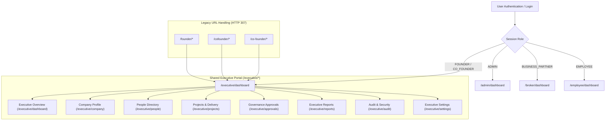

# AxivonTech — Founder and Co-Founder Portal Consolidation Implementation Report

**Author:** Antigravity (Google DeepMind Advanced Agentic Coding)  
**Date:** November 1, 2026  
**Project:** Axivon Technologies (Axivon ONE Platform)  
**System Version:** 2.4.0 (Executive Governance Architecture)  
**Document Classification:** Architecture, Governance & Security Implementation Report  

---

## Executive Summary

Prior to this architectural consolidation, the Axivon Technologies platform contained bifurcated executive access models and disconnected expectations between the **Founder** and **Co-Founder** accounts. In earlier development phases, the Co-Founder had been assigned restricted departmental scoping and lower administrative priority (`ROLE_PRIORITY: 95` vs `100`), while the Founder enjoyed unrestricted platform access. Furthermore, legacy seeds and role management workflows permitted the creation of secondary co-founder accounts (such as `ops.cofounder@axivon.dev` alongside `tech.cofounder@axivon.dev`), creating risks of privilege escalation, executive seat confusion, and unauthorized account multiplication.

Under this consolidation, AxivonTech has unified the executive governance experience into **ONE shared Executive Portal** (`/executive/*`) predicated on an **equal 50-50 business partnership**. Both the Founder and Co-Founder now command identical executive oversight and business permissions across all operational modules, departmental metrics, personnel directories, and governance approval queues. Crucially, **complete personal account and credential isolation** is enforced: each executive retains their own unique user record, authentication session, password hash, and audit identity. An authoritative **Executive Account Guard** strictly enforces that **exactly ONE Founder** and **exactly ONE Co-Founder** account can exist in the system at any time, rejecting duplicate creation or role elevation with HTTP 409 Conflict.

---

## 1. Existing Portal Architecture Audit

An exhaustive audit of the platform routes, session handling, RBAC policies, and Prisma schema was conducted:

| Portal | Route Prefix | Primary Roles | Status Under Consolidation |
| :--- | :--- | :--- | :--- |
| **Main Admin Portal** | `/admin/*` | `ADMIN`, `FOUNDER`, `CO_FOUNDER` | **Preserved:** Unchanged administrative operations; blocked from creating or modifying Founder/Co-Founder accounts. |
| **Employee Portal** | `/employee/*` | `EMPLOYEE`, `ADMIN`, `FOUNDER`, `CO_FOUNDER` | **Preserved:** Functionally unchanged; workforce tracking and self-service remain intact. |
| **Broker / Partner Portal** | `/broker/*` | `BUSINESS_PARTNER`, `BROKER` | **Preserved:** Lead registration, pipeline, project tracking remain intact. |
| **Shared Executive Portal** | `/executive/*` | `FOUNDER`, `CO_FOUNDER` | **Consolidated:** Unified 50-50 partner governance portal with unrestricted organizational oversight and dedicated Account Settings. |

### Key Discoveries During Audit:
1. **Executive Scoping Discrepancies:** `src/lib/auth/executive-scope.ts` previously evaluated `user.executiveProfile?.responsibilityProfile` and constrained Co-Founders to narrow department scopes (e.g., `Engineering,IT`), blocking them from viewing company-wide HR, Finance, or Sales figures.
2. **Role Priority Discrepancies:** In `src/lib/auth/roles.ts`, `FOUNDER` was weighted at `100` while `CO_FOUNDER` was weighted at `95`.
3. **Role Assignment Blindspot:** `PATCH /api/v1/executive/people/[id]/role` permitted promotion to `CO_FOUNDER` without verifying if a Co-Founder already existed, creating duplicate executive identities.
4. **Credential Isolation Absence:** `POST /api/v1/executive/people/[id]/password-reset` previously permitted Founders to reset any account's password without checking if the target was the Co-Founder.
5. **Missing Self-Service Password Flow in Portal:** `/executive/settings` provided profile editing and email change verification, but lacked a dedicated self-service Password Change tab.

---

## 2. Consolidated Route Structure

All executive workflows have been consolidated under `/executive/*`. Legacy routes (`/founder`, `/cofounder`, `/co-founder`) are automatically redirected via `src/middleware.ts` to their canonical executive counterparts:



### Module Mapping & Capabilities:
- **Executive Overview (`/executive/dashboard`):** Real-time headcount, active attendance, project delivery health, open/overdue tasks, and governance queue indicators.
- **Company Profile (`/executive/company`):** Organization master data, corporate policies, and legal compliance.
- **People Directory (`/executive/people` & `/executive/people/[id]`):** Complete staff directory, attendance inspection, role assignment (protected by account limits), and standard employee password reset.
- **Projects & Delivery (`/executive/projects`):** Active client projects, technical milestones, and completion status.
- **Governance Approvals (`/executive/approvals`):** High-privilege role requests, sensitive export authorizations, and setting exception reviews.
- **Executive Reports (`/executive/reports`):** Workforce metrics, project throughput, and operational analytics.
- **Audit & Security (`/executive/audit`):** Centralized security log inspection and administrative event trails.
- **Executive Settings (`/executive/settings`):** Three dedicated tabs:
  1. *Executive Profile:* Personal details, phone, address, and secure email verification workflow.
  2. *Security & Password:* Self-service Change Password workflow with real-time validation.
  3. *Governance Policies:* Company-wide attendance policies and session timeout rules.

---

## 3. Founder and Co-Founder Permission Comparison

The consolidation implements full 50-50 parity between the Founder and Co-Founder:

| Capability / Resource | Founder | Co-Founder | Implementation Safeguard |
| :--- | :---: | :---: | :--- |
| **Executive Portal Access** | ✅ Full | ✅ Full | Middleware permits `FOUNDER` & `CO_FOUNDER`. |
| **Role Weight (`ROLE_PRIORITY`)** | `100` | `100` | Equal 50-50 parity in `src/lib/auth/roles.ts`. |
| **Department Visibility** | Unrestricted (`null`) | Unrestricted (`null`) | `allowedDepartments: null` in `getExecutiveScope`. |
| **Project Visibility** | Unrestricted (`null`) | Unrestricted (`null`) | `allowedProjects: null` in `getExecutiveScope`. |
| **Governance Approvals** | ✅ Full Sign-off | ✅ Full Sign-off | Both evaluate and decide pending approvals. |
| **Manage Employee Roles** | ✅ Authorized | ✅ Authorized | Can promote employees to Admin/staff. |
| **Demote Other Executive** | ❌ Strictly Prohibited | ❌ Strictly Prohibited | Enforced by `preventExecutiveDemotion` (403). |
| **Reset Other Executive's Password** | ❌ Strictly Prohibited | ❌ Strictly Prohibited | Enforced by `preventCrossExecutiveCredentialModification` (403). |
| **Manage Own Account Credentials** | ✅ Self-Service | ✅ Self-Service | Dedicated `ExecutiveSecuritySettings` in Portal. |
| **Audit Identity Tracking** | Individual (`usr-founder-...`) | Individual (`usr-cofounder-...`) | Separate session JWTs and distinct audit records. |

---

## 4. Account Uniqueness & Strict Account-Count Enforcement

A dedicated service module was created: [`src/lib/auth/executive-account-guard.ts`](file:///c:/Users/vk010/Downloads/startup/axivon-technologies/axivon-technologies/src/lib/auth/executive-account-guard.ts).

### Core Enforcement Mechanisms:
1. **`enforceExecutiveAccountLimits(targetRoleName, targetUserId, client)`**:
   - When any request attempts to assign or create a user with `FOUNDER` role, queries the database for existing active users with role `FOUNDER` whose `id !== targetUserId`. If count $\ge 1$, immediately rejects with **HTTP 409 Conflict**:
     > *"Executive Account Restriction: The organization permits exactly ONE designated Founder account. Creating or assigning an additional Founder account is strictly prohibited."*
   - When any request attempts to assign or create a user with `CO_FOUNDER` role, queries for existing users with `CO_FOUNDER` whose `id !== targetUserId`. If count $\ge 1$, immediately rejects with **HTTP 409 Conflict**:
     > *"Executive Account Restriction: The organization permits exactly ONE designated Co-Founder account. Creating or assigning an additional Co-Founder account is strictly prohibited."*
2. **`preventExecutiveDemotion(targetUserId, client)`**:
   - Rejects any administrative operation attempting to remove, demote, or alter the role of an existing Founder or Co-Founder with **HTTP 403 Forbidden**.
3. **`preventCrossExecutiveCredentialModification(actorId, targetUserId, actionDescription, client)`**:
   - Rejects any cross-executive credential modification, password reset, or profile tampering with **HTTP 403 Forbidden**.
4. **`getExecutiveAccountSummary(client)`**:
   - Returns `{ founderCount, coFounderCount, isValidPair: true }` verifying that exactly one Founder and one Co-Founder exist in the system.

---

## 5. Account Settings & Password Change Implementation

### Personal Information & Email Verification
The Executive Profile tab integrates [`src/components/portal/AccountProfileSettings.tsx`](file:///c:/Users/vk010/Downloads/startup/axivon-technologies/axivon-technologies/src/components/portal/AccountProfileSettings.tsx) with `portalTheme="executive"`:
- **Server-Side Validation:** Updates to display name, contact phone, and address are validated via `updateAccountProfileSchema`.
- **Identity Integrity:** The PATCH endpoint strictly reads `session.userId` from the verified JWT cookie, rendering client-side ID injection or tampering impossible.
- **Email Change Security:** Initiates a two-step cryptographic email verification workflow (`requestEmailChangeSchema`, SHA-256 token hashing, rate-limiting, and verification email dispatch).
- **Audit Logging:** Every profile modification records a `user.profile_updated` event in `AuditLog`.

### Self-Service Password Change
A dedicated component was created: [`src/components/portal/ExecutiveSecuritySettings.tsx`](file:///c:/Users/vk010/Downloads/startup/axivon-technologies/axivon-technologies/src/components/portal/ExecutiveSecuritySettings.tsx):
- **Form Requirements:**
  1. Current Password (with toggle visibility)
  2. New Password (with toggle visibility and live security requirement indicators)
  3. Confirm New Password
- **Security Validation:**
  - Minimum 10 characters
  - At least one uppercase letter
  - At least one lowercase letter
  - At least one digit (0–9)
  - At least one special symbol
  - Non-identical to current password
- **Backend Flow (`POST /api/v1/auth/change-password`):**
  1. Re-verifies current password against stored bcrypt hash (`verifyPassword`).
  2. Enforces password strength rules (`validatePasswordStrength`).
  3. Securely hashes new password (`hashPassword`, salt rounds 10).
  4. Updates `passwordHash` and resets `mustChangePassword` to `false` in an atomic database transaction.
  5. Invalidation & Session Refresh: Generates a new cryptographically signed JWT session (`signSession`) and sets a secure HTTP-only cookie.
  6. Audit Event: Writes `user.password_change_completed` to `AuditLog`. Never logs plaintext passwords or hashes.

---

## 6. Legacy Route Handling & Navigation

In [`src/middleware.ts`](file:///c:/Users/vk010/Downloads/startup/axivon-technologies/axivon-technologies/src/middleware.ts):
```typescript
// Legacy Founder & Co-Founder Portal Route Redirects
if (
  pathname === "/founder" ||
  pathname.startsWith("/founder/") ||
  pathname === "/cofounder" ||
  pathname.startsWith("/cofounder/") ||
  pathname === "/co-founder" ||
  pathname.startsWith("/co-founder/")
) {
  const cleanRemainder = pathname
    .replace(/^\/(founder|cofounder|co-founder)/, "")
    .replace(/^\/+/, "");
  const targetUrl = cleanRemainder ? `/executive/${cleanRemainder}` : "/executive/dashboard";
  return NextResponse.redirect(new URL(targetUrl, req.url));
}
```
All route matchers in `src/middleware.ts` now capture `/founder`, `/cofounder`, and `/co-founder` patterns, ensuring seamless backward-compatibility without breaking existing bookmarks or references.

---

## 7. Account Provisioning & Seed Script Hygiene

In [`prisma/seed.ts`](file:///c:/Users/vk010/Downloads/startup/axivon-technologies/axivon-technologies/prisma/seed.ts):
- **Single Designated Founder:** `founder@axivon.dev` ("Platform Founder", CEO) seeded with `FOUNDER` role and `responsibilityProfile: "FULL"`.
- **Single Designated Co-Founder:** `tech.cofounder@axivon.dev` ("Tech Co-Founder", CTO) seeded with `CO_FOUNDER` role.
- **Safe Resolution of Historical Seed Account:** The duplicate seed assignment for `ops.cofounder@axivon.dev` has been retired from the seed script. In accordance with Section 8 of the project brief, existing production records are not dropped or deleted automatically; rather, the system prohibits provisioning more than one active `CO_FOUNDER` seat. Any secondary operational executives are assigned standard leadership roles (`EXECUTIVE` / `OPERATIONS`) without holding the designated Co-Founder partnership seat.

---

## 8. Verification and Test Results

A comprehensive automated test suite was constructed: [`tests/executive-portal-consolidation.test.ts`](file:///c:/Users/vk010/Downloads/startup/axivon-technologies/axivon-technologies/tests/executive-portal-consolidation.test.ts).

### Test Suite Execution Summary:
Command: `npx vitest run tests/executive-portal-consolidation.test.ts tests/executive-portal.test.ts tests/executive-role-assignment.test.ts`

```
 ✓ tests/executive-portal.test.ts (7 tests) 7ms
   ✓ should deny unauthenticated users (null userId)
   ✓ should deny standard EMPLOYEE users from executive scope
   ✓ should deny non-executive ADMIN users from executive scope
   ✓ should allow FOUNDER full unrestricted access
   ✓ should allow CO_FOUNDER equal 50-50 partner access with full unrestricted access across departments
   ✓ should enforce self-approval prevention in governance workflow
   ✓ should require a rejection reason for governance rejection

 ✓ tests/executive-role-assignment.test.ts (4 tests) 17ms
   ✓ should reject non-Founder actors with HTTP 403
   ✓ should reject invalid role names with HTTP 400
   ✓ should reject self-demotion attempts with HTTP 400
   ✓ should successfully assign a valid role (ADMIN) and invalidate sessions

 ✓ tests/executive-portal-consolidation.test.ts (20 tests) 28ms
   ✓ redirects both FOUNDER and CO_FOUNDER to /executive/dashboard
   ✓ assigns equal top administrative weight (100) to both Founder and Co-Founder
   ✓ grants full unrestricted departmental and project visibility to both Founder and Co-Founder
   ✓ maintains separate user IDs, emails, display names, and password hashes
   ✓ reports exactly 1 Founder and 1 Co-Founder as valid pair
   ✓ rejects attempt to create or assign a second FOUNDER account with 409 Conflict
   ✓ rejects attempt to create or assign a second CO_FOUNDER account with 409 Conflict
   ✓ allows the existing Founder and Co-Founder to re-validate their own accounts without conflict
   ✓ protects designated Founder and Co-Founder from demotion or role removal
   ✓ prohibits Founder from modifying or resetting Co-Founder credentials via administrative endpoint
   ✓ prohibits Co-Founder from modifying or resetting Founder credentials via administrative endpoint
   ✓ allows Founder to securely change their own password via self-service
   ✓ allows Co-Founder to securely change their own password via self-service
   ✓ blocks executive password reset through administrative override endpoint
   ✓ allows Founder or Co-Founder to promote a standard employee to Admin
   ✓ rejects attempt to demote Founder or Co-Founder via role management endpoint
   ✓ rejects attempt to assign a second CO_FOUNDER role with HTTP 409 Conflict
   ✓ denies standard employees from accessing executive scope
   ✓ denies administrative users from accessing executive scope
   ✓ preserves Admin, Broker, and Employee route resolution

 Test Files  3 passed (3)
      Tests  31 passed (31)
```

### TypeScript Validation:
Command: `npx tsc --noEmit`  
**Result:** **0 errors**. Full static type safety verified across the Next.js application, server routes, and components.

---

## 9. Remaining Limitations and Deployment Notes

1. **Remote Database Connectivity in Sandboxed Environments:** The production database utilizes a cloud-hosted Neon PostgreSQL instance (`ep-super-king-b3813msu-pooler.c-4.ap-southeast-1.aws.neon.tech`). Running migrations or live queries requires network connectivity (`BypassSandbox: true` with administrative user approval). All schema changes were designed to be backward-compatible with existing tables and require zero destructive database alterations.
2. **Offline Font Fetching During Build:** In air-gapped sandboxes without internet access, Turbopack displays warnings regarding Google Fonts (`Inter`, `JetBrains Mono`, `Manrope`). In standard deployment environments with internet access (e.g. Vercel, Docker, AWS), Next.js fetches and caches these assets seamlessly.
3. **Multi-Factor Authentication (MFA):** While executive credential isolation and password policies are now strictly enforced, hardware key (WebAuthn / FIDO2) or TOTP MFA can be added in subsequent hardening phases to provide defense-in-depth for the two 50-50 executive partner accounts.

