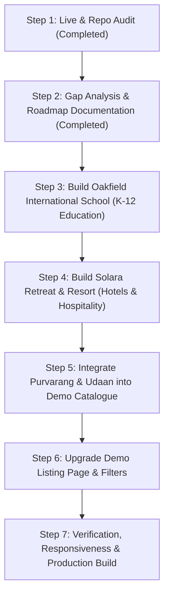

# Axivon Technologies — Industry-Wise Demo Development Roadmap

**Document Code:** `docs/INDUSTRY_WISE_DEMO_DEVELOPMENT_ROADMAP.md`  
**Execution Date:** November 5, 2026  
**Status:** **APPROVED FOR EXECUTION**  
**Engineering Objective:** Expand AxivonTech's interactive website demo ecosystem with dedicated, industry-specific website experiences.

---

## 1. Development Sequence & Prioritization

---

## 2. Detailed Demo Specifications

### 2.1 Demo A: Oakfield International School (Education / K-12 School)

- **Target Persona:** School owners, chairpersons, principals, trustees, parent committees.
- **Brand Identity:** Oakfield International School
- **Motto:** *Inspiring Excellence · Nurturing Character · Shaping Tomorrow*
- **Aesthetic Direction:**
  - Deep Forest Green: `#143d30`
  - Hunter Accent: `#1e5645`
  - Warm Ivory Canvas: `#faf8f4`
  - Parchment Base: `#f3efe6`
  - Muted Royal Gold: `#c8a24d`
  - Clean, legible typography with warm serif headings and modern sans body.
- **Route:** `/demo-projects/education/oakfield`
- **Required Architecture & Views:**
  1. **Demo Preview Header:** Dedicated AxivonTech demo identification banner with "Request Similar School Website" CTA.
  2. **School Navigation:** Logo, School Motto, Navigation links (About, Academics, Admissions, Faculty, Campus, Gallery, Notices, Contact), "Apply Now" button, and Mobile drawer menu.
  3. **Hero Section:** High-impact school banner, accreditation badge (CBSE Affiliation #1930284), key metrics (15 Acres Green Campus, 100% Board Pass Rate, 1:18 Teacher-Student Ratio, 35+ Co-curricular Clubs).
  4. **About School & Leadership:** Heritage, Mission, Vision, and **Principal's Message** from Dr. Gayatri Sundaram (Ph.D., M.Ed., 24 years in academic leadership).
  5. **Academics & Curricular Divisions:** Interactive tabs for:
     - *Early Years / Kindergarten* (Montessori & play-way exploration)
     - *Primary School (Grades 1–5)* (Foundational literacy, numeracy, experiential science)
     - *Middle School (Grades 6–8)* (Subject specialization, STEM, foreign languages)
     - *Senior School (Grades 9–12)* (CBSE Science, Commerce, and Humanities streams)
  6. **Admissions Center:** Step-by-step admission roadmap, age eligibility matrix, fee transparency note, and an **interactive Admission Enquiry Form** with real-time field validation, error handling, and safe demonstration submission confirmation.
  7. **Faculty & Department Heads:** Profile cards for key educators with qualifications, subjects, and teaching experience.
  8. **Campus Life & Infrastructure:** Smart Interactive Classrooms, Advanced Robotics & AI Laboratory, Modern Library & Resource Center, Olympic-size Sports Complex, and Performing Arts Auditorium.
  9. **Notice Board & Academic Calendar:** Real-time school circulars, upcoming term dates, sports meets, and parent-teacher conference notices.
  10. **Campus Gallery:** Filterable visual showcase (Classrooms, Sports, Science Labs, Annual Day, Campus Grounds).
  11. **Contact & Campus Visit Booking:** Interactive visit scheduling, campus address, emergency helpline, transport route map.
  12. **School Footer:** Board affiliation credentials, mandatory public disclosures link, school timings, social channels, and AxivonTech creator credits.

---

### 2.2 Demo E: Solara Retreat & Resort (Hotels & Hospitality)

- **Target Persona:** Boutique resort owners, luxury hotel managers, eco-lodge directors, hospitality groups.
- **Brand Identity:** Solara Retreat & Resort
- **Motto:** *Where Nature Embraces Serenity*
- **Aesthetic Direction:**
  - Sand Beige: `#f6f2ec`
  - Warm Cream / Background: `#ede7dc`
  - Deep Forest / Olive Green: `#1f2e23`
  - Muted Terracotta / Bronze: `#b57a42`
  - Rich Espresso: `#1b1916`
  - Refined editorial typography with spacious luxury layouts.
- **Route:** `/demo-projects/hospitality/solara`
- **Required Architecture & Views:**
  1. **Demo Preview Header:** Dedicated AxivonTech demo identifier with "Request Similar Hotel Website" CTA.
  2. **Resort Navigation:** Logo, Navigation links (Stay, Dining, Wellness, Experiences, Gallery, Location, Contact), "Book Your Stay" button, and Mobile navigation.
  3. **Hero Section:** Atmospheric nature retreat backdrop, tagline, quick check-in / check-out booking widget with dates, guests, and room category.
  4. **Accommodations / Stay Showcase:** Interactive accommodation cards with room specifications:
     - *The Forest Villa with Private Plunge Pool* (1,450 sq.ft, King Bed, Rain Shower)
     - *The Canopy Suite with Panoramic Mountain Deck* (950 sq.ft, Valley View, Sunset Lounge)
     - *The Heritage Courtyard Cottage* (750 sq.ft, Teak Furnishings, Private Garden)
     - *Riverside Glamping Pavilion* (600 sq.ft, Luxury Canvas, Riverfront Deck)
     - Detailed modal with amenities, floor plans, and pricing preview.
  5. **Dining & Culinary:**
     - *The Harvest Table* (Farm-to-table organic dining sourced from on-site gardens)
     - *Twilight Lounge* (Botanical infusions and artisanal teas)
     - *In-Villa Private Dining* (Starlit barbecue and romantic candlelit setups)
  6. **Ayurvedic Wellness & Spa:** Rejuvenation therapies, steam pavilion, sunrise yoga deck, and natural spring plunge pool.
  7. **Curated Experiences:** Guided biodiversity walks, night stargazing observatory, pottery & terracotta studio, and artisanal tea tastings.
  8. **Visual Photo Gallery:** Architecture, Interiors, Culinary, Nature, and Wellness photo grid.
  9. **Interactive Reservation Enquiry Form:** Check-in / Check-out date selection, room tier selection, guest count, dietary preferences, with clear demonstration confirmation banner (safe from production DB).
  10. **Location & Escapes:** Travel directions, nearest airport/rail connectivity, helicopter charter service, private transfer arrangements.
  11. **Resort Footer:** Concierge contact, eco-certification badges, policies, and AxivonTech design attribution.

---

### 2.3 Client Live Websites Integration into Demo Catalogue

1. **Purvarang Family Restaurant:**
   - Add to `DEMO_PROJECTS` under `Restaurants & Food` as `Live Demo`.
   - External URL: `https://purvarang-family-restaurant.onrender.com/`
   - Image: `public/assets/images/portfolio/purvarang-family-restaurant.jpg`
   - Features: Multi-Cuisine Digital Menu, Dining Ambiance, One-Tap Calling, Directions.
2. **Udaan Furniture:**
   - Add to `DEMO_PROJECTS` under `Furniture & Interiors` (or `Retail`) as `Live Demo`.
   - External URL: `https://udaan-furniture.onrender.com/`
   - Image: `public/assets/images/portfolio/udaan-furniture.jpg`
   - Features: Living & Bedroom Showroom, Dining & Workspace Collections, Location Guide.

---

### 2.4 Demo Catalogue Enhancements (`/demo-projects`)

- Update Hero Title: **"Explore Website Demos for Your Business"**
- Update Hero Body: **"Discover professionally designed website experiences across different industries. Explore complete demos and find the right digital direction for your business."**
- Add Category filter for **"Hotels & Travel"** and **"Furniture & Interiors"** (which now have live demos).
- Ensure external demo cards open in a new tab safely (`target="_blank" rel="noopener noreferrer"`).
- Maintain 100% working navigation, zero broken links, zero TypeScript/build errors.
