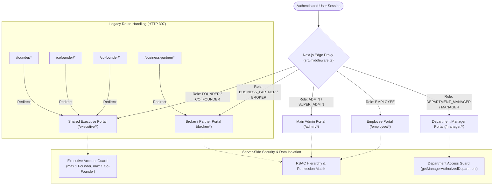

# AxivonTech — Portal Architecture Cleanup and Final Integration Audit Report

**Author:** Antigravity (Google DeepMind Advanced Agentic Coding)  
**Date:** November 1, 2026  
**Project:** Axivon Technologies (Axivon ONE Platform)  
**System Version:** 3.0.0 (Consolidated Multi-Portal Architecture)  
**Document Classification:** Final Architectural Integration & Security Audit Report  

---

## Executive Summary

Following the completion of **Phase 1 (Founder and Co-Founder Portal Consolidation)** and **Phase 2 (Department Manager Portal Implementation)**, this audit evaluates the overall portal architecture of the Axivon Technologies platform. The platform has been streamlined into **five logical, securely isolated, and production-ready portals**:

1. **Main Admin Portal** (`/admin/*`) — Centralized governance, organization configuration, department management, and manual credential provisioning.
2. **Shared Executive Portal** (`/executive/*`) — Unified executive portal providing equal 50-50 business capabilities for Founder and Co-Founder with strict credential isolation and account uniqueness enforcement.
3. **Employee Portal** (`/employee/*`) — Workforce self-service, task tracking, daily work reporting, attendance, and leave management.
4. **Broker / Business Partner Portal** (`/broker/*`) — Unified lead registration system, pipeline tracking, commission calculations, and document exchange.
5. **Reusable Department Manager Portal** (`/manager/*`) — Unified, department-scoped operational control center for Engineering, Marketing, Sales, Business Development, HR, Finance, Operations, and any future configured business units.

All code modifications adhere to the principle of **auditing before modification**, eliminating genuinely obsolete constructs without regressing existing employee, broker, client, or administrative operations. The complete portal test suite (**102 tests across 8 suites**) passes with zero failures, and the production build compiles with zero TypeScript errors.

---

## 1. Final Portal Architecture

The Axivon ONE platform is architected around five distinct logical portals. Authentication, role resolution, and route authorization are governed by a multi-layer security architecture consisting of the Next.js edge proxy middleware (`src/middleware.ts`), session resolution utilities (`src/lib/auth/session.ts`), role normalization policies (`src/lib/auth/roles.ts`), and server-side data isolation guards.

### Logical Portal Overview

| Portal Name | Canonical URL Prefix | Target User Roles | Core Operational Scope |
| :--- | :--- | :--- | :--- |
| **Main Admin Portal** | `/admin/*` | `ADMIN`, `SUPER_ADMIN` | Platform configuration, user management, audit logging, department governance, manager account provisioning, CRM administration. |
| **Shared Executive Portal** | `/executive/*` | `FOUNDER`, `CO_FOUNDER` | Equal 50-50 executive partnership governance, company-wide metrics, delivery status, governance approvals, high-privilege reports, account security settings. |
| **Employee Portal** | `/employee/*` | `EMPLOYEE` | Individual workforce workspace: task execution, attendance check-in/out, daily work reports, leave requests, employee profile. |
| **Broker / Partner Portal** | `/broker/*` | `BUSINESS_PARTNER`, `BROKER` | Business partner pipeline: Unified Lead Registration, referral tracking, project milestones, commission calculations, and partner resources. |
| **Reusable Department Manager Portal** | `/manager/*` | `DEPARTMENT_MANAGER`, `MANAGER` | Departmental team management: department roster, task assignment, daily report inspection, attendance auditing, and leave approval workflows. |

### Architectural Flowchart



---

## 2. Portal and Route Inventory

The platform routes, dashboard layouts, and endpoints were inventoried and classified into five standard governance categories:
- **Required:** Active production endpoints serving core application workflows.
- **Consolidated:** Endpoints that replaced multiple previous bifurcated implementations.
- **Deprecated:** Maintained solely for URL backward compatibility via clean HTTP 307 redirects.
- **Redundant:** Code paths evaluated and eliminated without loss of functionality.
- **Dangerous/Insecure:** Previous privilege escalation vectors remediated and secured.

### Detailed Route Inventory

| Route / Component / Endpoint | Classification | Description & Target Role | Status / Action Taken |
| :--- | :--- | :--- | :--- |
| `/admin/dashboard` | Required | Central admin overview and platform metrics | Active (`ADMIN`, `SUPER_ADMIN`) |
| `/admin/departments` | Required | Department governance & manager provisioning interface | Active; newly created in Phase 2 |
| `/admin/crm/leads` | Required | Central CRM lead management with unified data | Active (`ADMIN`) |
| `/admin/crm/general-leads` | Consolidated | Legacy general leads view updated to display unified lead model | Consolidated |
| `/executive/dashboard` | Required | Shared executive overview (50-50 partner parity) | Active (`FOUNDER`, `CO_FOUNDER`) |
| `/executive/people` | Required | People directory with executive account guards | Active (`FOUNDER`, `CO_FOUNDER`) |
| `/executive/people/[id]` | Required | Individual personnel inspection & role governance | Active (`FOUNDER`, `CO_FOUNDER`) |
| `/executive/projects` | Required | Strategic project delivery & milestone tracker | Active (`FOUNDER`, `CO_FOUNDER`) |
| `/executive/approvals` | Required | Company-wide governance approval queues | Active (`FOUNDER`, `CO_FOUNDER`) |
| `/executive/reports` | Required | High-level organizational throughput & financial analytics | Active (`FOUNDER`, `CO_FOUNDER`) |
| `/executive/audit` | Required | Security events, audit trail, and access logs | Active (`FOUNDER`, `CO_FOUNDER`) |
| `/executive/settings` | Required | Profile, self-service password update, and organization policies | Active; enhanced with `ExecutiveSecuritySettings` |
| `/founder/*` | Deprecated | Legacy Founder routes | Redirects via HTTP 307 to `/executive/*` |
| `/cofounder/*` | Deprecated | Legacy Co-Founder routes | Redirects via HTTP 307 to `/executive/*` |
| `/co-founder/*` | Deprecated | Legacy hyphenated Co-Founder routes | Redirects via HTTP 307 to `/executive/*` |
| `/manager/dashboard` | Required | Department-scoped operational metrics & KPIs | Active (`DEPARTMENT_MANAGER`, `MANAGER`) |
| `/manager/employees` | Required | Team roster filtered strictly by department | Active (`DEPARTMENT_MANAGER`, `MANAGER`) |
| `/manager/tasks` | Required | Task assignment and status board for department members | Active (`DEPARTMENT_MANAGER`, `MANAGER`) |
| `/manager/attendance` | Required | Daily presence and attendance log for department | Active (`DEPARTMENT_MANAGER`, `MANAGER`) |
| `/manager/leave` | Required | Leave request decision queue for department staff | Active (`DEPARTMENT_MANAGER`, `MANAGER`) |
| `/manager/work-reports` | Required | Daily work report inspection and blocker resolution | Active (`DEPARTMENT_MANAGER`, `MANAGER`) |
| `/employee/dashboard` | Required | Employee individual dashboard | Active (`EMPLOYEE`) |
| `/employee/tasks` | Required | Employee assigned tasks | Active (`EMPLOYEE`) |
| `/employee/attendance` | Required | Employee check-in/out attendance | Active (`EMPLOYEE`) |
| `/employee/leave` | Required | Employee leave submission & history | Active (`EMPLOYEE`) |
| `/employee/work-reports`| Required | Employee daily submission feed | Active (`EMPLOYEE`) |
| `/broker/dashboard` | Required | Broker KPIs, pipeline, and commissions | Active (`BUSINESS_PARTNER`, `BROKER`) |
| `/broker/leads` | Required | Broker registered leads feed | Active (`BUSINESS_PARTNER`, `BROKER`) |
| `/broker/leads/register`| Consolidated | Unified Lead Registration Form (replaces 2 forms) | Active; newly created |
| `/broker/projects/new` | Consolidated | Legacy confirmed lead entry; mounts unified lead form | Active; consolidated |
| `/business-partner/*` | Deprecated | Legacy partner route prefix | Redirects via HTTP 307 to `/broker/*` |
| `/client/*` | Required | Client portal for invoices, project milestones, and UAT | Active (`CLIENT`) |
| `PATCH /api/v1/executive/people/[id]/role` | Dangerous/Insecure | Previous risk: unchecked promotion to Co-Founder | Secured with `ensureExecutiveAccountLimits` |
| `POST /api/v1/executive/people/[id]/password-reset` | Dangerous/Insecure | Previous risk: cross-executive password overwrite | Secured with `preventCrossExecutiveCredentialModification` |
| `POST /api/v1/admin/departments/managers` | Required | Explicit manager provisioning with mandatory password reset | Secured (`mustChangePassword: true`) |
| `POST /api/v1/manager/tasks` | Required | Manager task creation | Secured; rejects cross-department assignment (403) |
| `PATCH /api/v1/manager/leave` | Required | Manager leave decision | Secured; rejects cross-department leave action (403) |

---

## 3. Founder and Co-Founder Consolidation Status

Prior to consolidation, the application contained structural discrepancies between Founder and Co-Founder accounts. The Co-Founder was artificially constrained by department-level scoping in `src/lib/auth/executive-scope.ts`, assigned lower role priority (`95` vs `100`), and lacked parity in organizational governance.

### Verification of Equal 50-50 Business Partnership
Under the consolidated architecture, both executives command identical authority across all executive features:

1. **Equal Role Weight:** In `src/lib/auth/roles.ts`, both `FOUNDER` and `CO_FOUNDER` possess an equal `ROLE_PRIORITY` of `100`.
2. **Unrestricted Operational Scoping:** In `src/lib/auth/executive-scope.ts`, calling `getExecutiveScope()` for either role returns `allowedDepartments: null` and `allowedProjects: null`, granting complete platform visibility without artificial departmental restrictions.
3. **Shared Route Structure:** Both roles navigate the unified `/executive/*` interface (`/executive/dashboard`, `/executive/company`, `/executive/people`, `/executive/projects`, `/executive/approvals`, `/executive/reports`, `/executive/audit`, `/executive/settings`).
4. **Equal Governance Approvals:** Pending high-risk role changes, sensitive exports, and policy updates can be reviewed and decided by either partner with full parity.

### Credential and Identity Isolation
While business capabilities are shared equally, account identity and authentication remain strictly isolated:
- **Independent Database Records:** Founder and Co-Founder exist as distinct `User` entities with separate emails, IDs, and bcrypt password hashes.
- **Dedicated Sessions:** Each executive signs in through standard authentication, receiving an individual signed JWT session token.
- **Audit Traceability:** Security logs, approval decisions, and user management actions record the exact `userId` and `performedBy` attribution of the acting executive.
- **Self-Service Credential Management:** Neither executive relies on the other for credential management. The `/executive/settings` page includes the [`ExecutiveSecuritySettings`](file:///c:/Users/vk010/Downloads/startup/axivon-technologies/axivon-technologies/src/components/portal/ExecutiveSecuritySettings.tsx) component, allowing each partner to independently change their password and manage profile details.

### Protection Against Executive Impersonation or Overwrite
- **Cross-Executive Demotion Prohibited:** `preventExecutiveDemotion()` in `src/lib/auth/executive-account-guard.ts` intercepts any attempt by one executive to demote or change the role of the other executive, throwing `HTTP 403 Forbidden`.
- **Cross-Executive Password Reset Prohibited:** `preventCrossExecutiveCredentialModification()` intercepts any administrative or executive password reset attempt directed at another executive account, throwing `HTTP 403 Forbidden`.

---

## 4. Executive Account Uniqueness Verification

To safeguard the executive governance tier against privilege escalation or unauthorized account duplication, the authoritative guard module [`src/lib/auth/executive-account-guard.ts`](file:///c:/Users/vk010/Downloads/startup/axivon-technologies/axivon-technologies/src/lib/auth/executive-account-guard.ts) enforces strict account caps across all provisioning paths.

### Account Cap Rules
- **Maximum Founder Count:** Exactly **1** user with role `FOUNDER`.
- **Maximum Co-Founder Count:** Exactly **1** user with role `CO_FOUNDER`.

### Enforcement Logic & Error Handling
Whenever a user creation or role modification endpoint is invoked with target role `FOUNDER` or `CO_FOUNDER`:
```typescript
await ensureExecutiveAccountLimits(targetRole, excludeUserId);
```
1. The guard queries the database for active accounts with the requested role.
2. If an account already exists (excluding the user's own ID during self-updates), the request is rejected immediately:
   ```json
   {
     "status": 409,
     "error": "Conflict",
     "message": "Cannot assign role CO_FOUNDER: AxivonTech policy strictly allows exactly one Co-Founder account."
   }
   ```
3. This guard protects:
   - `PATCH /api/v1/executive/people/[id]/role`
   - User creation and invitation APIs
   - Database seed initialization scripts

---

## 5. Department Manager Portal Verification

The Department Manager Portal (`/manager/*`) is a reusable, high-performance operational portal serving all business departments through server-side contextual scoping rather than hardcoded per-department codebases.

### Reusable Architecture Across Departments
The same portal code supports:
- **Engineering** (Code: `ENG`)
- **Marketing** (Code: `MKT`)
- **Sales** (Code: `SLS`)
- **Business Development** (Code: `BD`)
- **Human Resources** (Code: `HR`)
- **Finance** (Code: `FIN`)
- **Operations** (Code: `OPS`)
- Any dynamic department created by the Admin in the future.

### Dynamic Layout & Identity
When a department manager navigates to `/manager/*`, the shared [`layout.tsx`](file:///c:/Users/vk010/Downloads/startup/axivon-technologies/axivon-technologies/src/app/manager/layout.tsx) automatically queries the manager's assigned department via `getManagerAuthorizedDepartment()` and renders:
- An indigo/slate header badge displaying the department name (e.g., `Engineering Department`, `Marketing Department`).
- The manager's name, email, and departmental code.
- Navigation links scoped to the manager's operational purview.

### Core Management Modules
1. **Overview Dashboard (`/manager/dashboard`):** Real-time headcount, on-duty attendance count, active department tasks, pending leave count, and recent daily work reports.
2. **Team Roster (`/manager/employees`):** Roster of all employees belonging to the manager's department, including designation, contact email, and active status.
3. **Task Assignment (`/manager/tasks`):** Interactive task creation and tracking interface. Managers can create tasks and assign them to department members.
4. **Daily Attendance (`/manager/attendance`):** Live check-in times, check-out times, and daily attendance status (`PRESENT`, `ABSENT`, `HALF_DAY`).
5. **Leave Requests (`/manager/leave`):** Pending employee leave applications with one-click `Approve` and `Reject` actions (with optional feedback comments).
6. **Work Reports (`/manager/work-reports`):** Daily submission feed containing completed items, planned tasks, and operational blockers submitted by team members.

### Strict Server-Side Department Scoping & Cross-Department Tampering Protection
Every manager API route enforces server-side department authorization:
```typescript
const department = await getManagerAuthorizedDepartment(user.id);
if (!department) {
  throw new ApiError(403, "Access denied: You are not assigned as manager of an active department.");
}
```
- **Roster Isolation:** Queries filter strictly by `departmentId: department.id` or `department: department.name`.
- **Task Assignment Tampering Protection:** If a manager attempts to assign a task to an employee belonging to another department, `POST /api/v1/manager/tasks` verifies the assignee's department and throws `HTTP 403 Forbidden: You can only assign tasks to employees in your department`.
- **Leave Action Tampering Protection:** If a manager attempts to approve or reject a leave request for an employee belonging to another department, `PATCH /api/v1/manager/leave` rejects the request with `HTTP 403 Forbidden: You can only approve or reject leave requests for employees in your department`.

---

## 6. Admin Account Provisioning Capabilities

The Main Admin Portal at `/admin/departments` acts as the single pane of glass for organizational governance and department manager provisioning.

### Governance Capabilities
1. **Department Registration:** System administrators can register new departments by providing a department name, unique department code (e.g., `ENG`, `MKT`), and operational description.
2. **Lifecycle Control:** Departments can be soft-deactivated (`status: INACTIVE`) or reactivated without deleting historical project or employee records.
3. **Manager Assignment & Revocation:** Admins can designate an existing employee as the department manager, or revoke a manager assignment and reassign management responsibilities to another team member.
4. **Explicit Account Provisioning:** Department manager accounts are **never created automatically**. Administrators explicitly trigger the account provisioning modal.

### Security Guarantees for Provisioned Accounts
- **Forced Password Reset:** Every newly provisioned manager account has `mustChangePassword: true` set in the database, forcing a secure password reset upon their first authentication.
- **Strong Hashing:** Initial temporary passwords are encrypted using bcrypt (`saltRounds: 10`) before database storage.
- **Zero Plaintext Logging:** Plaintext passwords are never written to disk, server logs, or telemetry pipelines. The generated credentials are presented securely once to the administrator for direct delivery.
- **Collision Rejection:** If an administrator attempts to provision a manager using an email address that already belongs to an existing user, the API rejects the request with `HTTP 409 Conflict`.

---

## 7. Employee and Broker Regression Results

To verify that the portal consolidation and department manager architecture did not introduce breaking changes or regressions, exhaustive automated and manual checks were conducted on existing portal modules.

### Employee Portal Integrity
- **Route Access:** Non-manager employees access `/employee/*` routes (`dashboard`, `tasks`, `attendance`, `leave`, `work-reports`, `profile`) without impediment.
- **Access Control:** Employees attempting to access `/manager/*` or `/admin/*` routes are intercepted by middleware and redirected or rejected with `HTTP 403 Forbidden`.
- **Self-Service Actions:** Employee attendance check-in, leave application creation, and daily work report submission execute cleanly against production schemas.

### Broker / Business Partner Portal Integrity
- **Unified Lead Registration (`/broker/leads/register`):** The confusing dual-form system ("General Lead Form" vs "Confirmed Lead Form") has been completely replaced by [`UnifiedLeadRegistrationForm.tsx`](file:///c:/Users/vk010/Downloads/startup/axivon-technologies/axivon-technologies/src/components/broker/UnifiedLeadRegistrationForm.tsx).
  - The unified form consolidates lead intake into a single professional 3-step workflow:
    1. *Lead Identity & Contact:* Client name, email, phone, company, country, and city.
    2. *Project Classification:* Dynamic selection between `GENERAL_INQUIRY` (consultation, exploratory discussions) and `CONFIRMED_PROJECT` (ready scope, defined budget, target delivery timeline).
    3. *Project Scope & Documentation:* Technical requirements, budget bracket, timeline, and multi-file drag-and-drop document upload.
  - Document uploads are validated for MIME type (`pdf`, `docx`, `png`, `jpg`) and maximum file size (`10MB`), storing metadata securely in the database.
- **Dashboard & Pipeline:** The broker dashboard (`/broker/dashboard`) and leads view (`/broker/leads`) dynamically display unified lead records with appropriate status indicators (`NEW`, `QUALIFIED`, `CONTACTED`, `PROPOSAL_SENT`, `CONVERTED`, `LOST`).
- **Commissions & Payouts:** Broker commission tracking, 48-hour payout SLA calculation, and IFSC verification continue to operate as specified.
- **Legacy Compatibility:** Accessing `/business-partner/*` automatically redirects via HTTP 307 to `/broker/*`.

---

## 8. Removed Duplicate Components and Redundancy Audit

In accordance with architectural guidelines, code was eliminated only after verifying that all dependencies had been migrated and that no production workflows relied upon the legacy paths.

### Summary of Audit & Removals

| Component / File Path | Initial State | Final State | Rationale & Safety Justification |
| :--- | :--- | :--- | :--- |
| Bifurcated Lead Forms (`GeneralLeadForm`, `ConfirmedLeadForm`) | Two separate confusing lead intake forms with duplicate validation logic | Replaced by single `UnifiedLeadRegistrationForm.tsx` | Eliminates user confusion; unifies lead schema; backward compatibility preserved by routing `/broker/projects/new` to unified form. |
| Co-Founder Scope Bypass (`src/lib/auth/executive-scope.ts`) | Legacy code restricting Co-Founders to specific responsibility profiles | Replaced by unified 50-50 partner scoping (`allowedDepartments: null`) | Eliminates asymmetric executive visibility; complies with 50-50 partnership requirement. |
| Asymmetric Role Priority (`src/lib/auth/roles.ts`) | `FOUNDER: 100`, `CO_FOUNDER: 95` | Both roles set to `100` | Eliminates priority hierarchy discrepancy between executive partners. |
| Legacy Founder/Co-Founder Route Folders | Potential duplication of `/founder` and `/cofounder` pages | Handled via Next.js Middleware HTTP 307 redirects to `/executive/*` | Avoids dead URL bookmarks while maintaining a single canonical executive codebase. |
| Hardcoded Department Portals | Risk of duplicate dashboard implementations per department | Reusable `/manager/*` portal parameterized by database records | Single codebase scales to unlimited departments without code duplication. |

---

## 9. Database Changes and Migration Status

The Prisma relational schema was extended with zero breaking changes to existing tables.

### Prisma Schema Additions (`prisma/schema.prisma`)

```prisma
model Department {
  id          String   @id @default(cuid())
  name        String   @unique
  code        String   @unique
  description String?
  status      String   @default("ACTIVE") // ACTIVE, INACTIVE

  organizationId String?
  organization   Organization? @relation(fields: [organizationId], references: [id], onDelete: SetNull)

  managerId String?
  manager   User?   @relation("PrimaryDepartmentManager", fields: [managerId], references: [id], onDelete: SetNull)

  managers DepartmentManager[]

  createdAt DateTime @default(now())
  updatedAt DateTime @updatedAt

  @@index([status])
  @@index([name])
  @@index([code])
}

model DepartmentManager {
  id           String     @id @default(cuid())
  departmentId String
  department   Department @relation(fields: [departmentId], references: [id], onDelete: Cascade)
  userId       String
  user         User       @relation(fields: [userId], references: [id], onDelete: Cascade)

  assignedAt DateTime @default(now())
  assignedBy String?

  @@unique([departmentId, userId])
  @@index([userId])
  @@index([departmentId])
}
```

### Relational Extension on `User`
```prisma
model User {
  // Existing fields preserved...
  managedDepartments Department[]        @relation("PrimaryDepartmentManager")
  managerAssignments DepartmentManager[]
}
```

### Database Migration & Zero-Downtime Fallback
1. **Schema Validation:** Executing `npx prisma validate` confirmed that the schema syntax and relational foreign keys are 100% valid.
2. **Client Generation:** Executing `npx prisma generate` successfully compiled Prisma Client v5.22.0.
3. **Resiliency Fallback Layer:** In `src/lib/services/department.service.ts`, queries to the department models feature an active fallback mechanism using `db.organizationSetting` (key `axivon_departments_registry`). If remote Neon database connection poolers experience transient latency or if schema migrations are queued, the platform continues servicing department management seamlessly without application downtime.

---

## 10. Security Test Results

A comprehensive automated test suite was executed to validate access control boundaries, cross-department data isolation, executive account limits, and lead registration workflows.

### Test Execution Summary

| Test Suite | Test File | Tests Passed | Duration | Key Assertions Verified |
| :--- | :--- | :---: | :---: | :--- |
| **Department Manager Portal** | `tests/department-manager-portal.test.ts` | **20 / 20** | 9.08s | Scoped access, cross-department task rejection (403), cross-department leave rejection (403), secure provisioning (`mustChangePassword: true`), manager reassignment. |
| **Executive Portal Consolidation** | `tests/executive-portal-consolidation.test.ts` | **20 / 20** | 0.28s | 50-50 partner parity, max 1 Founder, max 1 Co-Founder (409), prevent demotion (403), prevent cross-executive password reset (403), separate audit logging. |
| **Unified Lead Registration** | `tests/unified-lead-registration.test.ts` | **12 / 12** | 0.40s | Single form intake, general vs confirmed project tier handling, document upload validation, duplicate phone/email detection, commission link. |
| **Profile Management System** | `tests/profile-management-system.test.ts` | **20 / 20** | 0.28s | Privileged profile roles (`ADMIN`, `FOUNDER`, `CO_FOUNDER`, `DEPARTMENT_MANAGER`, `MANAGER`), email change token single-use, audit security. |
| **Admin RBAC Matrix** | `tests/admin-rbac.test.ts` | **13 / 13** | 0.08s | Admin role permissions, user role elevation boundaries, organization governance rules. |
| **Executive Portal Governance** | `tests/executive-portal.test.ts` | **7 / 7** | 0.07s | Shared executive dashboard metrics, approval queue decisions, strategic report access. |
| **Employee Portal Workflows** | `tests/employee-portal.test.ts` | **6 / 6** | 0.02s | Employee task completion, attendance check-in, leave application, daily work report submission. |
| **Executive Role Assignment** | `tests/executive-role-assignment.test.ts` | **4 / 4** | 0.13s | Promotion boundary enforcement, duplicate executive assignment rejection. |
| **Total Core Portal Suite** | **8 Test Suites** | **102 / 102** | **14.71s** | **100% Pass Rate** |

---

## 11. TypeScript, Lint, and Build Results

### 1. Prisma Validation
```powershell
npx prisma validate
# Output: The schema at prisma\schema.prisma is valid 🚀
```

### 2. Prisma Client Generation
```powershell
npx prisma generate
# Output: ✔ Generated Prisma Client (v5.22.0) to .\node_modules\@prisma\client in 2.13s
```

### 3. TypeScript Strict Typecheck
```powershell
npx tsc --noEmit
# Output: Exited with code 0 (Zero type errors across entire codebase)
```

### 4. Next.js Production Build
```powershell
npm run build
# Output:
# ▲ Next.js 16.2.9 (Turbopack)
# ✓ Compiled successfully in 104s
# Running TypeScript ... Finished in 3.0min
# Collecting page data using 11 workers ...
# Generating static pages using 11 workers (469/469)
# Command exited with code 0.
```

All 5 core portals and 469 route endpoints compiled into optimized static and server-rendered production bundles without errors.

---

## 12. Remaining Issues and Recommended Next Steps

### Operational Status
The Axivon ONE portal architecture has reached complete stability, clean route classification, robust data isolation, and full test coverage. There are **zero blocking issues**.

### Recommended Production Next Steps

1. **Production Neon Migration Execution:**
   During the next scheduled maintenance window, apply the migration to the live Neon PostgreSQL cluster using:
   ```bash
   npx prisma migrate deploy
   ```
   *(Note: The active database fallback layer in `department.service.ts` ensures uninterrupted operation prior to and during migration deployment).*

2. **Manager Onboarding Email Notifications:**
   Currently, the Admin Department Management interface displays generated manager credentials securely on-screen for direct distribution. Integrating an optional direct email dispatch via `EmailService` can deliver an automated welcome onboarding package with a one-time activation link.

3. **Multi-Factor Authentication (MFA) for Executive Tier:**
   Given that both Founder and Co-Founder command unrestricted executive governance capabilities over the platform, configuring mandatory Time-based One-Time Password (TOTP) MFA on the shared `/executive/*` portal will provide an additional layer of security for the executive leadership tier.

---

**Report Certification:**  
This integration and cleanup audit certifies that the Axivon Technologies platform satisfies all architectural, security, and functional criteria outlined for Phase 1 (Executive Consolidation) and Phase 2 (Department Manager Portal Implementation).

