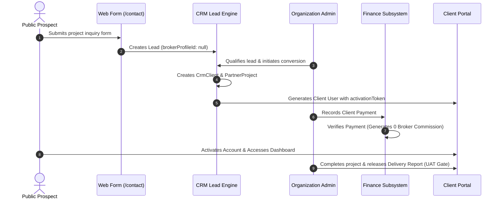
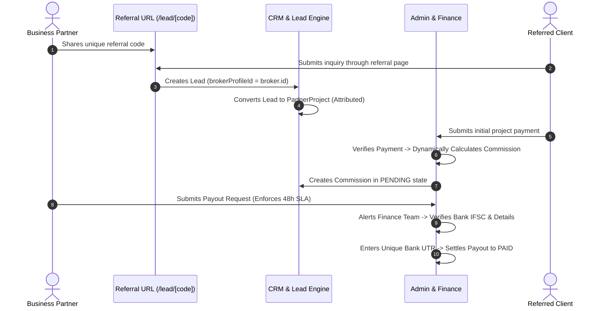
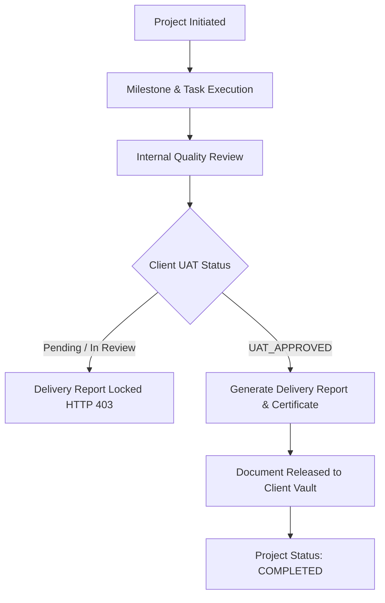
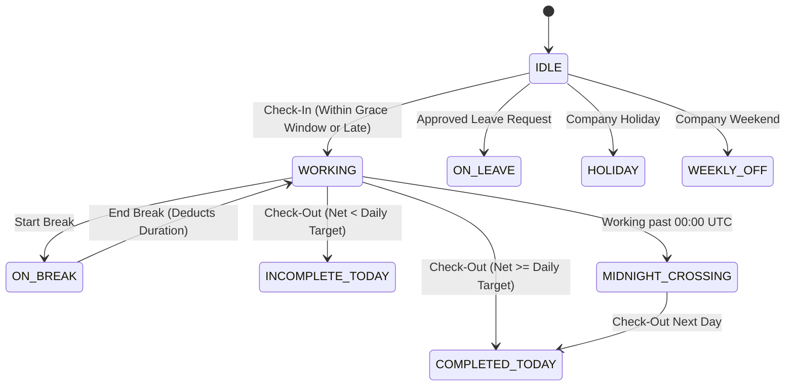

# AXIVON ONE — BUSINESS WORKFLOW & INTEGRATION AUDIT

**Document ID:** `AXIVON-AUDIT-WORKFLOWS-2026-10`  
**Platform Version:** AXIVON ONE v0.1.0 (`axivontech.in`)  
**Audit Executed:** October 22, 2026  
**Auditing Entity:** Senior Technical Architecture & Quality Assurance Audit Team  

---

## 1. Direct Client Engagement Workflow

The Direct Client journey handles organic prospects originating from marketing and the public website without third-party broker intermediary involvement:

### Verified Transitions & Safeguards:
1. **Source Attribution Gating:** Public contact submissions at [`src/app/api/contact/route.ts`](file:///c:/Users/vk010/Downloads/startup/axivon-technologies/axivon-technologies/src/app/api/contact/route.ts) set `brokerProfileId: null`. Direct clients cannot be retroactively assigned to brokers.
2. **Zero Commission Invariant (`AX-AUD-010`):** When payment is verified for a direct project, [`src/app/api/v1/admin/partner-payments/[id]/route.ts`](file:///c:/Users/vk010/Downloads/startup/axivon-technologies/axivon-technologies/src/app/api/v1/admin/partner-payments/[id]/route.ts) evaluates `brokerProfileId`. Since it is null, zero commission records are created. Verified passing in `tests/phase4-broker-direct-financial-safeguards.test.ts`.

---

## 2. Broker Referral & Commission Settlement Workflow

The Broker journey manages registered business partners who refer enterprise clients for commission:

### Verified Transitions & Safeguards:
1. **Dynamic Rate Evaluation:** Commission is calculated dynamically against active `CommissionRule` database entries rather than hardcoded percentages.
2. **Idempotency Guard (`AX-AUD-008`):** Verified that retrying payment verification checks `db.commission.findUnique({ partnerProjectId })` to guarantee that duplicate commissions are never generated.
3. **48-Hour SLA Due Date:** Payout requests stamp `payoutRequestedAt = now()` and `payoutDueAt = now() + 48 hours`.
4. **Bank UTR Uniqueness & Anti-Replay Guard (`AX-AUD-007`):** Settlements require a non-empty, non-whitespace Bank Transaction Reference (UTR) and query existing records to reject duplicate UTR reuse.
5. **Cross-Broker IDOR Barrier (`AX-AUD-009`):** Broker A cannot request payouts or view commissions belonging to Broker B (enforced with HTTP 403 in `src/app/api/v1/broker/commissions/payout-request/route.ts`).

---

## 3. Project Execution & Quality Delivery Gate

### Verified Quality Gates:
1. **Delivery Report Lock:** [`src/app/api/v1/admin/partner-projects/[id]/delivery/route.ts`](file:///c:/Users/vk010/Downloads/startup/axivon-technologies/axivon-technologies/src/app/api/v1/admin/partner-projects/[id]/delivery/route.ts) strictly requires `qaStatus === "UAT_APPROVED"` before generating formal project delivery documentation.
2. **Cross-Client Vault Isolation:** Documents stored in the project vault are scoped strictly to the assigned client user ID. Unauthorized download attempts return HTTP 404/403.

---

## 4. Employee Attendance Lifecycle

### Verified Workforce Features:
1. **Dynamic Targets (`AX-AUD-011`):** Respects individual employee contracts (e.g. 240 mins for interns, 480 mins for standard full-time) rather than imposing an arbitrary 8-hour requirement.
2. **Multi-Break Deductions:** Multiple break sessions per day (e.g. lunch, coffee) are tracked independently and accurately deducted from gross shift time.
3. **Grace Period & Lateness:** Check-ins between 06:00 and 06:15 UTC are flagged as on-time; arrivals after 06:15 UTC compute exact late minutes.
4. **Historical Session Abandonment:** Open punches older than 24 hours are automatically capped at the policy cutoff time (23:00 UTC) to prevent unbounded counter inflation.

---

## 5. Workflow Verification Matrix

| Workflow Stage | Initiating Actor | Target API | Resulting DB Mutation | Tested In Suite | Verdict |
| :--- | :--- | :--- | :--- | :--- | :--- |
| **Contact Inquiry** | Visitor | `/api/contact` | `Lead.create` (`brokerProfileId: null`) | `tests/contact-form-submission.test.ts` | **PASS** |
| **Broker Referral** | Visitor | `/api/v1/public/leads` | `Lead.create` (`brokerProfileId: broker.id`) | `tests/lead-generation-step2.test.ts` | **PASS** |
| **Lead Conversion** | Admin | `/api/v1/crm/leads/[id]/convert` | `PartnerProject.create`, `User.create` | `tests/phase4-broker-direct-financial-safeguards.test.ts` | **PASS** |
| **Client Payment Verify** | Finance | `/api/v1/admin/partner-payments/[id]` | `PartnerPayment.status = VERIFIED`, `Commission.create` | `tests/phase4-broker-direct-financial-safeguards.test.ts` | **PASS** |
| **Payout Request** | Broker | `/api/v1/broker/commissions/payout-request` | `Commission.status = PROCESSING`, `Notification.createMany` | `tests/phase4-broker-direct-financial-safeguards.test.ts` | **PASS** |
| **Payout Settlement** | Finance | `/api/v1/admin/commissions/[id]` | `Commission.status = PAID` (with Bank UTR) | `tests/phase4-broker-direct-financial-safeguards.test.ts` | **PASS** |
| **Attendance Check-In** | Employee | `/api/v1/employee/attendance` | `Attendance.create` (`checkInAt: now()`) | `tests/attendance-complete-system.test.ts` | **PASS** |
| **Attendance Check-Out**| Employee | `/api/v1/employee/attendance` | `Attendance.update` (`checkOutAt: now()`, `status`) | `tests/attendance-complete-system.test.ts` | **PASS** |
| **Client Delivery Report**| Admin | `/api/v1/admin/partner-projects/[id]/delivery` | `PartnerDocument.create` (`qaStatus: UAT_APPROVED`) | `tests/phase3-platform-integration-audit.test.ts` | **PASS** |
| **Client Document DL** | Client | `/api/v1/client/projects/[id]/documents/...` | Read stream (Scoped to client project) | `tests/idor-security.test.ts` | **PASS** |
