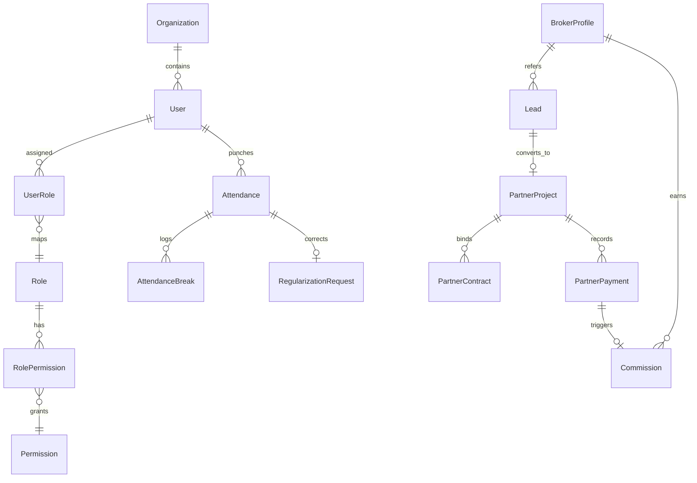

# AXIVON ONE — DATABASE AND DATA INTEGRITY AUDIT

**Document ID:** `AXIVON-AUDIT-DB-2026-10`  
**Platform Version:** AXIVON ONE v0.1.0 (`axivontech.in`)  
**Audit Executed:** October 22, 2026  
**Auditing Entity:** Senior Technical Architecture & Quality Assurance Audit Team  
**Database Engine:** PostgreSQL via Prisma ORM 5.22.0 (`prisma/schema.prisma`)  
**Total Database Models:** 81 Models  

---

## 1. Database Architecture & Technology Overview

AXIVON ONE utilizes **PostgreSQL** as its enterprise relational database, accessed strictly via **Prisma ORM 5.22.0**.
Connection pooling and query lifecycle are managed through a singleton client instance in [`src/lib/db.ts`](file:///c:/Users/vk010/Downloads/startup/axivon-technologies/axivon-technologies/src/lib/db.ts) to prevent connection leaks during Next.js serverless execution.

---

## 2. Core Model Groupings & Responsibilities

### 2.1 Identity, Authentication & Role-Based Access Control (RBAC)
* **`User` (Core Identity):** Contains `id`, `email`, `name`, `passwordHash`, `employeeId`, `department`, `designation`, `status` (`ACTIVE`/`INACTIVE`), `requiredDailyMinutes` (default 480), `mustChangePassword`, and `activationToken`.
* **`UserRole`, `Role`, `Permission`, `RolePermission`:** Many-to-many relationship supporting fine-grained capability checks (`attendance:manage`, `admin:access`, `finance:settle`).
* **`Session`:** Stores active user sessions with expiry dates and device metadata.
* **`AuditLog`:** Records security-sensitive actor actions with timestamp, IP, entity type, and delta payload.

### 2.2 Workforce Operations & Dynamic Attendance
* **`Attendance`:** Records daily employee shifts (`date`, `checkInAt`, `checkOutAt`, `status`, `requiredDailyMinutes`, `emailAlertSent`).
* **`AttendanceBreak`:** Tracks individual break segments (`startTime`, `endTime`, `durationMinutes`, `breakType`).
* **`AttendancePolicy`:** Global organizational parameters (`workWindowStart`, `graceMinutes`, `cutoffTime`, `weeklyOffDays`, `defaultRequiredMinutes`).
* **`RegularizationRequest`:** Tracks employee correction appeals with managerial review status (`PENDING`, `APPROVED`, `REJECTED`).
* **`Holiday` & `LeaveRequest`:** Manages paid time off and official company holidays.

### 2.3 CRM, Direct Clients & Broker Attribution
* **`Lead`:** Inbound client opportunities. Crucially includes `brokerProfileId` (nullable foreign key). When leads arrive via the public contact form, `brokerProfileId` is strictly `null`.
* **`BrokerProfile`:** Associates a user with broker-specific data (`referralCode`, `bankAccountNumber`, `bankIfscCode`, `panNumber`, `totalCommissionsEarned`).
* **`PartnerProject`:** Represents the contracted customer project (`projectCode`, `dealValue`, `clientUserId`, `brokerProfileId`, `status`, `qaStatus`).
* **`CommissionRule`:** Configures commission pricing models (`PERCENTAGE` vs `FIXED_AMOUNT`), minimum deal thresholds, and active status.
* **`Commission`:** Financial ledger recording broker compensation. Enforces `@unique` on `partnerProjectId` to prevent double-commission writes. Stores `payoutRequestedAt`, `payoutDueAt` (48h SLA), `status` (`PENDING`, `APPROVED`, `PROCESSING`, `PAID`), and `payoutReference` (Bank UTR).

### 2.4 Contracts, Deliverables & Document Vault
* **`PartnerContract` & `PartnerContractVersion`:** Manages client agreements, terms, counter-signatures, and audit history.
* **`PartnerPayment`:** Records incoming client installments (`amount`, `paymentMethod`, `status`: `RECORDED`, `VERIFIED`, `REJECTED`, `verifiedByUserId`).
* **`PartnerDocument`:** Centralized document vault with project-level ownership.

---

## 3. Data Integrity & Constraint Verification

| Constraint Type | Target Models & Fields | Purpose & Enforcement | Verification Result |
| :--- | :--- | :--- | :--- |
| **Unique Constraint** | `User.email` | Prevents duplicate user accounts | Enforced at DB level (`@unique`) |
| **Unique Constraint** | `User.employeeId` | Guarantees unique workforce identification code | Enforced at DB level (`@unique`) |
| **Unique Constraint** | `BrokerProfile.referralCode` | Prevents referral attribution collision | Enforced at DB level (`@unique`) |
| **Unique Constraint** | `PartnerProject.projectCode` | Guarantees unique enterprise project tracking ID | Enforced at DB level (`@unique`) |
| **Unique Constraint** | `Commission.partnerProjectId` | Guarantees 1 project cannot generate duplicate commissions | Enforced at DB level (`@unique`) |
| **Unique Constraint** | `Attendance [userId, date]` | Prevents multiple attendance master records per employee per day | Enforced at DB level (`@@unique([userId, date])`) |
| **Foreign Key Safety** | `PartnerPayment -> PartnerProject` | Prevents orphaned financial transactions | Enforced with `onDelete: Cascade` |
| **Foreign Key Safety** | `Commission -> BrokerProfile` | Ensures payouts only link to valid broker accounts | Enforced via Prisma relation |

---

## 4. Transactional Safety & Atomic Operations

Multi-step business operations are wrapped in atomic `db.$transaction([...])` calls to prevent partial database writes:

1. **Payment Verification & Commission Generation (`AX-AUD-008`):**
   - Updating `PartnerPayment.status = 'VERIFIED'`
   - Updating `PartnerProject.paymentStatus = 'PARTIALLY_PAID' | 'PAID'`
   - Querying existing `Commission` by `partnerProjectId` (Idempotency check)
   - Creating `Commission` record in `PENDING` status if broker attribution exists.
   *Execution:* All 4 steps occur within a single database transaction.

2. **Broker Payout Submission & SLA Dispatch:**
   - Updating `Commission.status = 'PROCESSING'`, stamping `payoutRequestedAt = now()`, `payoutDueAt = now() + 48 hours`
   - Inserting `Notification` records for all active users with `ADMIN`, `FOUNDER`, and `FINANCE` roles.
   *Execution:* Atomic transaction ensures broker cannot request payout without alerting finance.

3. **Client Account Activation:**
   - Updating `User.passwordHash`
   - Setting `User.mustChangePassword = false`
   - Wiping `User.activationToken = null` (Single-use security)
   - Deleting previous active `Session` records.
   *Execution:* Atomic transaction prevents account takeover.

---

## 5. Schema Drift Resilience & Fallbacks

* **Column Drift Handling in Attendance Route:**
  In [`src/app/api/v1/admin/attendance/route.ts`](file:///c:/Users/vk010/Downloads/startup/axivon-technologies/axivon-technologies/src/app/api/v1/admin/attendance/route.ts#L318-L326), queries to `db.holiday` are wrapped in localized `try/catch` handlers. If the database schema has a missing column (e.g. Prisma code `P2022`), the route catches the error and degrades gracefully rather than throwing an unhandled HTTP 500. This is verified by test suite `tests/attendance-complete-system.test.ts`.
