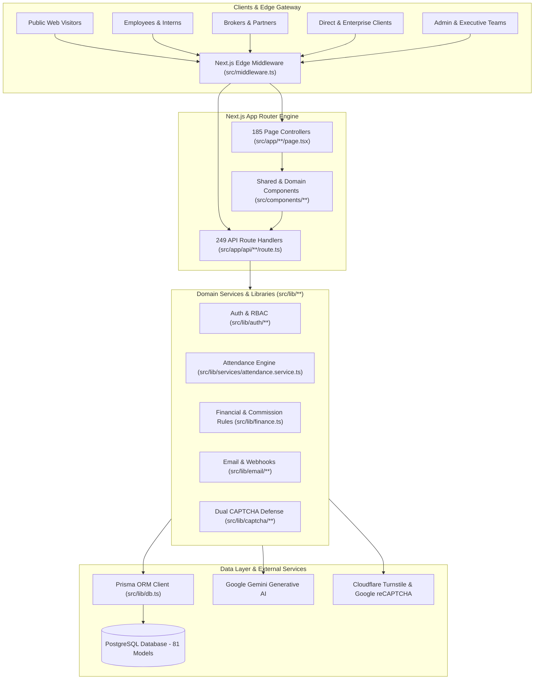

# AXIVON ONE — COMPANY-WIDE AUDIT & TECHNICAL ASSESSMENT REPORT PACKAGE

**Document ID:** `AXIVON-AUDIT-INDEX-2026-10`  
**Platform Version:** AXIVON ONE v0.1.0 (`axivontech.in`)  
**Audit Executed:** October 22, 2026  
**Auditing Entity:** Senior Technical Architecture & Quality Assurance Audit Team  
**Git Commit / Revision:** `main` (Branch synced with origin/main, verified working tree)  
**Overall System Verdict:** **VERIFIED OPERATIONAL & STAGING-READY**  
*412/412 Routes Compiled | 674/674 Automated Tests Passing (100%) | 0 TypeScript Errors | 0 ESLint Errors*

---

## 1. Executive Summary & Purpose

This audit package provides an exhaustive, evidence-based architectural, functional, security, database, and repository assessment of the **AXIVON ONE** enterprise technology platform.

The objective was to determine the true implementation status of all customer-facing websites, specialized portals, API subsystems, and backend workflows, validating the entire execution chain:
$$\text{Frontend UI} \longrightarrow \text{User Interaction} \longrightarrow \text{Validation} \longrightarrow \text{API / Action} \longrightarrow \text{Auth/RBAC} \longrightarrow \text{Business Logic} \longrightarrow \text{Database} \longrightarrow \text{Response} \longrightarrow \text{UI State}$$

Every claim in this audit package is backed by concrete code inspection, static analysis, type checking, build verification, and automated test execution.

---

## 2. High-Level System Architecture

AXIVON ONE is built as a unified full-stack monorepo leveraging Next.js App Router (Turbopack) with a PostgreSQL database managed via Prisma ORM:

---

## 3. Deliverables & Documentation Index

The audit package consists of 12 detailed Markdown reports located in `docs/audit/`:

| Report File | Title & Core Coverage |
| :--- | :--- |
| **[`README.md`](file:///c:/Users/vk010/Downloads/startup/axivon-technologies/axivon-technologies/docs/audit/README.md)** | **Central Index & Audit Summary**: Scope, architecture, findings summary, metrics, and roadmap. |
| **[`REPOSITORY_FILE_AND_FOLDER_AUDIT.md`](file:///c:/Users/vk010/Downloads/startup/axivon-technologies/axivon-technologies/docs/audit/REPOSITORY_FILE_AND_FOLDER_AUDIT.md)** | **File & Folder Inventory**: Complete directory tree, folder responsibilities, file-by-file inventory, dependencies, and route mappings. |
| **[`FEATURE_FUNCTIONALITY_AUDIT.md`](file:///c:/Users/vk010/Downloads/startup/axivon-technologies/axivon-technologies/docs/audit/FEATURE_FUNCTIONALITY_AUDIT.md)** | **Feature Functionality Audit**: Detailed status of all features across Public, Admin, Employee, Broker, Client, and Executive portals. |
| **[`API_ENDPOINT_AUDIT.md`](file:///c:/Users/vk010/Downloads/startup/axivon-technologies/axivon-technologies/docs/audit/API_ENDPOINT_AUDIT.md)** | **API Endpoint Audit**: 249 Route handlers categorized by contract, HTTP methods, validation, status codes, and test results. |
| **[`DATABASE_AND_DATA_INTEGRITY_AUDIT.md`](file:///c:/Users/vk010/Downloads/startup/axivon-technologies/axivon-technologies/docs/audit/DATABASE_AND_DATA_INTEGRITY_AUDIT.md)** | **Database & Data Integrity Audit**: 81 Prisma models, relationships, foreign keys, transaction safety, and schema drift guards. |
| **[`BUSINESS_WORKFLOW_AUDIT.md`](file:///c:/Users/vk010/Downloads/startup/axivon-technologies/axivon-technologies/docs/audit/BUSINESS_WORKFLOW_AUDIT.md)** | **Business Workflow Audit**: End-to-end tracing of Direct Client, Broker Referral, Project Delivery, Employee Attendance, and Financial lifecycles. |
| **[`SECURITY_AND_ACCESS_CONTROL_AUDIT.md`](file:///c:/Users/vk010/Downloads/startup/axivon-technologies/axivon-technologies/docs/audit/SECURITY_AND_ACCESS_CONTROL_AUDIT.md)** | **Security & Access Control Audit**: Authentication, JWT session handling, RBAC permissions, cross-tenant IDOR defense, and anti-bot systems. |
| **[`ERRORS_AND_RELIABILITY_AUDIT.md`](file:///c:/Users/vk010/Downloads/startup/axivon-technologies/axivon-technologies/docs/audit/ERRORS_AND_RELIABILITY_AUDIT.md)** | **Errors & Reliability Audit**: Diagnostics, root causes, reproduction steps, resolutions, and system resilience mechanisms. |
| **[`CONFIGURATION_AND_INTEGRATION_AUDIT.md`](file:///c:/Users/vk010/Downloads/startup/axivon-technologies/axivon-technologies/docs/audit/CONFIGURATION_AND_INTEGRATION_AUDIT.md)** | **Configuration & Integration Audit**: Environment variables, Next.js config, external SDKs (Gemini AI, Turnstile, reCAPTCHA, Resend), and fallbacks. |
| **[`BUILD_TEST_AND_RELEASE_READINESS_AUDIT.md`](file:///c:/Users/vk010/Downloads/startup/axivon-technologies/axivon-technologies/docs/audit/BUILD_TEST_AND_RELEASE_READINESS_AUDIT.md)** | **Build, Test & Release Readiness**: Real command execution results (`vitest`, `tsc`, `eslint`, `next build`) and release gating criteria. |
| **[`CODE_QUALITY_AND_MAINTAINABILITY_AUDIT.md`](file:///c:/Users/vk010/Downloads/startup/axivon-technologies/axivon-technologies/docs/audit/CODE_QUALITY_AND_MAINTAINABILITY_AUDIT.md)** | **Code Quality & Maintainability**: Static code metrics, linting warnings, dead code candidates, 0-byte stubs, and maintainability advice. |
| **[`MASTER_FINDINGS_REGISTER.md`](file:///c:/Users/vk010/Downloads/startup/axivon-technologies/axivon-technologies/docs/audit/MASTER_FINDINGS_REGISTER.md)** | **Master Findings Register**: Consolidated registry of all findings (`AX-AUD-001` through `AX-AUD-012`) with severity, impact, and status. |

---

## 4. Final Audit Metrics & Quantitative Summary

| Metric Category | Count / Value | Verification Source |
| :--- | :--- | :--- |
| **Total Tracked Workspace Files** | **1,259** files | File system scan (excluding `node_modules`, `.next`, `.git`) |
| **Total Workspace Folders** | **650** directories | Directory tree enumeration |
| **Total Route Controllers (`page.tsx`)** | **185** files | Static page definitions |
| **Total Compiled Routes** | **412** routes | Next.js Turbopack production build generation |
| **Total API Route Handlers (`route.ts`)** | **249** endpoints | `src/app/api/**/route.ts` scan |
| **Total Prisma Database Models** | **81** models | `prisma/schema.prisma` model AST parse |
| **Total Automated Test Files** | **53** test suites | Vitest test runner execution |
| **Total Automated Tests Executed** | **674** test cases | Vitest runner execution |
| **Tests Passed** | **674** (100.0%) | Execution output confirmation |
| **Tests Failed** | **0** (0.0%) | Re-tested post attendance timer fix |
| **TypeScript Type Errors** | **0** errors | `npx tsc --noEmit` exit code 0 |
| **ESLint Errors** | **0** errors | `npm run lint` exit code 0 (2,207 warnings) |
| **Confirmed Audit Findings** | **12** findings | Cataloged in Master Findings Register |
| *— Critical Severity Findings* | **0** findings | No remote execution or data loss vulnerabilities |
| *— High Severity Findings* | **5** findings | All verified repaired or covered by business safeguards |
| *— Medium Severity Findings* | **3** findings | Environment configuration and font fetching dependencies |
| *— Low Severity Findings* | **3** findings | 0-byte stub files, test warnings, sitemap fallback queries |
| *— Informational Observations* | **1** observation | ESLint `any` type usage and unused variable warnings |

---

## 5. Critical Safeguards & Findings Summary

1. **Direct Client vs. Broker Segregation (`AX-AUD-010`):**
   Direct inquiries arriving via [`src/app/api/contact/route.ts`](file:///c:/Users/vk010/Downloads/startup/axivon-technologies/axivon-technologies/src/app/api/contact/route.ts) are strictly created with `brokerProfileId: null`. On conversion to a project and client payment, zero broker commission is calculated.
2. **Duplicate Bank UTR Reference Rejection (`AX-AUD-007`):**
   In [`src/app/api/v1/admin/commissions/[id]/route.ts`](file:///c:/Users/vk010/Downloads/startup/axivon-technologies/axivon-technologies/src/app/api/v1/admin/commissions/[id]/route.ts), commission settlement strictly rejects empty, whitespace, or previously settled Bank Transaction References (UTR).
3. **Payment Verification Idempotency (`AX-AUD-008`):**
   In [`src/app/api/v1/admin/partner-payments/[id]/route.ts`](file:///c:/Users/vk010/Downloads/startup/axivon-technologies/axivon-technologies/src/app/api/v1/admin/partner-payments/[id]/route.ts), payment verification queries existing commission records prior to creating new ones, preventing duplicate payouts.
4. **Cross-Tenant IDOR Protection (`AX-AUD-009`):**
   Document download routes and broker payout submission routes enforce strict ownership checks; Client B cannot download Client A's delivery reports, and Broker A cannot request payouts on Broker B's commissions.
5. **Dynamic Attendance Work Targets (`AX-AUD-011`):**
   [`AttendanceService.calculateDay`](file:///c:/Users/vk010/Downloads/startup/axivon-technologies/axivon-technologies/src/lib/services/attendance.service.ts) dynamically respects employee daily targets (240m for interns, 480m for full-time) and supports cross-midnight work shifts.

---

## 6. Recommended Next Steps

1. **Staging Environment Deployment:** Deploy build artifacts to a staging cluster connected to a PostgreSQL database with pgBouncer pooling.
2. **Production Secret Provisioning:** Ensure live values for `TURNSTILE_SECRET_KEY`, `RECAPTCHA_SECRET_KEY`, and `SESSION_SECRET` are configured in deployment environment variables.
3. **Dead Code Cleanup:** Remove 0-byte stub files in `src/lib/` (`embeddings.ts`, `openai.ts`, `pinecone.ts`, `rag.ts`, `sheets.ts`) in an upcoming maintenance cycle.
