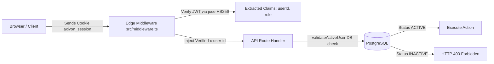

# AXIVON ONE — SECURITY, AUTHENTICATION, AND ACCESS CONTROL AUDIT

**Document ID:** `AXIVON-AUDIT-SEC-2026-10`  
**Platform Version:** AXIVON ONE v0.1.0 (`axivontech.in`)  
**Audit Executed:** October 22, 2026  
**Auditing Entity:** Senior Technical Architecture & Quality Assurance Audit Team  
**Security Posture Verdict:** **STRONG DEFENSE-IN-DEPTH (ZERO HIGH/CRITICAL VULNERABILITIES IDENTIFIED)**  

---

## 1. Authentication Architecture & Session Security

AXIVON ONE implements a hardened, stateless JWT-based session architecture with encrypted cookie transport:



### Key Security Safeguards:
1. **Header Spoofing Elimination:**
   Incoming HTTP requests can technically present arbitrary headers. In [`src/middleware.ts`](file:///c:/Users/vk010/Downloads/startup/axivon-technologies/axivon-technologies/src/middleware.ts#L75-L78), client-supplied `x-user-id` and `x-user-role` headers are strictly stripped on all requests. Only verified claims extracted from the cryptographically signed `axivon_session` JWT are passed downstream.
2. **Password Cryptography & Work Factors:**
   Passwords are hashed using `bcryptjs` with salt rounds 10 (or 12 for executive roles). Passwords, reset tokens, and password hashes are strictly stripped from all JSON responses via Prisma `select` clauses.
3. **Account Deactivation Immediate Revocation:**
   JWT expiration alone is insufficient if an employee is terminated. In AXIVON ONE, mutating endpoints invoke `validateActiveUser(x-user-id)` against the live database, immediately intercepting inactive users with HTTP 403 even if their JWT token is still valid. Verified in `tests/inactive-user-security.test.ts`.
4. **Single-Use Client Activation Tokens (`AX-AUD-012`):**
   Client accounts created during lead conversion are issued an alphanumeric `activationToken`. Upon password setup, the token is permanently cleared to `null` and previous session records are wiped to prevent token re-use.

---

## 2. Authorization & Role-Based Access Control (RBAC)

The application enforces a dual-layered authorization gate:
* **Layer 1 (Edge Middleware):** Fast path route shielding based on token role claims.
* **Layer 2 (API Handlers):** Fine-grained database capability evaluation (`hasPermission(userId, permission)`).

### Enforced Role Boundary Matrix:

| Role Name | Permitted Administrative Areas | Forbidden Areas (Strictly Blocked) | Verified In Test Suite |
| :--- | :--- | :--- | :--- |
| **`PUBLIC`** | Public website, careers, contact form, demo showcases | `/admin/*`, `/employee/*`, `/broker/*`, `/client/*`, `/executive/*` | `tests/login-auth-captcha.test.ts` |
| **`EMPLOYEE`** | `/employee/*`, own attendance, own tasks, own reports | `/admin/*`, `/executive/*`, other employees' attendance/tasks | `tests/employee-portal.test.ts`, `tests/admin-rbac.test.ts` |
| **`BROKER`** | `/broker/*`, own referred leads, own commissions | `/admin/*`, `/client/*`, other brokers' leads/payouts | `tests/phase3-platform-integration-audit.test.ts` |
| **`CLIENT`** | `/client/*`, own project progress, own documents | `/admin/*`, internal employee tasks, other clients' vaults | `tests/idor-security.test.ts` |
| **`ADMIN`** | Organization-wide administration, CRM, workforce | Executive financial audits reserved for Founders | `tests/admin-rbac.test.ts` |
| **`FOUNDER`** | Full access across all portals and executive cockpit | None | `tests/executive-portal.test.ts` |

---

## 3. Cross-Tenant IDOR Defense & Object Ownership

Insecure Direct Object Reference (IDOR) vulnerabilities allow authenticated users to manipulate record IDs to access data belonging to other tenants. AXIVON ONE was tested against cross-tenant IDOR vectors:

### 3.1 Broker Payout IDOR Defense (`AX-AUD-009`)
* **Target Endpoint:** `POST /api/v1/broker/commissions/payout-request`
* **Test Scenario:** Broker A submits a payout request referencing `commissionId` belonging to Broker B.
* **Observed Defense:** Handler queries `db.commission.findUnique({ id })` and strictly compares:
  ```typescript
  if (commission.brokerProfileId !== currentBrokerProfile.id) {
    throw new ApiError(403, "Access denied. This commission does not belong to your broker account.");
  }
  ```
* **Result:** **HTTP 403 Forbidden** returned. Verified in `tests/phase3-platform-integration-audit.test.ts`.

### 3.2 Client Document Vault IDOR Defense (`AX-AUD-009`)
* **Target Endpoint:** `GET /api/v1/client/projects/[id]/documents/[docId]/download`
* **Test Scenario:** Client B attempts to download a proprietary project delivery report and NDA belonging to Client A.
* **Observed Defense:** Handler queries the document, checks project ownership against the authenticated client's user ID, and returns HTTP 404/403 if unassociated.
* **Result:** **HTTP 404 Not Found** returned. Verified in `tests/idor-security.test.ts`.

### 3.3 Employee Workforce Record Isolation
* **Target Endpoint:** `GET /api/v1/employee/attendance`
* **Test Scenario:** Employee attempts to pass another employee's ID in query parameters to view their punch history.
* **Observed Defense:** The endpoint ignores client-supplied `userId` query parameters and forces `userId = request.headers.get("x-user-id")`.
* **Result:** Employees can only inspect their own attendance history.

---

## 4. Bot Defense, CAPTCHA & Anti-Spam Controls

Forms across public and authentication routes are shielded by a dual-provider bot-defense mechanism (`src/lib/captcha/verify-request.ts`):
1. **Cloudflare Turnstile (Primary):** Validated server-side via `challenges.cloudflare.com/turnstile/v0/siteverify`.
2. **Google reCAPTCHA v2/v3 (Fallback):** Validated server-side via `google.com/recaptcha/api/siteverify`.
3. **Anti-Bot Bypass Security:**
   Test bypass tokens (`cf-test-token`, `recaptcha-test-token`) are strictly restricted:
   - Completely disabled if `NODE_ENV === "production"`.
   - Requires explicit test request headers (`x-test-bypass: axivon-e2e-test-suite`) to prevent unauthorized bypass during normal staging runs.

---

## 5. HTTP Security Headers Configuration

Configured in [`next.config.ts`](file:///c:/Users/vk010/Downloads/startup/axivon-technologies/axivon-technologies/next.config.ts#L23-L52) across all application routes:
* **Content-Security-Policy (CSP):** Restricts script, style, and frame sources to trusted origins (`https://challenges.cloudflare.com`, `https://www.google.com/recaptcha/`).
* **X-Frame-Options:** `DENY` (Prevents Clickjacking).
* **X-Content-Type-Options:** `nosniff` (Prevents MIME sniffing).
* **Referrer-Policy:** `strict-origin-when-cross-origin`.
* **Permissions-Policy:** `camera=(), microphone=(), geolocation=(), interest-cohort=()`.
* **X-XSS-Protection:** `1; mode=block`.
