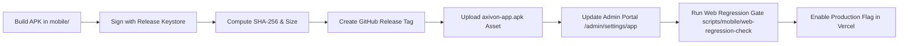

# Axivon Mobile Application Release Process

**Author:** Release Engineering  
**Applies to:** Axivon Technologies Android App (Capacitor WebView Shell)  
**Target Platform:** Android 8.0+ (API level 26+)  
**Repository:** `axivon-technologies` (branching into `axivon-mobile`)  

---

## 1. Principles & Safeguards

1. **Lightweight Hosting:** The web server and Vercel functions **NEVER** serve raw APK or AAB binaries. Binaries are hosted on **GitHub Releases** and delivered to users via `/download/axivon-app` redirect.
2. **Dual Kill-Switch Policy:**
   * Environment Level: `APP_MODE_ENABLED="false"` disables all app routes, download redirects, and version endpoints.
   * Organization Setting Level: `app.enabled = false` and `app.downloadPrompt.enabled = false` in the database toggle features dynamically without server redeployment.
3. **Staging Verification:** Every mobile release must be verified on a Vercel Preview deployment before production enablement.

---

## 2. Release Lifecycle Flow



---

## 3. Step-by-Step Release Guide

### Step 3.1: Build and Sign the Android APK
Inside the isolated `mobile/` directory:
```bash
cd mobile
npm run build
npx cap sync android
cd android
./gradlew assembleRelease
```
Sign the APK with the production keystore (do **never** commit keystores or passwords to git):
```bash
zipalign -v -p 4 app/build/outputs/apk/release/app-release-unsigned.apk axivon-app-aligned.apk
apksigner sign --ks axivon-release.jks --out axivon-app.apk axivon-app-aligned.apk
```

### Step 3.2: Compute Checksum and Binary Size
On Windows PowerShell:
```powershell
Get-FileHash -Algorithm SHA256 .\axivon-app.apk | Select-Object -ExpandProperty Hash
$sizeMb = [Math]::Round((Get-Item .\axivon-app.apk).Length / 1MB, 2)
Write-Output "Size in MB: $sizeMb"
```
Record the SHA-256 hash and size (e.g. `5.8 MB`).

### Step 3.3: Publish to GitHub Releases
1. Create a Git tag corresponding to the semantic version:
   ```bash
   git tag -a v1.0.0 -m "Release v1.0.0: Initial Axivon Android Portal App"
   git push origin v1.0.0
   ```
2. Navigate to GitHub Repository > **Releases** > **Draft a new release**.
3. Select tag `v1.0.0`. Set title: `Axivon Android App v1.0.0`.
4. Upload `axivon-app.apk` as a release binary asset.
5. Publish release. The download URL will be:
   `https://github.com/axivon/axivon-mobile/releases/download/v1.0.0/axivon-app.apk`

---

## 4. Registering the Release in Axivon Portal

### Option A: Via Admin Portal UI
1. Log in as an Administrator or Founder (`admin@axivon.dev` or `founder@axivon.dev`).
2. Navigate to **Admin Settings** > **Mobile App Management** (`/admin/settings/app`).
3. Fill in the release details:
   * **Latest Version:** `1.0.0`
   * **Minimum Supported Version:** `1.0.0` (or lower if older versions remain compatible)
   * **APK Download URL:** `https://github.com/axivon/axivon-mobile/releases/download/v1.0.0/axivon-app.apk`
   * **SHA-256 Checksum:** `<computed-hash>`
   * **APK Size (MB):** `5.8`
   * **Release Notes:** Bullet points detailing features or bugfixes.
4. Toggle Switches:
   * **App Mode Active:** Toggle ON.
   * **Daily Download Modal:** Toggle ON (if ready to display to web users).
5. Click **Save Configuration**.

### Option B: Via Admin Management API
```bash
curl -X PATCH https://axivontech.in/api/v1/admin/app/settings \
  -H "Content-Type: application/json" \
  -H "Cookie: axivon_session=<admin_token>" \
  -d '{
    "enabled": true,
    "popupEnabled": true,
    "latestVersion": "1.0.0",
    "minVersion": "1.0.0",
    "apkUrl": "https://github.com/axivon/axivon-mobile/releases/download/v1.0.0/axivon-app.apk",
    "sha256": "<computed-hash>",
    "sizeMb": 5.8,
    "notes": "Official Axivon Portal Android Application"
  }'
```

---

## 5. Verification Checklist

Before announcing the release:
- [ ] Verify `curl -I https://axivontech.in/download/axivon-app` returns HTTP 307 with `Content-Type: application/vnd.android.package-archive`.
- [ ] Verify `curl https://axivontech.in/api/v1/app/version` returns valid JSON with matching `latestVersion` and `apkUrl`.
- [ ] Verify download log row is added in database `AuditLog` table.
- [ ] Test update gate with older version (`AxivonApp/0.8.0`) to confirm blocking dialog renders correctly.
- [ ] Test real Android phone: download APK, install, sign in with role account, verify attendance and portal features.

---

## 6. Emergency Rollback & Kill Switch

If an unexpected regression or broken APK is discovered:

### Fast Rollback 1: Admin Toggle (Zero Deployment)
1. Go to `/admin/settings/app` and toggle **App Mode Active** and **Daily Download Modal** to **OFF**.
2. Click **Save Configuration**.
3. All download popups immediately stop appearing, and the app gracefully falls back.

### Fast Rollback 2: Vercel Environment Kill Switch
In the Vercel Project Dashboard:
1. Set `APP_MODE_ENABLED="false"`.
2. Redeploy or promote previous deployment.
3. Every mobile route returns HTTP 404, edge middleware early-returns, and all mobile code is completely isolated.
