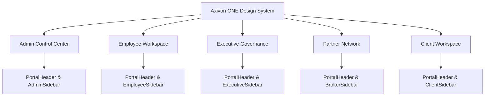

# Axivon ONE — Portal Redesign Implementation Report

**Date:** October 16, 2026  
**Implementation Lead:** Senior Frontend Engineer & UI/UX Architect  
**Subject:** Portal-by-Portal Architectural Transformation  

---

## 1. Overview of Redesigned Portals

All portal shells, navigation sidebars, headers, and dashboard interfaces across the Axivon ONE platform were systematically transformed from dark, fragmented AI layouts into an integrated, human-crafted enterprise SaaS experience.

---

## 2. Portal-by-Portal Transformation

### 2.1. Admin Control Center & Sales CRM
- **Files Modified / Created:**
  - `src/components/portal/AdminSidebar.tsx`
  - `src/components/portal/AdminPortalClient.tsx` (New)
  - `src/app/admin/layout.tsx`
  - `src/components/admin/dashboard/DashboardHeader.tsx`
  - `src/app/admin/employees/page.tsx`
  - `src/app/admin/crm/pipeline/page.tsx`
  - `src/app/admin/crm/leads/[id]/page.tsx`
- **Key Enhancements:**
  - Replaced `#050505` dark background with crisp `bg-slate-50 text-slate-800` layout.
  - Implemented collapsible accordion groups for CRM, Partner Network, Workforce, Content, and Platform settings.
  - Replaced `Good Morning, Vikas 👋` with dynamic greeting, current date formatting, and new project action button.
  - Added responsive drawer for tablet and mobile screens ($<1024\text{px}$) with smooth slide-in animation.
  - Fully integrated with the live lead ingestion stream and summary statistics.

### 2.2. Employee Workspace
- **Files Modified:**
  - `src/components/portal/EmployeeSidebar.tsx`
  - `src/components/portal/EmployeeNavbar.tsx`
  - `src/components/portal/EmployeePortalClient.tsx`
  - `src/app/employee/layout.tsx`
- **Key Enhancements:**
  - Eradicated all blue navigation pills and dark backgrounds.
  - Active navigation indicator changed to `bg-red-50 text-red-700 border-red-200/80` with brand indicator pip.
  - Clean uninverted logo presentation.
  - Standardized search trigger button with `Ctrl+K` shortcut indicator.
  - Polished inactive account lockout view with clean light styling.

### 2.3. Executive & Founder Portal
- **Files Modified / Created:**
  - `src/components/portal/ExecutiveSidebar.tsx`
  - `src/components/portal/ExecutivePortalClient.tsx` (New)
  - `src/app/executive/layout.tsx`
- **Key Enhancements:**
  - Replaced divergent amber border highlights with cohesive enterprise design tokens.
  - Distinctive Executive Governance badge (`Crown` icon with crimson accent pill).
  - Organized navigation into three clear executive sections: *Operations & People*, *Business & CRM*, and *Governance & Compliance*.
  - Full mobile drawer support with dismissible backdrop overlay.

### 2.4. Partner & Broker Network
- **Files Modified:**
  - `src/components/portal/BrokerSidebar.tsx`
  - `src/app/broker/layout.tsx`
- **Key Enhancements:**
  - Added previously missing `PortalHeader` with partner identity, referral code badge, and notification alerts.
  - Converted static non-responsive sidebar into a dual desktop/mobile drawer system.
  - Modernized sign-out workflow.

### 2.5. Client Workspace (Brand New Implementation)
- **Files Created:**
  - `src/components/portal/ClientSidebar.tsx`
  - `src/app/client/layout.tsx`
  - `src/app/client/dashboard/page.tsx`
  - `src/app/client/projects/page.tsx`
  - `src/app/client/documents/page.tsx`
- **Key Enhancements:**
  - Connected existing backend APIs (`/api/v1/client/me`, `/api/v1/client/projects`, `/api/v1/client/notifications`) to a full frontend suite.
  - Dashboard includes metric cards for Total Projects, Active Sprints, Awaiting UAT, and Delivered deliverables.
  - Projects directory with real-time search, status filtering, and sprint completion progress bars.
  - Document repository with categorized downloads and security badges.
  - Fully responsive with mobile drawer navigation.

---

## 3. Shared Portal Shell Architecture

Each portal now conforms to the unified two-layer shell pattern:
1. **Desktop ($ \ge 1024\text{px}$):** Static $256\text{px}$ sidebar (`w-64`) on the left, sticky $64\text{px}$ header at the top, and scrollable `main` area (`max-w-7xl mx-auto`).
2. **Mobile / Tablet ($ < 1024\text{px}$):** Collapsed sidebar off-canvas (`-translate-x-full`), hamburger button in header, and sliding drawer overlay with `z-50` backdrop blur.
